# AquaControl 360

Grupo 9 (ShirmpProgrammers) · Cloud Computing 2026 · Universidad Galileo

- **Integrantes:** Edgar Andrés Culajay Hernández, Allan Josué Gómez Pérez
- **Proveedor cloud:** Google Cloud Platform (GCP)
- **Servicios principales:** Cloud Run (API y web), Cloud SQL (PostgreSQL 17), Cloud Storage, Pub/Sub (push con OIDC), Vertex AI (Gemini), Secret Manager, Cloud IAM, Cloud Build, Artifact Registry, Cloud Logging y Monitoring
- **Repositorio:** Repositorio privado
- **Despliegue:** https://aquacontrol-web-1000315935309.us-central1.run.app (API: https://aquacontrol-api-1000315935309.us-central1.run.app)
- **Documentación PDF:** [documentacion.pdf](documentacion.pdf)
- **Video:** [Video de demostración](video.mp4)

---

Plataforma de gestión acuícola para granjas de camarón y tilapia, con monitoreo IoT de piscinas, control remoto de aireadores, administración de la producción y un prototipo de ganadería con conteo de animales mediante IA. Todo el sistema corre en **Google Cloud** con un backend propio en **Spring Boot** y una base de datos relacional **PostgreSQL**.

Proyecto de los cursos de **Ingeniería de Software**, **CC6** y **Cloud Computing** de la Universidad Galileo.

**Integrantes:** Allan Gómez y Andrés Culajay

| Recurso | Enlace |
|---|---|
| Sitio web desplegado | https://aquacontrol-web-1000315935309.us-central1.run.app |
| API REST desplegada | https://aquacontrol-api-1000315935309.us-central1.run.app |
| Video de demostración | [Video de demostración](video.mp4) |
| Repositorio | Repositorio privado |
| Documentación PDF | [documentacion.pdf](documentacion.pdf) |

> Los usuarios de prueba no se publican en este repositorio. Se comparten de forma privada con el catedrático.

---

## Índice

- [Descripción del proyecto](#descripción-del-proyecto)
- [Capturas del sistema](#capturas-del-sistema)
- [Arquitectura en la nube](#arquitectura-en-la-nube)
- [Servicios de Google Cloud utilizados](#servicios-de-google-cloud-utilizados)
- [Evidencia en la consola de Google Cloud](#evidencia-en-la-consola-de-google-cloud)
- [Flujos principales](#flujos-principales)
- [Estructura del repositorio](#estructura-del-repositorio)
- [Base de datos](#base-de-datos)
- [Backend y API REST](#backend-y-api-rest)
- [Aplicación web](#aplicación-web)
- [Aplicación Android](#aplicación-android)
- [Aplicación iOS](#aplicación-ios)
- [Nodos IoT con ESP32](#nodos-iot-con-esp32)
- [Inteligencia artificial](#inteligencia-artificial)
- [Diagramas de Ingeniería de Software](#diagramas-de-ingeniería-de-software)
- [Despliegue paso a paso](#despliegue-paso-a-paso)
- [Ejecución local](#ejecución-local)
- [Seguridad](#seguridad)
- [Estimación de costos](#estimación-de-costos)
- [Decisiones de arquitectura](#decisiones-de-arquitectura)
- [Limitaciones y trabajo futuro](#limitaciones-y-trabajo-futuro)
- [Historial del proyecto](#historial-del-proyecto)
- [Videos](#videos)
- [Referencias](#referencias)

---

## Descripción del proyecto

AquaControl nació como una aplicación que medía el oxígeno de una piscina camaronera y encendía el aireador desde el celular, conectada directamente a Firebase. Durante este semestre se transformó en una plataforma completa:

- **Backend propio** en Java 21 con Spring Boot, con API REST, autenticación JWT y tres roles.
- **Base de datos relacional** PostgreSQL con 36 tablas normalizadas hasta 3FN, diseñada con un DER en notación Chen.
- **Tres clientes** que consumen la misma API: sitio web (Next.js), app Android (Kotlin) y app iOS (SwiftUI).
- **Nodos IoT** con ESP32-S3 en cada piscina y una ESP32-CAM para el prototipo de ganadería.
- **Despliegue en Google Cloud** con 10 servicios. Firebase ya no forma parte del sistema.

El problema que resuelve es concreto: si el oxígeno disuelto baja durante la noche, el camarón puede morir en pocas horas. El sistema mide de forma continua, enciende el aireador por su cuenta si el oxígeno cae, avisa al personal y permite controlar los equipos desde el teléfono. Además lleva la administración de la granja.

### Funciones implementadas

| Módulo | Qué hace |
|---|---|
| Sesión y roles | Inicio de sesión con JWT. Roles Dueño, Administrador y Trabajador, cada uno con su propio menú. |
| Piscinas y monitoreo | Oxígeno disuelto y temperatura en vivo, historial de lecturas con gráficas. |
| Actuadores | Encendido y apagado de aireador y luces desde web, Android e iOS. |
| Alertas | Alertas automáticas de oxígeno y temperatura generadas a partir de las lecturas que pasan por Pub/Sub. |
| Ciclos de producción | Apertura y cierre de ciclos por piscina y especie (camarón o tilapia). |
| Muestreos | Registro de atarrayazos y cálculo de población, biomasa y alimento diario. |
| Gastos | Registro de gastos por categoría. |
| Trabajadores y pagos | Personal de la granja y sus pagos. |
| Cosechas, clientes y ventas | Cosechas por ciclo y ventas a clientes. |
| Asistente de IA | Preguntas sobre la granja respondidas por Gemini con datos reales del sistema. |
| Ganadería (prototipo) | Vista en vivo de la ESP32-CAM y conteo de animales con IA, con un recuadro por animal. |

Los módulos de sifoneo, alimentación, mortalidad, inventario y compras están diseñados en la base de datos y aparecen en la interfaz como **Próximamente**.

---

## Capturas del sistema

### Web

Detalle de una piscina: ciclo activo, últimas lecturas de los sensores (en rojo cuando el oxígeno está en nivel crítico) y controles del aireador y las luces. A la izquierda, el menú con todos los módulos; los que todavía no están listos aparecen como *Próximamente*.

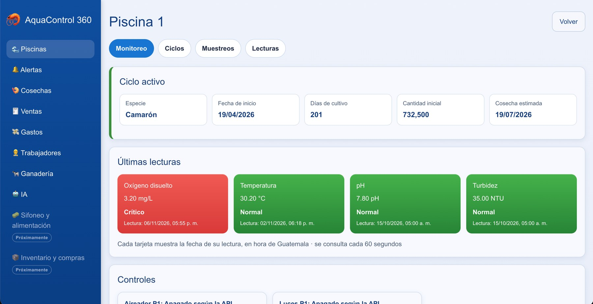

Ganadería (prototipo): la ESP32-CAM toma la vista aérea de la maqueta, Gemini en Vertex AI marca cada animal y la web muestra cuántos detectó y la diferencia con lo esperado.

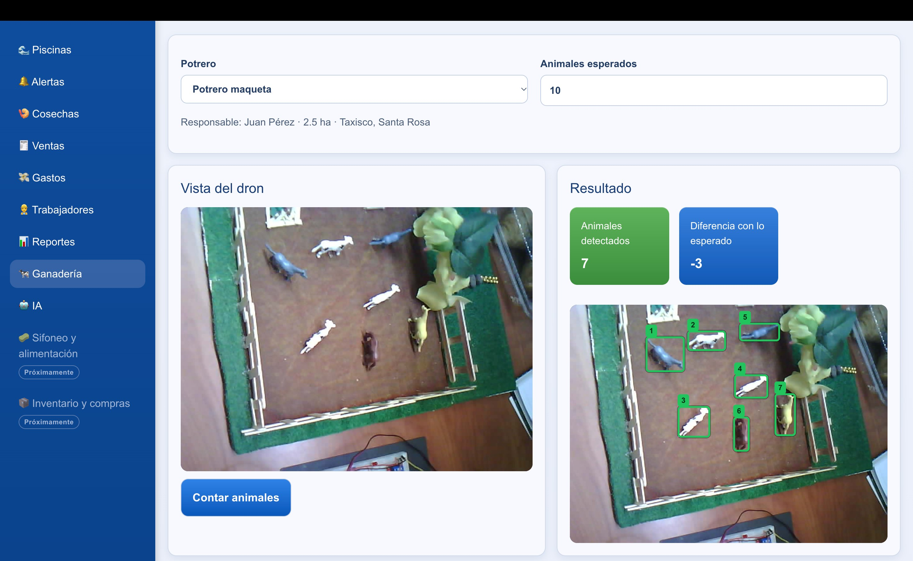

La web se puede probar en el [sitio desplegado](https://aquacontrol-web-1000315935309.us-central1.run.app).

### App Android

| Inicio (rol Dueño) | Menú Más |
|---|---|
| 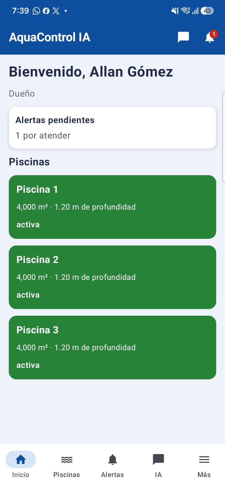 | 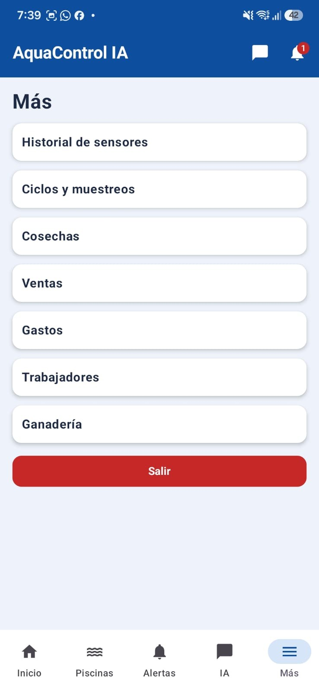 |

### App iOS

| Calculadora de muestreo | Alertas |
|---|---|
| 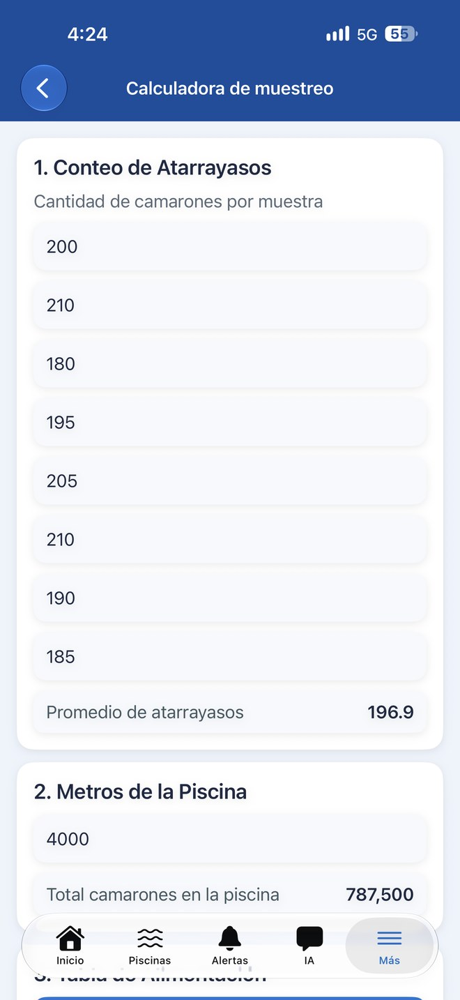 | 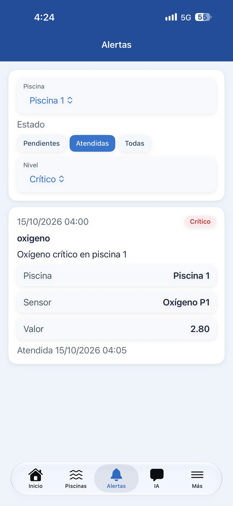 |

Android e iOS consumen la misma API y tienen la misma navegación inferior: Inicio, Piscinas, Alertas, IA y Más.

---

## Arquitectura en la nube

Todo pasa por un solo backend en Cloud Run. Ningún cliente se conecta directamente a la base de datos ni al bucket: hablan con la API por HTTPS y la API es la única que tiene permisos sobre los datos.

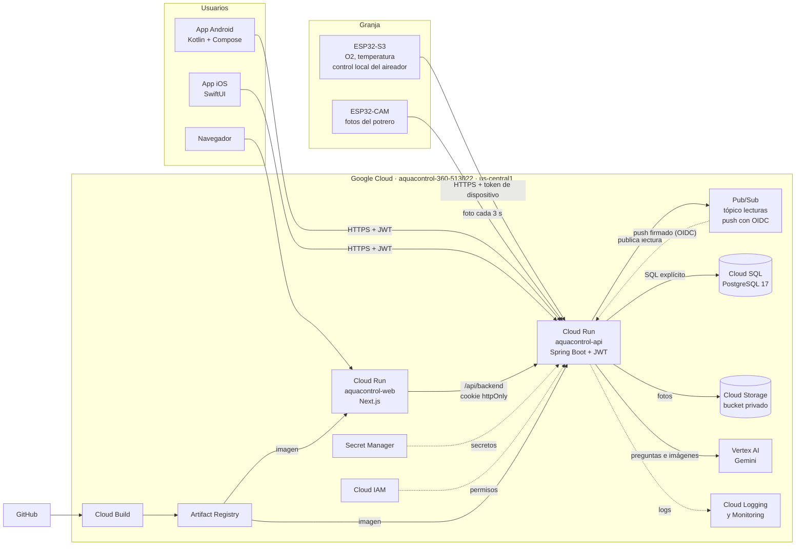

Los componentes se organizan en cuatro capas:

- **Campo:** el ESP32-S3 de cada piscina lee los sensores y decide localmente si enciende el aireador, aunque no haya internet. La ESP32-CAM envía fotos del potrero.
- **Clientes:** web, Android e iOS. Todos consumen la misma API REST.
- **Aplicación y datos:** la API en Cloud Run, Cloud SQL, Cloud Storage, Pub/Sub y Vertex AI.
- **Seguridad, operación y despliegue:** IAM, Secret Manager, Cloud Logging y Monitoring, Cloud Build y Artifact Registry.

---

## Servicios de Google Cloud utilizados

Proyecto `aquacontrol-360-513022`, región `us-central1`.

| # | Servicio | Rol en AquaControl | Configuración |
|---|---|---|---|
| 1 | **Cloud Run** | Ejecuta la API (`aquacontrol-api`) y la web (`aquacontrol-web`) en contenedores con HTTPS y escalado automático. | 512 MiB, mínimo 0 y máximo 2 instancias en la API. |
| 2 | **Cloud SQL (PostgreSQL)** | Guarda todos los datos del negocio. | Instancia `aquacontrol-db`, PostgreSQL 17, `db-f1-micro`, 10 GB SSD, respaldo diario. |
| 3 | **Cloud Storage** | Fotos de la ESP32-CAM y conteos. En PostgreSQL solo se guarda la ruta. | Bucket `aquacontrol-360-513022-archivos`, acceso uniforme y prevención de acceso público. |
| 4 | **Pub/Sub** | Recibe cada lectura del ESP32 y la entrega a la API. Si el procesamiento falla, reintenta y la lectura no se pierde. | Tópico `lecturas`, suscripción push `lecturas-a-procesador` autenticada con OIDC. |
| 5 | **Vertex AI (Gemini)** | Asistente de IA y conteo de ganado en imágenes. | Modelo `gemini-3.1-flash-lite`, ubicación global. |
| 6 | **Secret Manager** | Contraseña de la base y clave de firma de los JWT. Nada de esto está en el código. | Secretos `db-password` y `jwt-secret`, montados como variables en Cloud Run. |
| 7 | **Cloud IAM** | Cuentas de servicio propias con permisos mínimos. | `aquacontrol-backend`, `aquacontrol-web` (sin permisos) y `pubsub-push` (solo firma los mensajes de Pub/Sub). |
| 8 | **Cloud Build** | Compila el backend y la web a partir del código fuente. | `gcloud run deploy --source`. |
| 9 | **Artifact Registry** | Guarda las imágenes Docker versionadas de las que arranca Cloud Run. | Repositorios `aquacontrol` y `cloud-run-source-deploy`. |
| 10 | **Cloud Logging y Monitoring** | Logs de Spring Boot y Next.js, métricas de solicitudes, latencia, errores e instancias. | Integración de Cloud Run; consulta en Registros y Métricas. |

---

## Evidencia en la consola de Google Cloud

Las capturas de cada servicio en la consola están en el [documento PDF de la entrega](documentacion.pdf). Los servicios también se pueden comprobar desde Cloud Shell:

```bash
gcloud config set project aquacontrol-360-513022
gcloud run services list
gcloud sql instances list
gcloud storage buckets list --format="value(name)"
gcloud pubsub subscriptions describe lecturas-a-procesador --format="yaml(pushConfig)"
gcloud secrets list
gcloud iam service-accounts list
gcloud builds list --limit=5
gcloud artifacts repositories list
```

---

## Flujos principales

### Lectura de un sensor y alerta de oxígeno

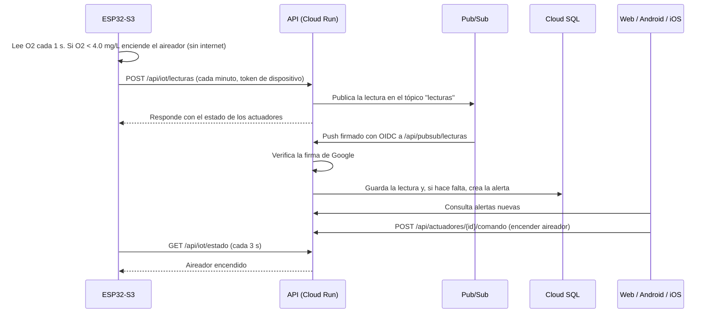

Umbrales usados por el backend: oxígeno crítico por debajo de 4.0 mg/L, advertencia por debajo de 5.0 mg/L y temperatura fuera de 23 a 32 °C. En el ESP32, el aireador se enciende por regla local con menos de 4.0 mg/L y se apaga cuando el oxígeno se recupera por encima de 5.0 mg/L.

### Conteo de ganado con IA

1. La ESP32-CAM sube una foto cada 3 segundos; la API guarda la última en Cloud Storage.
2. La web muestra esa foto como vista en vivo del potrero.
3. Al presionar **Contar**, la API copia la foto con su propio nombre y se la envía a Gemini en Vertex AI.
4. Gemini devuelve la cantidad de animales y sus coordenadas; la API guarda el conteo en Cloud SQL con la ruta de la imagen.
5. La web dibuja un recuadro sobre cada animal y muestra el historial de conteos del potrero.

### Despliegue de una nueva versión

El código vive en GitHub. Desde Cloud Shell se descarga la rama y se ejecuta `gcloud run deploy --source`: Cloud Build compila con el `Dockerfile`, guarda la imagen en Artifact Registry y Cloud Run crea una revisión nueva. Si la revisión falla, se regresa a la anterior desde la consola sin volver a compilar.

---

## Estructura del repositorio

```text
.
├── backend/                         # API REST en Spring Boot (Java 21, Maven)
│   └── src/main/java/com/aquacontrol/backend/
│       ├── controller/              # Endpoints REST, uno por recurso
│       ├── service/                 # Lógica de negocio (IoT, Pub/Sub, IA, ganado, ventas...)
│       ├── repository/              # Consultas SQL escritas a mano con JdbcClient
│       ├── dto/                     # Objetos de entrada y salida de la API
│       ├── model/                   # Modelos internos
│       ├── security/                # JWT, filtro de autenticación y roles
│       └── config/                  # Clientes de Google Cloud
├── Database/
│   ├── BD.sql                       # Esquema PostgreSQL completo (36 tablas)
│   ├── DatosPrueba.sql              # Datos de prueba
│   ├── DatosComercial.sql           # Datos de cosechas, clientes y ventas
│   ├── pruebas.sql                  # Consultas de verificación
│   └── AquaControl_DER_Chen.drawio  # DER en notación Chen
├── my-app/                          # Web en Next.js + React + TypeScript
├── Proyecto_AR_Aqua_Intelligence/   # App Android (Kotlin + Jetpack Compose)
├── aquaInteligence/                 # App iOS (SwiftUI)
├── Proyecto/AquaControl_ESP32S3.ino # Firmware del nodo de la piscina 1 (Arduino)
├── firmware-esp32/                  # Firmware del nodo de la piscina 2 (PlatformIO, sensores simulados)
├── firmware-esp32-cam/              # Firmware de la ESP32-CAM para ganadería
└── docs/
    ├── diagramas/                   # Diagramas UML, casos de uso, secuencia y DER
    ├── images/                      # Capturas del sistema y de la consola
    └── pubsub/configurar_pubsub.sh  # Script de configuración de Pub/Sub
```

---

## Base de datos

- **Motor:** PostgreSQL 17 en Cloud SQL (probado también en PostgreSQL 16 local).
- **Diseño:** DER en notación Chen dividido en módulos (administración y personal, producción, operación del ciclo, IoT, alertas, inventario y compras, ventas y gastos, equipos y mantenimiento, ganadería y archivos).
- **Normalización:** hasta 3FN. Lo que se puede calcular (promedio de atarrayazos, biomasa, alimento diario) no se guarda; lo calcula la API.
- **Especies:** camarón y tilapia comparten la misma estructura mediante las tablas `especie` y `ciclo_produccion`.
- **Archivos:** las imágenes van a Cloud Storage y en la base solo se guarda su ruta.
- **Consultas:** escritas de forma explícita en SQL, sin herramientas que generen las consultas solas (sin JPA ni Hibernate).

Relaciones principales:

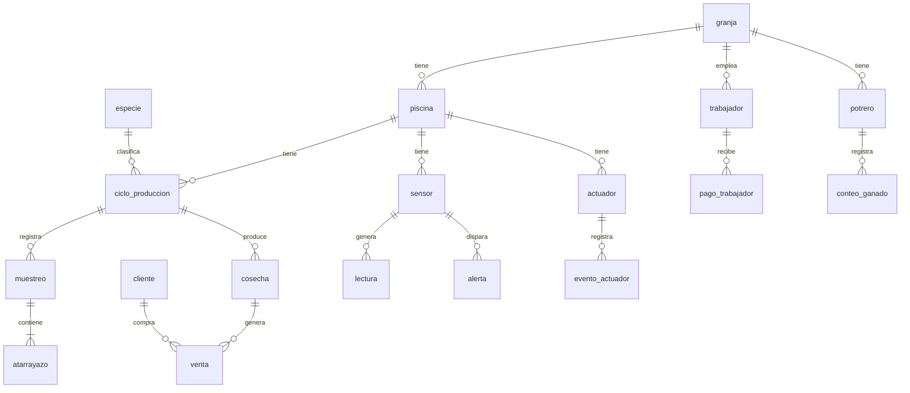

---

## Backend y API REST

- Java 21, Spring Boot 4, Maven.
- Contraseñas con BCrypt y tokens JWT firmados con HS512.
- Cada endpoint valida el rol y que los datos pertenezcan a la granja del usuario.
- Errores con el formato `{"mensaje": "..."}`. Fechas en ISO 8601.

| Recurso | Endpoints |
|---|---|
| Autenticación | `POST /api/auth/login`, `GET /api/yo` |
| Piscinas | `GET /api/piscinas`, `GET /api/piscinas/{id}/actuadores` |
| Lecturas | `GET /api/piscinas/{id}/lecturas`, `GET /api/piscinas/{id}/lecturas/ultima` |
| Actuadores | `POST /api/actuadores/{id}/comando` |
| Ciclos | `GET` y `POST /api/piscinas/{id}/ciclos`, `GET /api/ciclos`, `PATCH /api/ciclos/{id}` |
| Muestreos | `GET /api/piscinas/{id}/muestreos`, `GET` y `POST /api/ciclos/{id}/muestreos` |
| Alertas | `GET /api/alertas`, `GET /api/alertas/nuevas`, `PATCH /api/alertas/{id}` |
| Especies | `GET /api/especies` |
| Gastos | `GET /api/categorias-gasto`, `GET` y `POST /api/gastos` |
| Trabajadores | `GET` y `POST /api/trabajadores`, `GET` y `POST /api/trabajadores/{id}/pagos` |
| Cosechas y ventas | `GET` y `POST /api/cosechas`, `/api/ventas`, `/api/clientes` |
| IA | `POST /api/ia/preguntar` |
| Ganadería | `GET /api/ganado/potreros`, `GET` y `POST /api/ganado/potreros/{id}/conteos` |
| IoT (ESP32) | `POST /api/iot/lecturas`, `GET /api/iot/estado` |
| Pub/Sub | `POST /api/pubsub/lecturas` (solo acepta mensajes firmados por Google) |

---

## Aplicación web

**Ubicación:** `my-app/` · **Tecnologías:** Next.js 16, React 19, TypeScript, CSS Modules, Recharts.

- Rutas separadas por módulo dentro de `app/(panel)/`: piscinas, alertas, gastos, trabajadores, cosechas, ventas, ganado, IA y reportes.
- El token se guarda en una **cookie httpOnly**. El navegador nunca habla directo con la API: pasa por el puente `app/api/backend` del servidor de Next.js, que agrega el token.
- La URL de la API sale de la variable de servidor `API_URL`, no del código.
- Se despliega en Cloud Run con su propio `Dockerfile`.

---

## Aplicación Android

**Ubicación:** `Proyecto_AR_Aqua_Intelligence/` · **Tecnologías:** Kotlin, Jetpack Compose, Material 3, Retrofit, corrutinas y `StateFlow`.

```text
app/src/main/java/com/callan/ar/aquaintelligence/
├── data/remote/        # ApiClient, ApiService (Retrofit), DTOs y manejo de errores
├── data/models/        # Modelos de la interfaz
├── viewmodel/          # Un ViewModel por pantalla
├── ui/screens/         # Login, Inicio, Piscinas, Detalle, Lecturas, Ciclos, Muestreos,
│                       # Alertas, Gastos, Trabajadores, Cosechas, Ventas, Ganado, IA
├── ui/components/      # Tarjetas, gráficas, formularios y estados de carga
├── notifications/      # Notificaciones locales de alertas
└── utils/              # Tabla de alimentación, formato y fechas
```

- Consume la misma API que la web. La URL base se define en `BuildConfig.API_URL`.
- Ya no usa Firebase: se quitaron `google-services.json` y sus dependencias.
- Las fórmulas de muestreo se calculan en la app solo como vista previa; el valor oficial lo calcula la API.

---

## Aplicación iOS

**Ubicación:** `aquaInteligence/` · **Tecnologías:** SwiftUI, arquitectura MVVM.

Replica las pantallas de Android (monitoreo, lecturas, ciclos, muestreos, alertas, gastos, trabajadores, cosechas, ventas, ganado e IA) consumiendo la misma API. El código de esta app fue generado con apoyo de IA y así se le informó al catedrático.

---

## Nodos IoT con ESP32

### Nodo de la piscina 1 (Allan)

**Archivo:** `Proyecto/AquaControl_ESP32S3.ino` · **Placa:** ESP32-S3-DevKitC-1.

| Elemento | Detalle |
|---|---|
| Sensor de oxígeno disuelto | Gravity analógico, leído con ADS1115 por I2C (SDA GPIO 8, SCL GPIO 9) |
| Aireador | Relé en GPIO 4, activo en LOW |
| Luces | GPIO 16 |
| Control local | Lee el oxígeno cada 1 s. Con menos de 4.0 mg/L enciende el aireador aunque no haya internet, y lo apaga arriba de 5.0 mg/L |
| Comandos de la app | Consulta `GET /api/iot/estado` cada 3 s |
| Envío de lecturas | `POST /api/iot/lecturas` cada minuto, o de inmediato si hay una emergencia |

### Nodo de la piscina 2 (Andrés)

**Carpeta:** `firmware-esp32/` (PlatformIO). Como solo se cuenta con un sensor de oxígeno, este nodo simula por software el oxígeno disuelto y el pH, para probar el sistema con dos piscinas.

### ESP32-CAM para ganadería

**Carpeta:** `firmware-esp32-cam/`. Toma una foto cada 3 segundos y la envía a la API. Las credenciales van en `src/secrets.h`, que no se sube al repositorio.

---

## Inteligencia artificial

La IA es un complemento: el monitoreo, las alertas y el control funcionan sin ella.

- **Modelo:** `gemini-3.1-flash-lite` en Vertex AI, llamado únicamente desde el backend. Ningún cliente tiene llaves de IA.
- **Asistente:** recibe la pregunta y el contexto real de la granja (lecturas, último muestreo, alertas) y responde sobre oxígeno, temperatura, biomasa y alimentación.
- **Conteo de ganado:** recibe la foto del potrero y devuelve la cantidad de animales y las coordenadas de cada uno.

El asistente en la web, respondiendo con las lecturas reales de la piscina seleccionada:

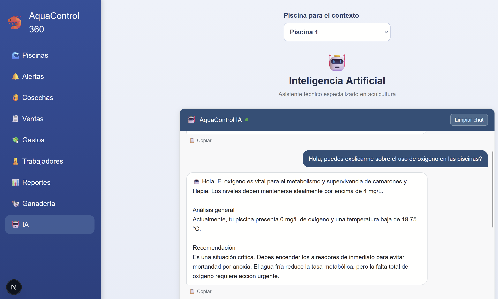

---

## Diagramas de Ingeniería de Software

Los archivos editables (`.drawio`) están en `docs/diagramas/`.

### Diagrama entidad relación (notación Chen)

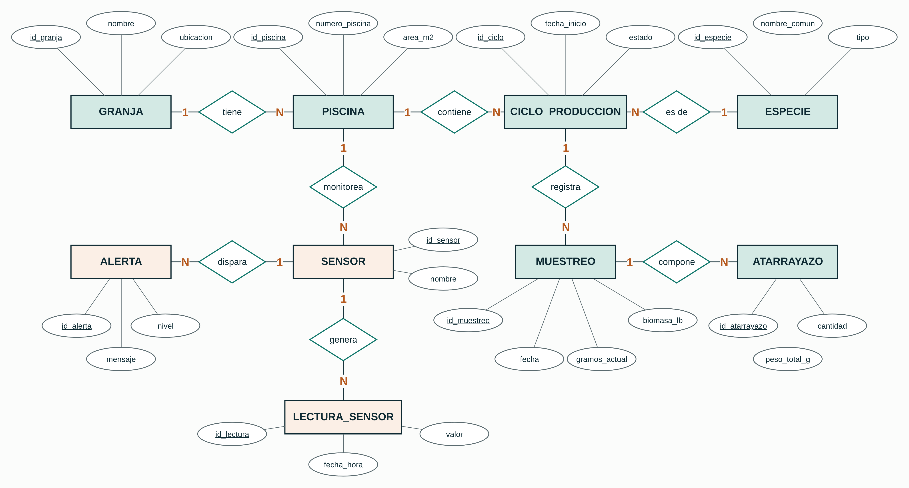

### Casos de uso

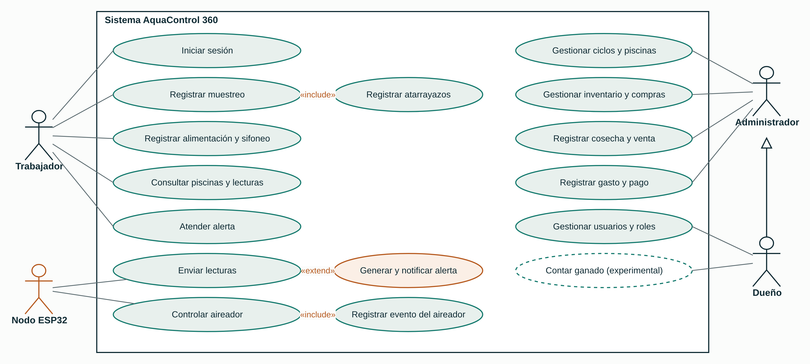

### Secuencia: alerta de oxígeno

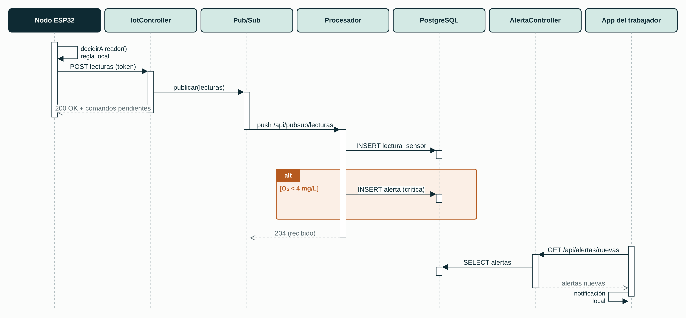

### Secuencia: registro de muestreo

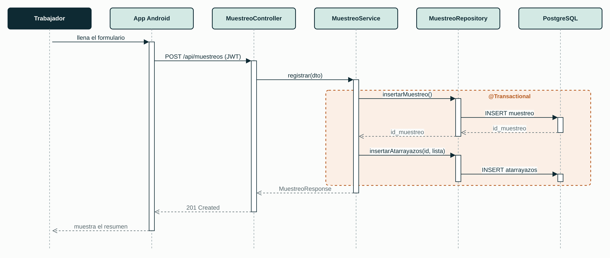

---

## Despliegue paso a paso

Los comandos se ejecutan en **Cloud Shell** con un usuario propietario del proyecto. Los valores entre `<` y `>` se reemplazan por los propios.

### 1. Proyecto y APIs

```bash
gcloud config set project aquacontrol-360-513022
gcloud services enable run.googleapis.com sqladmin.googleapis.com \
  secretmanager.googleapis.com artifactregistry.googleapis.com \
  cloudbuild.googleapis.com storage.googleapis.com iam.googleapis.com \
  pubsub.googleapis.com aiplatform.googleapis.com
```

### 2. Base de datos en Cloud SQL

```bash
gcloud sql instances create aquacontrol-db --database-version=POSTGRES_17 \
  --edition=ENTERPRISE --tier=db-f1-micro --region=us-central1 \
  --storage-type=SSD --storage-size=10GB --availability-type=zonal \
  --backup-start-time=08:00
gcloud sql databases create aquacontrol --instance=aquacontrol-db
gcloud sql users create aquacontrol_app --instance=aquacontrol-db --password=<CONTRASEÑA>
gcloud sql connect aquacontrol-db --user=postgres --database=aquacontrol
# dentro de psql:
#   \i Database/BD.sql
#   \i Database/DatosPrueba.sql
```

### 3. Secretos

```bash
printf "%s" "<CONTRASEÑA>" | gcloud secrets create db-password --data-file=-
openssl rand -base64 64 | tr -d '\n' | gcloud secrets create jwt-secret --data-file=-
```

### 4. Cuenta de servicio del backend con permisos mínimos

```bash
gcloud iam service-accounts create aquacontrol-backend --display-name="Backend AquaControl (Cloud Run)"
SA=aquacontrol-backend@aquacontrol-360-513022.iam.gserviceaccount.com

gcloud projects add-iam-policy-binding aquacontrol-360-513022 \
  --member="serviceAccount:$SA" --role="roles/cloudsql.client"
gcloud projects add-iam-policy-binding aquacontrol-360-513022 \
  --member="serviceAccount:$SA" --role="roles/aiplatform.user"
for s in db-password jwt-secret; do
  gcloud secrets add-iam-policy-binding $s \
    --member="serviceAccount:$SA" --role="roles/secretmanager.secretAccessor"
done
```

### 5. Bucket privado

```bash
gcloud storage buckets create gs://aquacontrol-360-513022-archivos \
  --location=us-central1 --uniform-bucket-level-access --public-access-prevention
gcloud storage buckets add-iam-policy-binding gs://aquacontrol-360-513022-archivos \
  --member="serviceAccount:$SA" --role="roles/storage.objectAdmin"
```

El permiso se da solo sobre este bucket, no sobre todo el proyecto.

### 6. Despliegue de la API

```bash
git clone <URL del repositorio> aquacontrol
cd aquacontrol

gcloud run deploy aquacontrol-api --source backend --region us-central1 \
  --service-account $SA \
  --set-env-vars "DB_URL=jdbc:postgresql:///aquacontrol?cloudSqlInstance=aquacontrol-360-513022:us-central1:aquacontrol-db&socketFactory=com.google.cloud.sql.postgres.SocketFactory,DB_USER=aquacontrol_app,GANADO_BUCKET=aquacontrol-360-513022-archivos" \
  --set-secrets "DB_PASSWORD=db-password:latest,JWT_SECRET=jwt-secret:latest" \
  --allow-unauthenticated --memory 512Mi --max-instances 2
```

Cloud Build compila el proyecto, guarda la imagen en Artifact Registry y Cloud Run la despliega. Para las siguientes versiones basta con:

```bash
gcloud run deploy aquacontrol-api --source backend --region us-central1
```

### 7. Pub/Sub con autenticación OIDC

El script completo está en `docs/pubsub/configurar_pubsub.sh`. Resumen:

```bash
gcloud pubsub topics create lecturas
gcloud pubsub topics add-iam-policy-binding lecturas \
  --member="serviceAccount:$SA" --role="roles/pubsub.publisher"

# Cuenta que firma los mensajes que Pub/Sub entrega a la API
gcloud iam service-accounts create pubsub-push --display-name="Pub/Sub push (firma OIDC)"
PUSH_SA=pubsub-push@aquacontrol-360-513022.iam.gserviceaccount.com
AUD=https://aquacontrol-api-1000315935309.us-central1.run.app/api/pubsub/lecturas

gcloud run services update aquacontrol-api --region us-central1 \
  --update-env-vars "PUBSUB_TOPIC_LECTURAS=lecturas,PUBSUB_PROJECT=aquacontrol-360-513022,PUBSUB_PUSH_AUDIENCE=$AUD,PUBSUB_PUSH_SA=$PUSH_SA"

gcloud pubsub subscriptions create lecturas-a-procesador --topic lecturas \
  --push-endpoint="$AUD" \
  --push-auth-service-account="$PUSH_SA" \
  --push-auth-token-audience="$AUD" \
  --ack-deadline=30 --min-retry-delay=10s --max-retry-delay=600s
```

La URL del push ya no lleva ningún token. Pub/Sub firma cada mensaje con la identidad de `pubsub-push` y el backend verifica esa firma, la audiencia y la cuenta antes de aceptarlo. Una llamada sin firma responde `401`.

### 8. Despliegue de la web

```bash
gcloud iam service-accounts create aquacontrol-web --display-name="AquaControl web (sin permisos)"

gcloud run deploy aquacontrol-web --source my-app --region us-central1 \
  --service-account aquacontrol-web@aquacontrol-360-513022.iam.gserviceaccount.com \
  --set-env-vars API_URL=https://aquacontrol-api-1000315935309.us-central1.run.app \
  --allow-unauthenticated
```

La web corre con una cuenta **sin permisos** porque no necesita ningún recurso de Google Cloud; solo habla con la API. Si no se le asigna una, usaría la cuenta predeterminada de Compute Engine, que tiene rol de Editor sobre todo el proyecto.

### 9. Clientes y nodos IoT

- **Android:** definir `API_URL` en la configuración de compilación (`BuildConfig`).
- **iOS:** definir la URL base de la API en la app.
- **ESP32:** configurar la red WiFi, la URL de la API y el token del dispositivo (registrado en la tabla `dispositivo`).

### 10. Verificación

```bash
# Debe responder 401: el endpoint de Pub/Sub rechaza llamadas sin firma
curl -s -o /dev/null -w "%{http_code}\n" -X POST $AUD -H "Content-Type: application/json" -d '{}'

# Mensajes entregados por Pub/Sub en los últimos 10 minutos (deben ser 204)
gcloud logging read 'resource.type="cloud_run_revision" AND httpRequest.requestUrl:"/api/pubsub/lecturas"' \
  --limit=5 --freshness=10m --format="value(timestamp,httpRequest.status)"
```

---

## Ejecución local

### Base de datos

```bash
createdb aquacontrol
psql -d aquacontrol -f Database/BD.sql
psql -d aquacontrol -f Database/DatosPrueba.sql
```

### Backend

Requiere Java 21. Las variables se toman del entorno, nunca del código:

```bash
cd backend
export DB_URL=jdbc:postgresql://localhost:5432/aquacontrol
export DB_USER=<usuario>
export DB_PASSWORD=<contraseña>
export JWT_SECRET=<clave larga aleatoria>
./mvnw spring-boot:run
```

### Web

Requiere Node.js 20 o superior. Crear `my-app/.env.local` (no se sube al repositorio):

```text
API_URL=http://localhost:8080
```

```bash
cd my-app
npm install
npm run dev
```

Abrir http://localhost:3000.

### Android

Abrir `Proyecto_AR_Aqua_Intelligence/` en Android Studio, esperar la sincronización de Gradle y ejecutar en un emulador o dispositivo.

### iOS

Abrir `aquaInteligence/aquaInteligence.xcodeproj` en Xcode y ejecutar en el simulador o en un iPhone.

### ESP32

- **Piscina 1:** abrir `Proyecto/AquaControl_ESP32S3.ino` en Arduino IDE, seleccionar la placa ESP32-S3, configurar WiFi, URL y token, cargar y abrir el monitor serial a 115200 baudios.
- **Piscina 2 y ESP32-CAM:** abrir la carpeta en VS Code con PlatformIO y ejecutar *Upload*.

---

## Seguridad

| Medida | Cómo se aplica |
|---|---|
| Permisos mínimos | `aquacontrol-backend` solo tiene los roles que usa; Storage sobre un bucket y Pub/Sub sobre un tópico. La web corre con una cuenta sin permisos. |
| Secretos fuera del código | Contraseña de la base y clave de los JWT en Secret Manager. El repositorio no contiene credenciales de producción. |
| Sin llaves JSON | Los servicios se autentican con su cuenta de servicio; no se descargó ninguna llave. |
| Conexión a la base | Conector de Cloud SQL autenticado con IAM; la contraseña solo existe en Secret Manager. |
| Usuarios | Contraseñas con BCrypt y JWT firmados con HS512 y con vencimiento. |
| Autorización | Cada endpoint valida el rol y que los datos sean de la granja del usuario. |
| Dispositivos IoT | Cada ESP32 se identifica con su propio token de dispositivo. |
| Pub/Sub | Push autenticado con **OIDC**: el backend verifica la firma de Google, la audiencia y la cuenta `pubsub-push`. Sin tokens en la URL. |
| Archivos | Bucket privado con acceso uniforme y prevención de acceso público. Las imágenes se entregan a través de la API. |
| Web | Token en cookie httpOnly y puente en el servidor de Next.js. CORS limitado a los orígenes del proyecto. |
| Inyección SQL | Consultas con parámetros mediante `JdbcClient`. |
| HTTPS | Administrado por Cloud Run en ambos servicios. |
| Disponibilidad | Respaldo diario de Cloud SQL y control local del aireador en el ESP32 ante fallas de red. |

---

## Estimación de costos

Precios de lista de Google Cloud en `us-central1`. Costo mensual en USD:

| Servicio | Prototipo (1 granja) | 10 granjas | 100 granjas |
|---|---:|---:|---:|
| Cloud SQL | 9.93 | 30.15 | 61.01 |
| Vertex AI (Gemini) | 0.56 | 5.55 | 55.50 |
| Cloud Run | 0.00 | 0.00 | 32.25 |
| Cloud Storage | 0.00 | 0.30 | 1.90 |
| Artifact Registry | 0.01 | 0.13 | 0.13 |
| Pub/Sub, Secret Manager, Build, Logging | 0.00 | 0.00 | 0.00 |
| **Total mensual** | **10.50** | **36.13** | **150.79** |
| **Costo por granja** | **10.50** | **3.61** | **1.51** |

En el prototipo casi todo el costo es Cloud SQL, el único servicio sin capa gratuita. Al crecer, el costo por granja baja porque la base es un costo fijo que se reparte. Para controlar el gasto se limitó Cloud Run a 2 instancias, se deja escalar a cero y se usa la máquina de base de datos más pequeña.

---

## Decisiones de arquitectura

| Decisión | Alternativa descartada | Motivo |
|---|---|---|
| Cloud Run para API y web | Compute Engine, GKE | Pago por uso, escala a cero y no hay servidores que administrar. |
| PostgreSQL en Cloud SQL | Firebase, Firestore | Los datos tienen muchas relaciones y el curso exige SQL explícito y 3FN. |
| Pub/Sub entre el ESP32 y la base | Guardar dentro de la misma solicitud | El ESP32 recibe respuesta al instante y, si el guardado falla, Pub/Sub reintenta. |
| OIDC en el push de Pub/Sub | Token secreto en la URL | El token en la URL queda en logs y en la configuración; la firma OIDC la verifica Google y no se guarda en ningún lado. |
| Control local en el ESP32 | Depender solo de la nube | Una caída de internet de noche no puede dejar sin aireación a la piscina. |
| Archivos en Cloud Storage | Imágenes dentro de PostgreSQL | La base crecería y costaría más; en SQL solo va la ruta. |
| Un solo backend | Cada cliente con acceso propio a los datos | Las reglas y permisos se escriben una vez y ningún cliente tiene credenciales de la base. |
| Monolito por capas | Microservicios | Para dos personas y un semestre, un solo servicio es más fácil de mantener y de defender. |

---

## Limitaciones y trabajo futuro

- Sifoneo, alimentación, mortalidad, inventario y compras están en la base de datos pero aparecen como **Próximamente** en la interfaz.
- En el segundo nodo, el oxígeno y el pH son simulados porque solo hay un sensor de oxígeno.
- La calibración del sensor de oxígeno es de un solo punto.
- Las reglas de alerta están en el código; más adelante se puede agregar una tabla `regla_alerta` para configurarlas por piscina.
- Pendiente: activador automático de Cloud Build conectado a GitHub, reportes PDF con Cloud Run Jobs, alerta de presupuesto e infraestructura como código con Terraform.
- El reporte mensual de la web todavía usa datos de ejemplo.

---

## Historial del proyecto

| Fecha | Cambio |
|---|---|
| Mayo 2026 | Primera versión: Android, web, iOS y ESP32 conectados a Firebase Realtime Database. Notificaciones push de oxígeno. |
| Septiembre 2026 | DER en notación Chen de toda la plataforma (Hito 1 de Cloud). |
| Octubre 2026 | Esquema PostgreSQL, backend en Spring Boot con JWT y roles, despliegue en Cloud Run y Cloud SQL. Web migrada a la API. |
| Noviembre 2026 | Android e iOS conectados a la API, Firebase eliminado, ganadería con ESP32-CAM y Gemini, alertas con Pub/Sub, push autenticado con OIDC y firmware con control local en su propio núcleo. |

---

## Videos

- Demostración del proyecto final (Cloud Computing): [Video de demostración](video.mp4)

---

## Referencias

Google Cloud. (s.f.). *Cloud Run documentation*. https://cloud.google.com/run/docs

Google Cloud. (s.f.). *Cloud SQL for PostgreSQL documentation*. https://cloud.google.com/sql/docs/postgres

Google Cloud. (s.f.). *Authentication for push subscriptions*. https://cloud.google.com/pubsub/docs/authenticate-push-subscriptions

Google Cloud. (s.f.). *Secret Manager documentation*. https://cloud.google.com/secret-manager/docs

Google Cloud. (s.f.). *Generative AI on Vertex AI*. https://cloud.google.com/vertex-ai/generative-ai/docs

Google Cloud. (s.f.). *Google Cloud pricing*. https://cloud.google.com/pricing

Spring. (s.f.). *Spring Boot reference documentation*. https://docs.spring.io/spring-boot/

The PostgreSQL Global Development Group. (s.f.). *PostgreSQL documentation*. https://www.postgresql.org/docs/

Vercel. (s.f.). *Next.js documentation*. https://nextjs.org/docs

Android Developers. (s.f.). *Jetpack Compose*. https://developer.android.com/compose

Apple. (s.f.). *SwiftUI*. https://developer.apple.com/documentation/swiftui

Espressif Systems. (s.f.). *ESP32-S3 documentation*. https://docs.espressif.com/projects/esp-idf/en/latest/esp32s3/

---

Proyecto académico de Allan Gómez y Andrés Culajay, Universidad Galileo, 2026.
