# Guíame — Ecosistema de salud digital para el autoexamen de mama

Cloud Computing 2026 · Universidad Galileo

- **Integrantes:** Molly Toledo Vega, María Teresa Rivera López
- **Proveedor cloud:** Google Cloud Platform (GCP)
- **Servicios principales:** Cloud Run, Cloud SQL (PostgreSQL), Cloud Storage, Vertex AI (Gemini 2.5 Flash), Cloud Load Balancing, Cloud IAM, Secret Manager, Cloud Monitoring y Logging, Cloud Build (y Artifact Registry)
- **Repositorio:** https://github.com/mtvhua/Guiame
- **Despliegue:** https://guiame-api-252741632220.us-east1.run.app (comprobar con `/health` y `/health/db`)
- **Documentación PDF:** [documentacion.pdf](documentacion.pdf)
- **Video:** [Video de demostración](video.mp4)

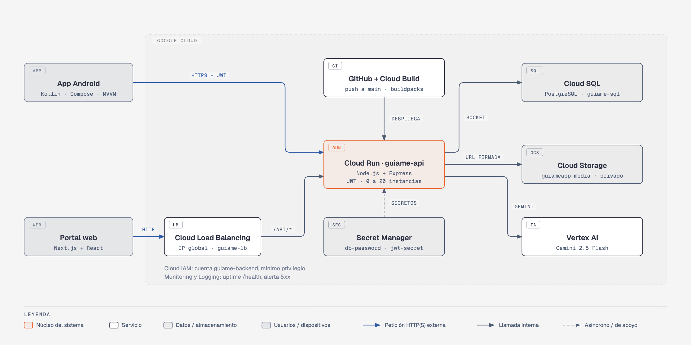

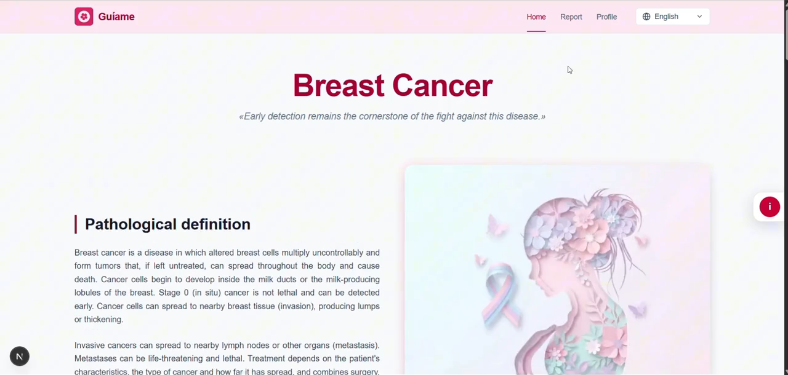

---

> Contenido tomado de la documentación cloud del equipo ([documentacion.pdf](documentacion.pdf)).

## 1. Descripción del proyecto

Guíame es un ecosistema de salud digital que enseña y acompaña el autoexamen de mama en Guatemala. Tiene dos clientes que comparten el mismo backend y la misma base de datos:

- **App Android** (Kotlin, Jetpack Compose, patrón MVVM): autoexamen guiado de 7, preguntas Sí / No / No estoy segura, reporte generado con IA, historial, información educativa, recordatorios mensuales y selector de idioma.
- **Portal web** (Next.js con React): información sobre cáncer de mama, descripción de la app, inicio de sesión y registro, consulta del historial y de los reportes de los autoexámenes realizados desde la app, perfil de la usuaria, directorio de hospitales de la zona 10 de la Ciudad de Guatemala y selector de idioma (español / inglés).
- **API REST** (Node.js + Express): desplegada en Cloud Run, que atiende a ambos clientes.

Como funcionalidades principales el ecosistema de salud digital cuenta con autenticación, historial, notificaciones (recordatorios), videos e imágenes guiadas, soporte multilingüe e IA generativa para redactar el reporte del autoexamen. El reporte nunca da un diagnóstico y recomienda consultar a un profesional de salud.

Cada cliente envía la cabecera `X-Cliente` (`web` o `android`) y la API registra en Cloud Logging, en formato JSON, el cliente, el método, la ruta, el estado y el tiempo de cada solicitud (nunca cuerpos, tokens ni contraseñas). Así se puede comprobar en Logging y Monitoring que ambos clientes usan la misma API.

## 2. Arquitectura

La Figura 1 muestra los clientes, el borde de red, el cómputo y los servicios de Google Cloud que usa Guíame. Debajo se explica el recorrido de una petición.

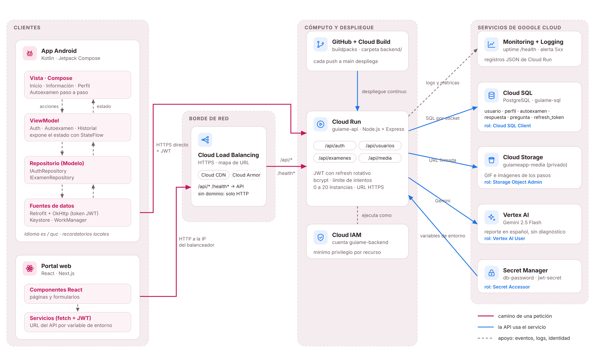

*Figura 1. Arquitectura de Guíame en Google Cloud.*

### 2.1. Cómo fluye una petición

1. La app Android sigue MVVM: la pantalla (Compose) envía acciones al ViewModel, este usa un repositorio y el repositorio llama a la API con Retrofit/OkHttp, enviando el token JWT. El token se guarda cifrado con Android Keystore.
2. La app llama directamente a la URL HTTPS de Cloud Run. El portal web puede entrar por la IP del balanceador de carga, que reenvía `/api/*` y `/health*` al servicio de Cloud Run.
3. La API valida el JWT y consulta Cloud SQL (PostgreSQL) por socket Unix.
4. Al terminar un autoexamen, la API pide el reporte a Vertex AI (Gemini 2.5 Flash) y guarda el resultado en la base de datos. Si Vertex AI falla, se usa un reporte por reglas y el autoexamen se guarda igual.
5. Los GIF e imágenes viven en un bucket privado de Cloud Storage; la API entrega a la app un enlace firmado que caduca en 10 minutos.
6. Los secretos (`db-password`, `jwt-secret`) llegan a Cloud Run desde Secret Manager; los permisos se controlan con IAM.
7. Cloud Monitoring y Logging vigilan la disponibilidad y los errores; Cloud Build despliega cada push a la rama `main` de GitHub.

> **Nota:** Sin dominio propio el balanceador solo atiende HTTP, y Android bloquea tráfico HTTP sin cifrar. Por eso la app llama directo a la URL HTTPS de Cloud Run y el portal web usa el balanceador. Con un dominio y un certificado administrado de Google, la app también podría pasar por él.

## 3. Servicios de Google Cloud utilizados

El proyecto usa 9 servicios de Google Cloud.

| # | Servicio | Categoría | Rol en Guíame | Integración |
|---|---|---|---|---|
| 1 | Cloud Run | Cómputo | Ejecuta la API Node.js (`guiame-api`). Autoescalado con el número de usuarios activos | Despliegue continuo desde GitHub; se conecta a Cloud SQL, Storage y Vertex AI con la cuenta de servicio `guiame-backend`. |
| 2 | Cloud SQL (PostgreSQL) | Base de datos | Guarda usuarias, autoexámenes, respuestas, preguntas, notificaciones y sesiones. | Conexión por socket Unix `/cloudsql/...` con el usuario `app`. |
| 3 | Cloud Storage | Almacenamiento | Bucket privado `guiameapp-media` con los GIF de los 7 pasos e imágenes de información. | La API genera URL firmadas V4 y responde con redirección 302. |
| 4 | Vertex AI (Gemini 2.5 Flash) | IA | Redacta el reporte del autoexamen en español, sin diagnóstico. | El SDK `@google/genai` en modo Vertex usa la cuenta de servicio; no hay llaves API. |
| 5 | Cloud Load Balancing | Redes | Balanceador de aplicaciones externo global `guiame-lb`. Backend serverless hacia Cloud Run. | Grupo de extremos serverless (NEG) → Cloud Run. |
| 6 | Cloud IAM | Seguridad | Cuenta de servicio `guiame-backend` con roles mínimos por recurso. | Roles asignados en proyecto, bucket y secretos (ver sección 6). |
| 7 | Secret Manager | Seguridad | Guarda `db-password` y `jwt-secret`. | Se montan como variables de entorno en Cloud Run. |
| 8 | Cloud Monitoring y Logging | Observabilidad | Verificación de disponibilidad de `/health`, alerta por errores 5xx, panel y consulta guardada de errores. | Los registros JSON de Cloud Run llegan solos a Logging. |
| 9 | Cloud Build (y Artifact Registry) | CI/CD | Construye la imagen del backend con buildpacks y la despliega en cada push. | Activador desde GitHub, carpeta `backend/`. |

### 3.1. Dónde está implementado en el código

| Tema | Archivo |
|---|---|
| Rutas de la API | `backend/src/routes/auth.js`, `usuarios.js`, `examenes.js`, `media.js`, `notificaciones.js` |
| Conexión a Cloud SQL | `backend/src/db/pool.js` y `config.js` (pool de 5 conexiones por instancia) |
| Prompt y llamada a Gemini | `backend/src/services/vertex.js` (`armarPrompt`, `generarReporte`); selector de proveedor en `reportes.js` |
| URL firmadas de Storage | `backend/src/routes/media.js` |
| JWT y refresh token | `backend/src/services/tokens.js` |
| Límite de intentos | `backend/src/routes/auth.js` (`express-rate-limit`) |
| Registro de cliente (web / app) | `backend/src/middleware/cliente.js` |
| Esquema de la base de datos | `backend/src/db/schema.sql` y migración `notificacion-tipo.sql` |
| Cliente Android (MVVM) | `Guiame-App/app/src/main/java/com/example/guiame/`: `ui/screens`, `ui/viewmodel`, `data/repository`, `data/remote` |
| Cliente web (Next.js) | `web/lib/api.ts` (sesión, refresh de token y llamadas a la API), `web/lib/dictionaries.ts` (español / inglés), páginas de inicio, app, login, registro, perfil y reporte |

## 4. Modelo de datos

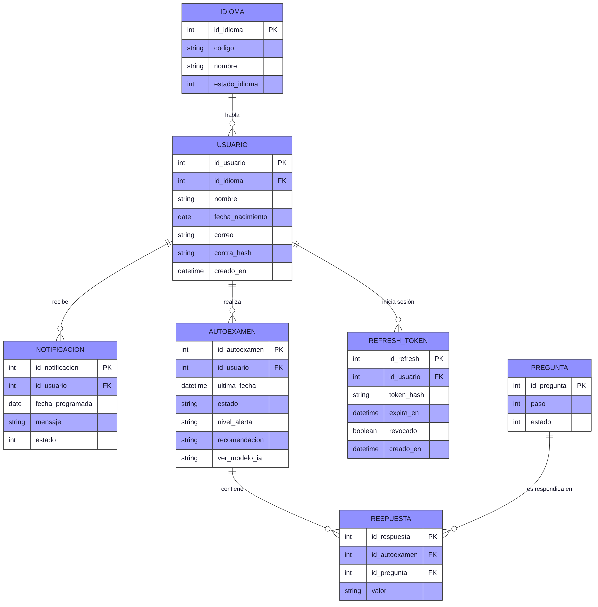

*Figura 2. Modelo de datos en Cloud SQL (PostgreSQL).*

| Tabla | Contenido y restricciones |
|---|---|
| `idioma` | Inglés o español, nombre y estado |
| `usuario` | Nombre, fecha de nacimiento, correo único, contraseña, idioma y fecha de creación |
| `autoexamen` | Usuaria, fecha del último movimiento, estado (`en_progreso`, `completado`, `cancelado`), nivel de alerta (`sin_hallazgos`, `consultar`), reporte generado y modelo de IA usado. |
| `respuesta` | Una fila por paso: autoexamen, pregunta y valor (`no`, `si`, `no_segura`). Única por autoexamen y pregunta. |
| `pregunta` | Los 7 pasos del autoexamen |
| `notificacion` | Usuaria, fecha programada, mensaje, estado (0 pendiente, 1 enviada, 2 leída) y tipo (por defecto `general`; `recordatorio_mensual` para los avisos creados desde el perfil web). |
| `refresh_token` | Fecha de expiración, indicador de revocado y fecha de creación. |

Las llaves foráneas usan `ON DELETE CASCADE` desde `usuario`, de modo que al eliminar una usuaria se eliminan sus autoexámenes, respuestas, notificaciones y sesiones. Hay índices por usuaria y fecha en `autoexamen` y `notificacion`, por autoexamen en `respuesta`, por usuaria en `refresh_token` y por tipo en `notificacion`. La API se conecta con el usuario `app`, que solo tiene permisos de lectura y escritura de filas.

## 5. Pasos de despliegue

Todos los pasos se hicieron desde la consola web de Google Cloud. Los nombres corresponden a los usados en el proyecto.

### 5.1 Proyecto y APIs

El proyecto `guiameapp` es el contenedor de todos los recursos de Guíame y la unidad a la que se asocia la facturación. Antes de crear cualquier servicio hay que habilitar sus APIs; sin ellas, la consola no permite usarlos.

### 5.2 Cuenta de servicio (IAM)

IAM controla quién puede hacer qué sobre cada recurso. Se creó la cuenta de servicio `guiame-backend`, que es la identidad con la que corre la API, y se le dieron solo los roles que necesita (mínimo privilegio). Así no se usan llaves JSON ni contraseñas dentro del código.

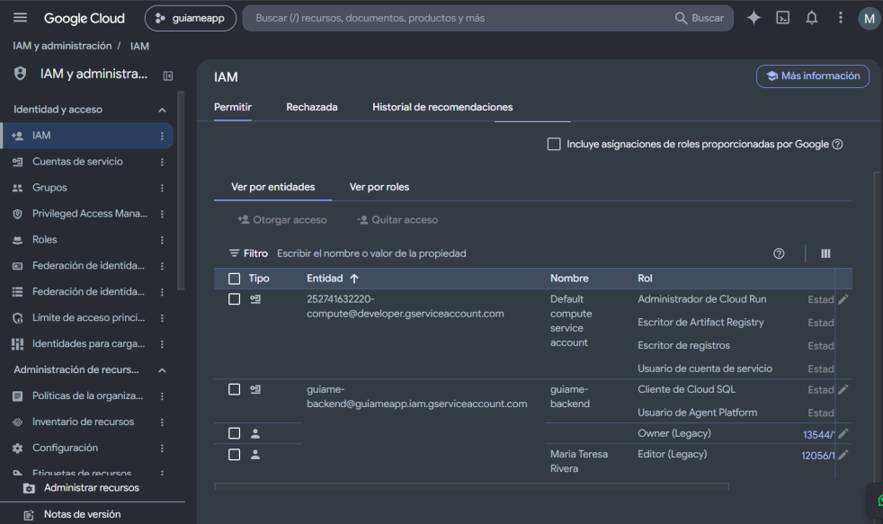

*Ilustración 1: Cloud IAM*

### 5.3 Cloud SQL

Cloud SQL aloja la base de datos PostgreSQL administrada por Google, que guarda usuarias, autoexámenes, respuestas, notificaciones y sesiones. Se creó la instancia, el usuario `app` (sin permisos de estructura) y la base `guiame`, y el esquema se cargó desde Cloud SQL Studio. La API se conecta por socket Unix, sin exponer la base a internet.

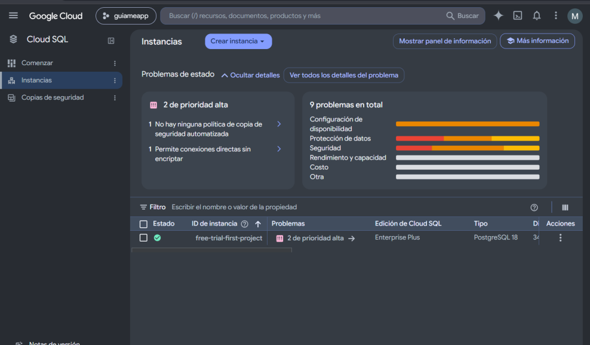

*Ilustración 2: Cloud SQL con PostgreSQL*

### 5.4 Secret Manager

Secret Manager guarda la contraseña de la base (`db-password`) y la clave de firma de los tokens (`jwt-secret`). Cloud Run los recibe como variables de entorno y solo `guiame-backend` puede leerlos, por lo que ningún secreto queda en el código ni en GitHub.

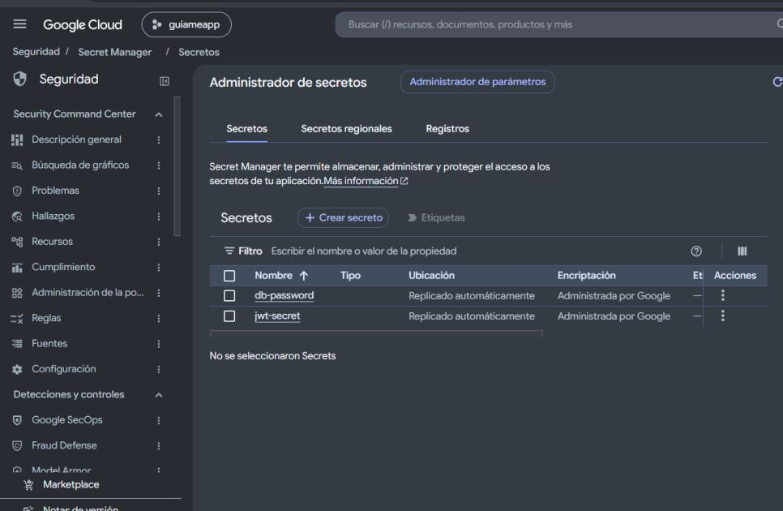

*Ilustración 3: Secret Manager*

### 5.5 Cloud Storage

Cloud Storage almacena los GIF de los 7 pasos y las imágenes informativas en el bucket privado `guiameapp-media`. Como el bucket no es público, la API entrega a la app enlaces firmados que caducan en 10 minutos.

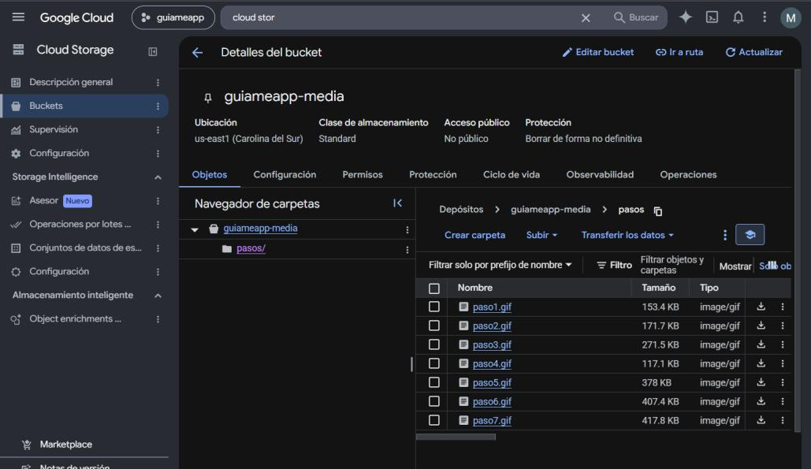

*Ilustración 4: Cloud Storage*

### 5.6 Cloud Run (despliegue continuo desde GitHub)

Cloud Run ejecuta la API Node.js (`guiame-api`) sin administrar servidores: escala automáticamente según la demanda, hasta 20 instancias, y se factura por solicitud. Está conectado a GitHub mediante Cloud Build, de modo que cada cambio que llega a la rama `main` se construye y se despliega solo.

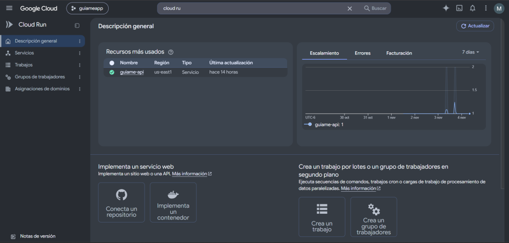

*Ilustración 5: Cloud Run*

### 5.7 Monitoring y Logging

Cloud Monitoring y Cloud Logging dan visibilidad del servicio. Un uptime check consulta `/health` cada 5 minutos, una alerta avisa por correo si hay errores 5xx o si el servicio deja de responder, y un panel muestra solicitudes, latencia y errores. Los registros JSON de Cloud Run llegan solos a Logging y permiten ver qué cliente (web o app) hace cada solicitud.

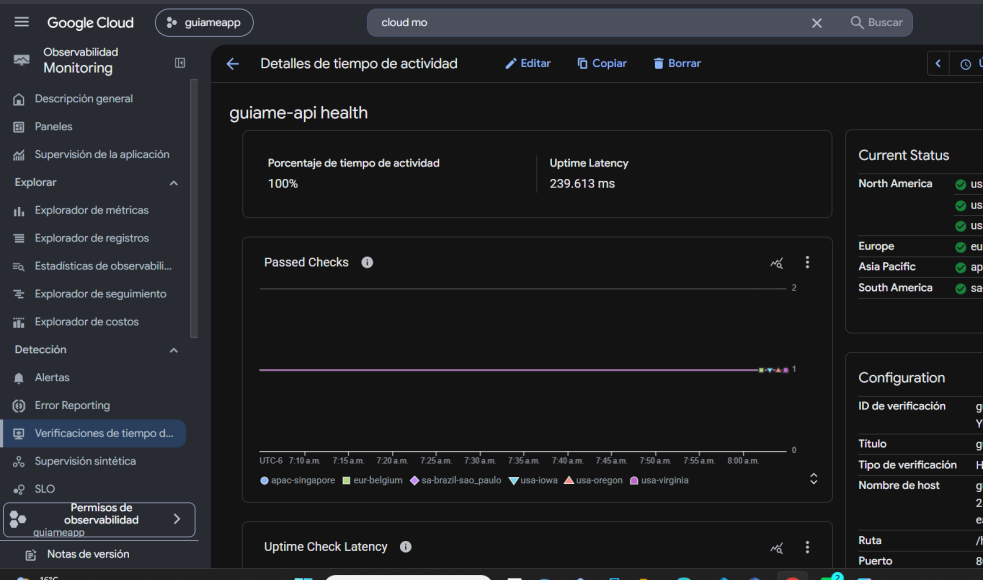

*Ilustración 6: Cloud Monitoring y Logging*

### 5.8 Cloud Load Balancing

Cloud Load Balancing publica una IP global (`guiame-lb`) que recibe el tráfico del portal web y lo reenvía a Cloud Run mediante un grupo de extremos serverless (`guiame-neg`). Sin dominio solo atiende HTTP; con dominio y certificado pasaría a HTTPS y podría sumar CDN y Cloud Armor.

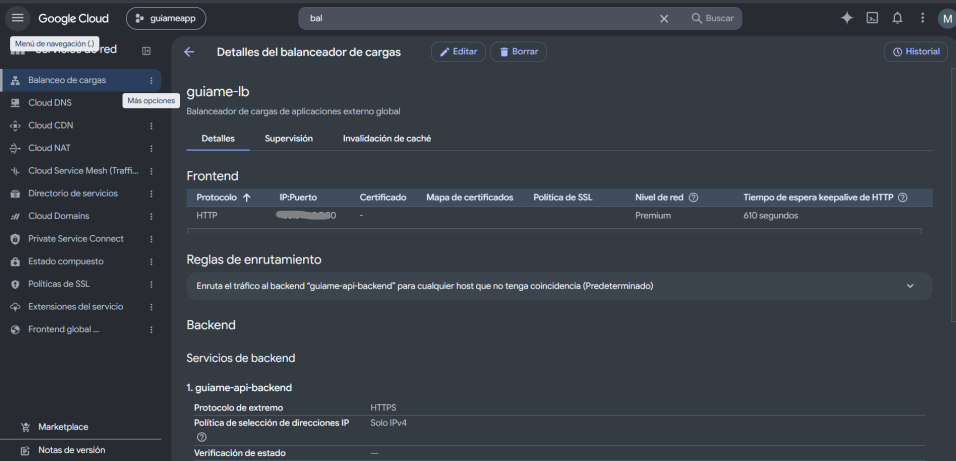

*Ilustración 7: Cloud Load Balancing*

## 6. Seguridad

### 6.1. Medidas aplicadas

| Área | Medida |
|---|---|
| Secretos | Contraseña de la base y clave JWT en Secret Manager; nunca en el código ni en GitHub. `.env.example` solo contiene valores de ejemplo. |
| Contraseñas de usuarias | Se guardan con hash bcrypt; entre 8 y 72 caracteres. |
| Sesiones | JWT de acceso de 30 minutos y refresh token de 30 días, rotativo, guardado solo como hash SHA-256 y revocable al cerrar sesión. El identificador de la usuaria se toma siempre del token, nunca del cuerpo de la petición. |
| Archivos multimedia | Bucket privado con prevención de acceso público; enlaces firmados V4 de 10 minutos; la ruta solicitada se valida con una lista blanca. |
| Base de datos | Usuario `app` sin permisos de estructura; consultas parametrizadas (sin concatenar texto del usuario) contra inyección SQL. |
| Abuso | Límite de 100 peticiones por IP y 10 inicios de sesión fallidos por correo (respuesta 429). |
| HTTP | HTTPS en Cloud Run, cabeceras seguras con `helmet`, CORS con lista blanca de orígenes y cuerpo JSON limitado a 20 KB. |
| Datos de salud | Se guarda solo lo necesario. Los registros no incluyen tokens, contraseñas, respuestas ni reportes. |
| Clientes | Android: token guardado cifrado (AES-GCM) con Android Keystore. Web: tokens en `localStorage` (ver riesgos). |
| IA | Prompt con reglas: sin diagnóstico, sin medicamentos, aclara que no reemplaza al profesional de salud. El nivel de alerta lo decide el código, nunca la IA. Si Vertex AI falla, se usa un reporte por reglas y el autoexamen se guarda igual. |

### 6.2. Riesgos conocidos

| Riesgo | Mitigación o siguiente paso |
|---|---|
| Sin dominio, el balanceador solo atiende HTTP: el tráfico del portal que pasa por él no va cifrado. | Registrar un dominio y usar un certificado administrado de Google (HTTPS). |
| Los tokens del portal web se guardan en `localStorage`, expuestos si hubiera una vulnerabilidad XSS. | El acceso dura 30 minutos y el refresh token se rota y es revocable. A futuro: cookies HttpOnly y una política de seguridad de contenido (CSP). |
| El límite de intentos cuenta en la memoria de cada instancia; con varias instancias, cada una lleva su propia cuenta. | Mover el contador a un almacén común (Memorystore / Redis). |
| Cloud SQL es una sola instancia: sin alta disponibilidad, una falla la deja sin servicio. | Activar alta disponibilidad y copias de seguridad automáticas en producción. |
| Si se activa Cloud CDN, un caché mal configurado podría guardar respuestas con datos personales. | Aplicar CDN solo a contenido público (imágenes y GIF); excluir `/api/*`. |
| La API permite invocaciones sin autenticación de Google (se protege con JWT). | Cloud Armor y límites por IP en el balanceador para tráfico real. |

## 7. Estimación de costos

Las cifras son la estimación mensual del equipo, en USD, para dos escenarios: el período de prueba (uso del curso) y el período de producción (uso real). Los precios unitarios de referencia se consultaron en las páginas oficiales de Google Cloud en octubre de 2026.

### 7.1 Período de prueba

| Servicio | % del total |
|---|---:|
| Cloud SQL (PostgreSQL) | 56.9 % |
| Cloud Run | 21.1 % |
| Cloud Load Balancing | 20.4 % |
| Vertex AI (Gemini) | 1.6 % |
| Cloud Storage | 0 % |
| Secret Manager | 0 % |
| Cloud IAM | 0 % |
| Cloud Monitoring y Logging | 0 % |
| **Total mensual** | **100 %** |

### 7.2 Período de producción

| Servicio | USD / mes | % del total |
|---|---:|---:|
| Vertex AI (Gemini) | 140.00 | 34.7 % |
| Cloud SQL (PostgreSQL) | 115.62 | 28.6 % |
| Cloud Storage | 99.90 | 24.7 % |
| Cloud Run | 18.91 | 4.7 % |
| Cloud Load Balancing | 18.33 | 4.5 % |
| Cloud Monitoring y Logging | 10.00 | 2.5 % |
| Secret Manager | 0.92 | 0.2 % |
| Cloud IAM | 0.00 | 0 % |
| **Total mensual** | **403.68** | **100 %** |

Comparación: producción cuesta cerca de 4.5 veces el período de prueba (403.68 frente a 89.65 USD al mes). Los totales son la suma de las filas de cada tabla.

## 8. Escalabilidad

La API está diseñada para crecer horizontalmente. La tabla resume cómo escala cada capa, dónde está el límite y qué medida se aplicaría.

| Capa | Situación actual | Medida si crece el uso |
|---|---|---|
| API (Cloud Run) | Sin estado: el JWT viaja con cada petición, así que las instancias se crean y destruyen sin perder datos. Cada una atiende 80 solicitudes a la vez, hasta 20 instancias, y baja a cero sin tráfico. | Subir el máximo de instancias; fijar instancias mínimas para evitar arranques en frío. |
| Base de datos (Cloud SQL) | Cuello de botella principal. Pool de 5 conexiones por instancia (máximo teórico: 100 con 20 instancias) para no agotar el límite de conexiones de Cloud SQL. | Instancia más grande, alta disponibilidad, réplicas de lectura para el historial y un pool de conexiones externo (PgBouncer). |
| Contenido (Storage) | Escala sin límite práctico; los GIF se sirven con enlaces firmados. | Cloud CDN para reducir carga, latencia y salida de datos. |
| IA (Vertex AI) | Cuotas por proyecto; el reporte se genera durante la petición y, si falla, se usa el reporte por reglas. | Pedir aumento de cuota o procesar los reportes en segundo plano con una cola (Pub/Sub o Cloud Tasks). |
| Límite de intentos | Contador en memoria por instancia. | Contador compartido en Memorystore (Redis). |
| Sesiones | La tabla `refresh_token` crece con cada inicio de sesión. | Tarea programada que elimine tokens vencidos o revocados. |
| Borde de red | Balanceador global con un solo backend serverless. | Cloud Armor, CDN y varias regiones si se requiere. |
| Costos y vigilancia | Alertas de 5xx y disponibilidad. | Presupuestos de facturación y una prueba de carga para medir el límite real (pendiente). |

## 9. Limitaciones y trabajo futuro

- Sin dominio propio: la app usa la URL de Cloud Run y el balanceador solo atiende HTTP. Con dominio y certificado, ambos clientes pasarían por el balanceador con HTTPS.
- La traducción al K’iche’ requiere revisión de hablantes nativos; la app y el portal ofrecen español e inglés. El reporte de IA se genera siempre en español.
- Las preguntas del autoexamen están en la app. Para que cambien con la base de datos (tablas `texto_pregunta` y `recurso_multimedia`) haría falta un endpoint de preguntas por idioma.
- El recordatorio mensual del portal solo programa los avisos en la tabla `notificacion`; el envío al celular lo debe hacer la app o un proceso del servidor (por ejemplo, Cloud Scheduler con Cloud Run).
- Edición de perfil (nombre y fecha de nacimiento) mediante `PATCH /api/usuarios/me`.
- Los reportes los crea la app; el portal web solo los muestra.
- Alta disponibilidad de Cloud SQL, Cloud CDN, Cloud Armor, HTTPS con dominio y prueba de carga: recomendados para producción real.

## Documentación adicional

- Instrucciones para ejecutar el backend, la app Android y el portal web, y variables de entorno: [README del repositorio](https://github.com/mtvhua/Guiame#readme).
