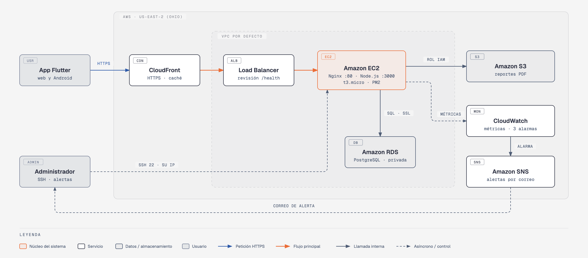
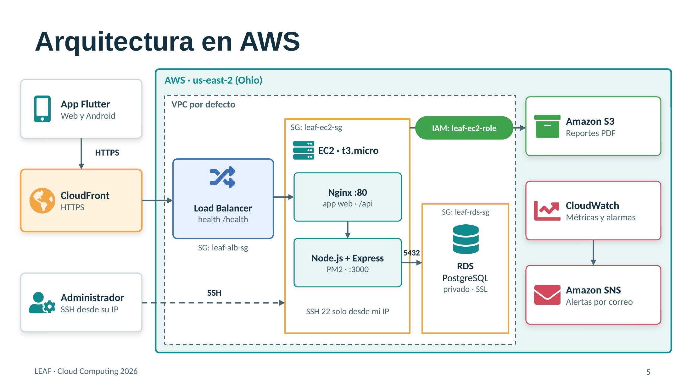
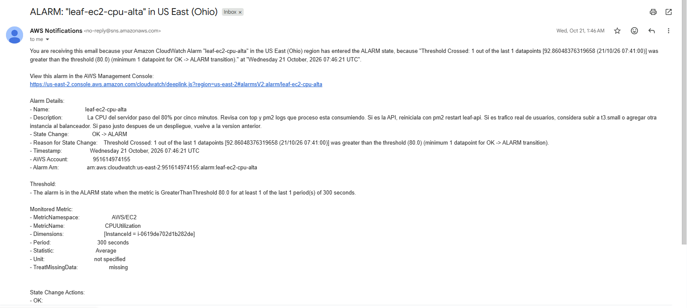

# LEAF

Cloud Computing 2026 · Universidad Galileo

- **Integrantes:** Pablo Daniel Vásquez Aldana
- **Proveedor cloud:** Amazon Web Services (AWS), región us-east-2 (Ohio)
- **Servicios principales:** Amazon EC2, Amazon RDS for PostgreSQL, Amazon S3, AWS IAM, Elastic Load Balancing (ALB), Amazon CloudFront, Amazon CloudWatch, Amazon SNS
- **Repositorio:** https://github.com/Zylohw/Proyecto-Final-Cloud-Computing
- **Despliegue:** https://d1eik3xsy2bfk4.cloudfront.net
- **Documentación PDF:** [documentacion.pdf](documentacion.pdf)



---

> Contenido convertido de la documentación entregada por el equipo ([documentacion.pdf](documentacion.pdf)).

## Resumen

LEAF es una aplicación para registrar, supervisar y consultar lecturas de los contadores de agua en viviendas de un condominio. Digitalizar un proceso que hoy se realiza a mano: el personal de mantenimiento registra cada lectura, el sistema calcula el consumo comparándolo con la lectura anterior y los residentes pueden consultar dicha lectura y también lecturas anteriores.

El sistema cuenta con 3 tipos de usuarios:

- **Administrador:** gestiona viviendas, usuarios, reportes y supervisa lecturas
- **Mantenimiento:** Registra las lecturas de los contadores.
- **Residente o usuario común:** consulta su consumo e historial

La solución utiliza Flutter en el frontend, NodeJS con Express para Backend y PostgreSQL como base de datos.

### 1. Proyecto

| Entregable | dato |
|---|---|
| Proyecto Desplegado | https://d1eik3xsy2bfk4.cloudfront.net |
| Repositorio | https://github.com/Zylohw/Proyecto-Final-Cloud-Computing.git |
| Video de demostración | https://youtu.be/jv2t3hB3gt4 |
| Región de AWS | US-East-2(Ohio) |

### 2. Cuentas de demostración

| Rol | Correo | Contraseña |
|---|---|---|
| Administrador | admin@leaf.com | [REDACTADO] |
| Mantenimiento | mantenimiento@leaf.com | [REDACTADO] |
| Residente o usuarios comunes | usuario@leaf.com | [REDACTADO] |

- Estas cuentas son de prueba y se almacenan en la base de datos como hash bycript, nunca en texto plano.

## Proveedor de nube

Se eligió Amazon Web Services en lugar de Google Cloud Platform (el proveedor visto en clase). Para LEAF, AWS fue la mejor opción por cuatro hechos verificables:

1. **HTTPS sin dominio propio.** La aplicación necesita HTTPS: el almacenamiento seguro de la sesión en Flutter web solo funciona en un contexto seguro. LEAF no tiene dominio propio. CloudFront asigna a cada distribución una dirección `*.cloudfront.net` que ya incluye el certificado de Amazon, por lo que la aplicación tuvo HTTPS de inmediato. En GCP, con la misma arquitectura (máquina virtual, balanceador y CDN), el certificado administrado por Google solo se emite para un dominio propio que apunte al balanceador: habría sido necesario comprar uno.
2. **Seguridad por defecto.** En AWS, una instancia EC2 nace sin ningún permiso: el servidor de LEAF no pudo acceder a nada hasta que se le asignó el rol `leaf-ec2-role`, que solo permite usar un bucket. En GCP, una VM nueva usa por defecto la cuenta de servicio de Compute Engine, que puede recibir automáticamente el rol Editor del proyecto y trae acceso de lectura a todo Cloud Storage; la propia documentación de Google recomienda desactivar esa concesión automática.
3. **Duración del plan gratuito.** El plan gratuito de AWS para cuentas nuevas dura hasta seis meses (con créditos y un límite de gasto que impide cobros); la prueba de GCP dura 90 días, menos que el semestre. Con AWS, LEAF permanece en línea durante todo el curso y su evaluación.
4. **Trayectoria y adopción.** Amazon EC2 se lanzó en 2006 y Compute Engine en 2013. En el primer trimestre de 2026, AWS tenía el 28 % del mercado de infraestructura en la nube frente al 14 % de Google Cloud, y la encuesta de Stack Overflow de 2026 reporta 41.8 % de uso de AWS frente a 24.5 % de Google Cloud. Esto se traduce en más documentación y casos resueltos: cada error del despliegue (sección 9) tenía solución documentada.

Además, usar un segundo proveedor demuestra que los conceptos del curso son transferibles. La tabla muestra el equivalente en GCP de cada servicio utilizado:

| Función | AWS (usado) |
|---|---|
| Cómputo | Amazon EC2 |
| Base de datos | Amazon RDS for PostgreSQL |
| Almacenamiento | Amazon S3 |
| Seguridad e identidades | AWS IAM |
| Balanceo de carga | Elastic Load Balancing (ALB) |
| Red de distribución (CDN) | Amazon CloudFront |
| Monitoreo | Amazon CloudWatch |
| Notificaciones | Amazon SNS |

## Arquitectura



*Fig.1 Arquitectura de LEAF en AWS*

**Flujo:**

1. El usuario abre https://d1eik3xsy2bfk4.cloudfront.net desde el navegador (o la app Android hace una petición a la API).
2. CloudFront recibe la conexión cifrada con HTTPS y la reenvía al balanceador de carga.
3. El Application Load Balancer dirige la petición a la instancia EC2 que esté sana según su revisión de salud (`/health`).
4. En la instancia, Nginx decide: las rutas `/api/...` van a la API de Node.js; todo lo demás entrega la aplicación web de Flutter.
5. La API (Node.js + Express), administrada por PM2, consulta RDS PostgreSQL mediante una conexión cifrada con SSL, y guarda o lee archivos en S3 usando las credenciales temporales del rol de IAM.
6. CloudWatch recibe las métricas de EC2, RDS y el balanceador. Si una alarma se activa, SNS envía un correo al administrador con el plan de respuesta.

**Decisiones de diseño:**

- **Una sola entrada pública.** El usuario solo conoce la URL de CloudFront. El servidor no se expone directamente: el puerto 80 del EC2 solo acepta tráfico del balanceador.
- **Base de datos privada.** RDS no tiene acceso público y solo acepta conexiones desde el Security Group del servidor.
- **Sin credenciales en el código.** El servidor obtiene permisos de S3 a través de un rol de IAM; no existen llaves de acceso en archivos de configuración.
- **Preparada para crecer.** Para soportar más condominios basta con agregar instancias EC2 al grupo de destino del balanceador, sin cambios en la aplicación.
- **Costo controlado.** Se eligieron los tamaños más pequeños (t3.micro y db.t4g.micro), Single-AZ, sin NAT Gateway ni WAF.

## Servicios utilizados

El proyecto utiliza ocho servicios de AWS:

| No. | Servicio | Categoría | Recurso | Rol en LEAF |
|---|---|---|---|---|
| 1 | Amazon EC2 | Cómputo | leaf-backend (t3.micro) | Ejecuta Nginx, la app web y la API de Node.js |
| 2 | Amazon RDS | Base de datos | leaf-db (PostgreSQL) | Usuarios, viviendas, lecturas, reportes y notificaciones |
| 3 | Amazon S3 | Almacenamiento | leaf-files-pvasq | Reportes PDF de las lecturas, descargados con URL prefirmadas |
| 4 | AWS IAM | Seguridad | Rol, políticas y 5 usuarios | Permisos de mínimo privilegio para servidor y personas |
| 5 | Elastic Load Balancing | Redes | leaf-alb + leaf-tg | Punto de entrada, revisión de salud y escalabilidad |
| 6 | Amazon CloudFront | Redes (CDN) | leaf-cf | HTTPS público y distribución de la app web |
| 7 | Amazon CloudWatch | Monitoreo | 3 alarmas | Métricas y alarmas con plan de respuesta |
| 8 | Amazon SNS | Notificaciones | leaf-alertas | Envía las alertas por correo electrónico |

### Amazon EC2

| Parámetro | Valor |
|---|---|
| Instancia | leaf-backend · i-0619de702d1b282de |
| Tipo / sistema | t3.micro (2 vCPU, 1 GiB) · Ubuntu |
| Zona | us-east-2a · VPC por defecto |
| Software | Nginx (proxy inverso y archivos web), Node.js (nvm, versión LTS), PM2, cliente PostgreSQL, AWS CLI |
| Security Group | leaf-ec2-sg |
| Rol de IAM | leaf-ec2-role |

### Amazon RDS for PostgreSQL

| Parámetro | Valor |
|---|---|
| Instancia | leaf-db · db.t4g.micro (2 vCPU, 1 GiB) · PostgreSQL 18 |
| Base de datos | leaf |
| Almacenamiento | 20 GiB SSD gp2 · cifrado con la llave administrada aws/rds |
| Disponibilidad | Single-AZ (us-east-2c) |
| Acceso público | Deshabilitado |
| Conexión | SSL obligatorio, verificado con el certificado global-bundle.pem de AWS |
| Security Group | leaf-rds-sg: puerto 5432 solo desde leaf-ec2-sg |

### Amazon S3

El bucket `leaf-files-pvasq` (us-east-2, uso general) almacena los reportes PDF de las lecturas. Tiene bloqueado todo el acceso público, las ACL deshabilitadas, cifrado SSE-S3 y sin control de versiones. La API usa el AWS SDK para JavaScript (`@aws-sdk/client-s3`) con las credenciales temporales del rol de IAM.

Flujo de los reportes:

1. El personal de mantenimiento emite el reporte de una lectura desde la app.
2. La API genera el PDF con pdfkit y lo sube a S3 con la llave `reportes/reporte-<id>.pdf`; en la base de datos solo se guarda el nombre del archivo.
3. El residente presiona el ícono de PDF en Mis reportes. La API verifica que el reporte pertenece a una casa asignada a ese residente (tablas reciben y tiene) y que el archivo existe en S3.
4. La API responde con una URL prefirmada válida por 5 minutos, con `Content-Disposition: attachment`, y el navegador descarga el PDF directamente desde S3.

Guardar los PDF en S3 y no en el disco del servidor permite reemplazar la instancia o agregar más instancias detrás del balanceador sin perder archivos.

### AWS IAM

**Rol del servidor**

El rol `leaf-ec2-role` está asignado a la instancia EC2 y tiene una política propia, `leaf-s3-policy`, que solo permite leer, subir, borrar y listar objetos del bucket `leaf-files-pvasq` (ver Anexo A). El SDK de AWS obtiene credenciales temporales del rol automáticamente, por lo que no hay llaves en el código ni en el archivo `.env`.

**Usuarios y sus funciones**

| Usuario | Políticas | Función |
|---|---|---|
| pablo-admin | AdministratorAccess | Administrador del proyecto |
| mario-admin | AdministratorAccess | Administrador del proyecto |
| leaf-dev | AmazonEC2ReadOnlyAccess, CloudWatchReadOnlyAccess, leaf-reiniciar-ec2 | Responde a las alertas: puede ver y reiniciar el servidor, pero no detenerlo ni borrarlo |
| leaf-auditor | ReadOnlyAccess | Revisión de la infraestructura sin poder modificarla |
| leaf-finanzas | Billing | Control de costos, sin acceso a servidores ni datos |

La política propia `leaf-reiniciar-ec2` permite únicamente la acción `ec2:RebootInstances` sobre la instancia leaf-backend (ver Anexo A).

### Elastic Load Balancing

| Componente | Configuración |
|---|---|
| Balanceador | leaf-alb · Application Load Balancer · Internet-facing · IPv4 · zonas us-east-2a y us-east-2b |
| Agente de escucha | HTTP:80 → reenvía a leaf-tg |
| Grupo de destino | leaf-tg · instancias · HTTP:80 · destino leaf-backend |
| Revisión de salud | HTTP GET /health (Nginx la reenvía a la ruta raíz de la API) |
| Security Group | leaf-alb-sg: HTTP 80 desde cualquier origen |

El balanceador controla tres aspectos: hacia dónde va el tráfico (los usuarios nunca hablan directamente con el EC2), si el servidor está sano (deja de enviar tráfico a una instancia que no responde en `/health`) y la escalabilidad (para atender más carga basta con registrar otra instancia en leaf-tg).

### Amazon CloudFront

| Componente | Configuración |
|---|---|
| Distribución | leaf-cf · dominio d1eik3xsy2bfk4.cloudfront.net |
| Origen | leaf-alb (HTTP solo, puerto 80) |
| Protocolo del usuario | Redirect HTTP to HTTPS |
| Métodos permitidos | GET, HEAD, OPTIONS, PUT, POST, PATCH, DELETE |
| Política de caché | leaf-api-cache (propia) |
| Política de solicitud al origen | AllViewerExceptHostHeader |
| Firewall (WAF) | No habilitado (costo adicional) |

CloudFront aporta HTTPS con certificado gratuito sin necesidad de comprar un dominio. Esto es indispensable: la aplicación guarda el token de sesión con flutter_secure_storage, que en la web solo funciona en contextos seguros (HTTPS).

La política leaf-api-cache (TTL mínimo 0, por defecto 0, máximo 1; encabezado Authorization; todas las cadenas de consulta) cumple dos objetivos: obliga a CloudFront a reenviar el token de autenticación en las peticiones GET y evita que se guarden en caché respuestas privadas. Como el token forma parte de la llave de caché, ningún usuario puede recibir la respuesta de otro.

### Amazon CloudWatch y Amazon SNS

El tema de SNS `leaf-alertas` tiene una suscripción por correo electrónico confirmada. Las alarmas de CloudWatch publican en ese tema, y cada una incluye en su descripción el plan de respuesta, que llega en el mismo correo.

## Pasos de Despliegue

Esta sección describe cómo reproducir el despliegue desde cero. Todos los recursos se crean en la región us-east-2 (Ohio).

### Prerrequisitos

- Cuenta de AWS con acceso a la consola.
- Repositorio del proyecto (backend Node.js y frontend Flutter).
- En la computadora local: Git, Flutter SDK y un cliente SSH (PowerShell incluye ssh y scp).
- Recomendado: una alerta de AWS Budgets para controlar el gasto.

### Security Groups

| Grupo | Regla de entrada | Origen | Propósito |
|---|---|---|---|
| leaf-alb-sg | HTTP 80 | 0.0.0.0/0 | Tráfico público hacia el balanceador |
| leaf-ec2-sg | SSH 22 | IP del administrador | Administración del servidor |
| leaf-ec2-sg | HTTP 80 | leaf-alb-sg | Solo el balanceador llega al servidor |
| leaf-rds-sg | PostgreSQL 5432 | leaf-ec2-sg | Solo el servidor llega a la base de datos |

### Base de datos (RDS)

1. RDS → Crear base de datos → PostgreSQL, plantilla de capa gratuita.
2. Identificador leaf-db, nombre de base de datos inicial leaf, usuario maestro postgres y contraseña autoadministrada (no Secrets Manager).
3. Clase db.t4g.micro, 20 GiB gp2, Multi-AZ desactivado, acceso público: No.
4. Security Group: leaf-rds-sg.

### Servidor (EC2)

1. EC2 → Lanzar instancia: nombre leaf-backend, AMI Ubuntu, tipo t3.micro, par de claves .pem nuevo, IP pública habilitada, Security Group leaf-ec2-sg.
2. Conectarse por SSH desde la carpeta de la llave (en Windows, restringir los permisos de la llave con icacls antes del primer uso):

```powershell
ssh -i .\leaf-backend-key.pem ubuntu@IP-PUBLICA-DEL-EC2
```

Instalar el software base:

```bash
sudo apt update && sudo apt upgrade -y

# Node.js con nvm (script de instalacion desde github.com/nvm-sh/nvm)

source ~/.bashrc

nvm install --lts

npm install -g pm2

sudo apt install -y nginx postgresql-client

sudo snap install aws-cli --classic
```

### Backend

```bash
git clone https://github.com/USUARIO/leaf-cloud.git ~/Leaf-Counter

cd ~/Leaf-Counter/backend/leaf-backend

npm install    # incluye @aws-sdk/client-s3 y @aws-sdk/s3-request-presigner

curl -o ~/global-bundle.pem https://truststore.pki.rds.amazonaws.com/global/global-bundle.pem

nano .env
```

Variables del archivo `.env` del servidor (el archivo no se sube al repositorio):

| Variable | Valor |
|---|---|
| PORT | 3000 |
| DB_HOST | Endpoint de leaf-db (…us-east-2.rds.amazonaws.com) |
| DB_PORT / DB_NAME / DB_USER | 5432 / leaf / postgres |
| DB_PASSWORD | Contraseña maestra, entre comillas dobles si tiene caracteres especiales como # |
| DB_SSL / DB_SSL_CA | true / /home/ubuntu/global-bundle.pem |
| JWT_SECRET | Cadena aleatoria generada con openssl rand -hex 32 |
| JWT_EXPIRES_IN | 8h |
| AWS_REGION / S3_BUCKET | us-east-2 / leaf-files-pvasq |

La conexión a PostgreSQL (`src/config/db.js`) activa SSL solo cuando `DB_SSL=true`, de modo que el mismo código funciona en local y en la nube:

```js
const sslConfig = process.env.DB_SSL === 'true'

    ? { ca: fs.readFileSync(process.env.DB_SSL_CA).toString() }

    : false;

// ... new Pool({ host, port, database, user, password, ssl: sslConfig })
```

Crear el esquema y los datos iniciales, y arrancar la API:

```bash
psql "host=ENDPOINT-RDS dbname=leaf user=postgres sslmode=require" -f "Script de La Base de Datos.sql"

psql "host=ENDPOINT-RDS dbname=leaf user=postgres sslmode=require" -f seed_roles.sql

pm2 start server.js --name leaf-api

pm2 save

pm2 startup    # ejecutar el comando sudo que imprime
```

### S3 e IAM

1. S3 → Crear bucket de uso general leaf-files-pvasq en us-east-2, con todo el acceso público bloqueado y ACL deshabilitadas.
2. IAM → Políticas → Crear política leaf-s3-policy con el JSON del Anexo A.
3. IAM → Roles → Crear rol para el servicio EC2, con la política leaf-s3-policy, nombre leaf-ec2-role.
4. EC2 → leaf-backend → Acciones → Seguridad → Modificar rol de IAM → leaf-ec2-role.
5. Verificar desde el servidor con `aws sts get-caller-identity` (debe mostrar `assumed-role/leaf-ec2-role`).

### Aplicación WEB

La aplicación Flutter se compila en la computadora local (no en el EC2) y se sube como archivos estáticos:

```powershell
# En la carpeta del proyecto Flutter

flutter build web --release --dart-define=API_BASE_URL=

scp -i .\leaf-backend-key.pem -r "RUTA\build\web" ubuntu@IP-PUBLICA:~/leaf-web
```

`API_BASE_URL` vacío hace que la aplicación llame a `/api/...` en el mismo dominio desde el que se cargó, por lo que funciona igual detrás del balanceador y de CloudFront. En el servidor:

```bash
sudo mkdir -p /var/www/leaf

sudo cp -r ~/leaf-web/. /var/www/leaf/

sudo find /var/www/leaf -type d -exec chmod 755 {} \;

sudo find /var/www/leaf -type f -exec chmod 644 {} \;
```

Configurar Nginx en `/etc/nginx/sites-available/leaf` (contenido completo en el Anexo B), activar el sitio y recargar:

```bash
sudo ln -s /etc/nginx/sites-available/leaf /etc/nginx/sites-enabled/

sudo rm /etc/nginx/sites-enabled/default

sudo nginx -t && sudo systemctl reload nginx
```

### Balaceadores de carga

1. EC2 → Grupos de destino → Crear: tipo instancias, leaf-tg, HTTP:80, revisión de salud en /health; registrar leaf-backend.
2. EC2 → Balanceadores de carga → Crear → Application Load Balancer: leaf-alb, expuesto a Internet, zonas us-east-2a y us-east-2b, Security Group leaf-alb-sg, agente de escucha HTTP:80 → leaf-tg.
3. Esperar el estado Activo y comprobar que el destino aparece como Healthy.
4. En leaf-ec2-sg, reemplazar la regla HTTP 80 desde 0.0.0.0/0 por una con origen leaf-alb-sg.

### CloudFront

1. CloudFront → Policies → Cache → Create cache policy leaf-api-cache: TTL mínimo 0, máximo 1, por defecto 0; encabezado Authorization; cadenas de consulta: todas; cookies: ninguna.
2. Create distribution: nombre leaf-cf, configuración de un solo sitio, sin dominio propio.
3. Origen: leaf-alb, con configuración personalizada HTTP only, puerto 80.
4. Comportamiento predeterminado: Redirect HTTP to HTTPS; todos los métodos HTTP; política de caché leaf-api-cache; política de solicitud al origen AllViewerExceptHostHeader; sin WAF.
5. Esperar a que termine el despliegue y abrir `https://<dominio>.cloudfront.net`.

### Monitoreo y Alertas

1. SNS → Temas → Crear tema estándar leaf-alertas; crear una suscripción de correo electrónico y confirmarla desde el correo recibido.
2. CloudWatch → Alarmas → Crear alarma para cada métrica de la sección 7, con acción "En alarma" (y "OK") hacia leaf-alertas y el plan de respuesta en la descripción.

### Actualizar la aplicación

| Cambio | Procedimiento |
|---|---|
| Backend | git pull en el servidor y pm2 restart leaf-api |
| Variables de entorno | Editar .env y pm2 restart leaf-api --update-env |
| App web | flutter build web → scp → copiar a /var/www/leaf → chmod → CloudFront: crear invalidación /* |

## Seguridad

### Red

- Una sola entrada pública (CloudFront). El EC2 solo acepta HTTP desde el balanceador, y SSH solo desde la IP del administrador.
- RDS sin acceso público, accesible únicamente desde el Security Group del servidor; las reglas por Security Group no dependen de direcciones IP.
- La API de Node.js escucha en el puerto 3000, que no está abierto hacia el exterior: solo Nginx la alcanza localmente.

### Cifrado

- En tránsito: HTTPS entre el usuario y CloudFront; SSL verificado con el certificado de AWS entre la API y RDS.
- En reposo: RDS cifrado con la llave administrada aws/rds; S3 con cifrado SSE-S3.

### Identidades y permisos

- Principio de mínimo privilegio en todos los niveles: el servidor solo accede a su bucket; cada usuario de IAM tiene solo los permisos de su función.
- Credenciales temporales del rol de IAM en lugar de llaves de acceso en el código.
- Las claves de acceso usadas para pruebas se eliminaron al terminar; la cuenta raíz no se usa para el trabajo diario.
- Cada administrador accede al servidor con su propia llave SSH; las llaves privadas no se comparten.

### Aplicación y secrets

- Contraseñas de usuarios almacenadas como hash bcrypt; autenticación con JWT firmado con un secreto exclusivo de producción.
- Secretos (contraseña de la base de datos, JWT_SECRET) solo en el .env del servidor, excluido del repositorio junto con los archivos .pem.
- La política de caché de CloudFront incluye el token en la llave de caché, de modo que nunca se comparten respuestas privadas entre usuarios.
- Bucket de S3 con acceso público bloqueado; los archivos se entregan con URL prefirmadas temporales.

### Privilegios

| Prueba | Comando | Resultado |
|---|---|---|
| El servidor lista su bucket | `aws s3 ls s3://leaf-files-pvasq/` | Permitido |
| El servidor lista todos los buckets | `aws s3 ls` | AccessDenied |
| leaf-dev consulta instancias | `aws ec2 describe-instances` | Permitido |
| leaf-dev reinicia el servidor | `aws ec2 reboot-instances --dry-run` | DryRunOperation (permitido) |
| leaf-dev detiene el servidor | `aws ec2 stop-instances --dry-run` | UnauthorizedOperation |

## Monitoreo y respuesta a incidentes

Cada alarma envía un correo a través de SNS cuando cambia de estado. La descripción de la alarma contiene el plan de respuesta y llega incluida en el correo.

| Alarma | Métrica y condición | Plan de respuesta |
|---|---|---|
| leaf-ec2-cpu-alta | EC2 CPUUtilization, media de 5 min > 80 % | Revisar con top y pm2 logs qué proceso consume CPU. Si es la API, reiniciarla con pm2 restart. Si es tráfico real, subir a t3.small o agregar otra instancia al balanceador. Si coincidió con un despliegue, volver a la versión anterior. |
| leaf-ec2-caido | EC2 StatusCheckFailed ≥ 1 | Comprobar si la API responde y reiniciar la instancia. Si no responde, detenerla e iniciarla para que AWS la mueva a otro hardware. Revisar errores con journalctl y confirmar que PM2 levantó la API. |
| leaf-rds-poco-espacio | RDS FreeStorageSpace < 2 GB | Nunca borrar datos del negocio: las lecturas son el historial de cada vivienda. Primero ampliar el almacenamiento desde RDS, que se aplica sin apagar la base. Después revisar desde psql las tablas más grandes y recuperar espacio desperdiciado con VACUUM. Si el historial crece mucho, archivar las lecturas antiguas en S3. Como prevención, activar el escalado automático de almacenamiento de RDS. |

### Pruega de alarma

Para validar la cadena completa se generó carga artificial en el servidor durante 10 minutos:

```bash
for i in 1 2; do timeout 600 yes > /dev/null & done
```

La CPU alcanzó 92.86 %, la alarma leaf-ec2-cpu-alta pasó de OK a ALARM y SNS entregó el correo con la descripción y el plan de respuesta.



## Estimación de costos

### Supuestos de uso

- Un condominio con 44 viviendas, lecturas mensuales y tres roles de usuario.
- Servicios encendidos las 24 horas (730 horas al mes), región us-east-2, precios bajo demanda.
- Tráfico bajo: menos de 1 TB de transferencia y menos de 10 millones de peticiones al mes en CloudFront.
- Hasta 5 GB de fotografías y reportes PDF en S3; disco raíz del EC2 de 8 GiB.

### Costo mensual del proyecto

| Servicio | Recurso | Cálculo | USD/mes |
|---|---|---|---:|
| Amazon EC2 | t3.micro | 0.0104 × 730 h | 7.59 |
| Amazon EC2 (EBS) | 8 GiB gp3 | 8 × 0.08 | 0.64 |
| IPv4 pública (EC2) | 1 dirección | 0.005 × 730 h | 3.65 |
| Amazon RDS | db.t4g.micro Single-AZ | 0.016 × 730 h | 11.68 |
| Amazon RDS (almacenamiento) | 20 GiB gp2 | 20 × 0.115 | 2.30 |
| Amazon RDS (respaldos) | 7 días, menor al tamaño de la base | Incluido | 0.00 |
| Elastic Load Balancing | 1 ALB | 0.0225 × 730 h | 16.43 |
| Elastic Load Balancing (LCU) | ≈ 0.1 LCU promedio | 0.1 × 0.008 × 730 h | 0.58 |
| IPv4 públicas (ALB) | 2 direcciones (2 zonas) | 2 × 0.005 × 730 h | 7.30 |
| Amazon CloudFront | < 1 TB y < 10 M peticiones | Capa siempre gratuita | 0.00 |
| Amazon S3 | 5 GB + peticiones | 5 × 0.023 + peticiones | 0.15 |
| Amazon CloudWatch | Métricas básicas + 3 alarmas | Dentro de 10 alarmas gratuitas | 0.00 |
| Amazon SNS | < 1,000 correos | Capa gratuita | 0.00 |
| AWS IAM | Usuarios, roles y políticas | Sin costo | 0.00 |
| Transferencia de datos | ALB → CloudFront | Sin costo desde orígenes de AWS | 0.00 |
| **Total mensual estimado** | | | **≈ 50.32** |

### Análisis de viabilidad

- El costo proyectado equivale a unos USD 604 al año, aproximadamente USD 1.14 por vivienda al mes para un condominio de 44 viviendas.
- El componente más caro es el balanceador con sus dos direcciones IPv4 (≈ USD 24.31 al mes, 48 % del total). Con una sola instancia podría omitirse y conectar CloudFront directamente al EC2, reduciendo el total a ≈ USD 26 al mes, a cambio de perder la revisión de salud y la escalabilidad horizontal.
- Con un compromiso de uno o dos años (Savings Plans o instancias reservadas), el costo de EC2 y RDS puede reducirse de forma significativa.
- Escenario de crecimiento: agregar una segunda instancia EC2 detrás del balanceador suma ≈ USD 11.88 al mes (instancia, disco e IPv4), para un total de ≈ USD 62 al mes.
- Los servicios de monitoreo, notificaciones e identidades se mantienen dentro de sus capas gratuitas a esta escala.

## Problemas encontrados y soluciones

| Síntoma | Causa | Solución |
|---|---|---|
| SSH: Connection timed out | Cambió la IP pública del administrador | Actualizar la regla SSH 22 con "Mi IP" |
| UNPROTECTED PRIVATE KEY FILE (Windows) | Permisos abiertos en la llave .pem | icacls con /inheritance:r y permiso de lectura solo para el usuario |
| ERR_TIMED_OUT en el puerto 80 | Faltaba la regla HTTP en el Security Group | Agregar la regla HTTP 80 |
| ECONNREFUSED 127.0.0.1:5432 | DB_HOST apuntaba a localhost | Usar el endpoint de RDS |
| Error 28P01 (autenticación) | El # de la contraseña se interpretaba como comentario en .env | Escribir el valor entre comillas dobles |
| Error 3D000 (base inexistente) | DB_NAME apuntaba a otra base | DB_NAME=leaf |
| 403 en /api/admin/* | El código valida rol_id fijos y los IDs del RDS estaban en otro orden | Alinear los IDs de la tabla rol con los usados en el código |
| UnauthorizedOperation al reiniciar | La política leaf-reiniciar-ec2 no estaba creada | Crearla y asignarla a leaf-dev |
| Pantalla en blanco en la app web | Las carpetas copiadas desde Windows no tenían permiso de ejecución | chmod 755 a carpetas y 644 a archivos |
| FlutterSecureStorageWeb only works in secure contexts | La app web se servía por HTTP | Agregar CloudFront para servir por HTTPS |
| 504 Gateway Time-out al abrir la aplicación | Al actualizar la regla SSH con "Mi IP", la regla HTTP 80 de leaf-ec2-sg también quedó con la IP del administrador, y el balanceador ya no podía llegar al servidor | Regla HTTP 80 con origen leaf-alb-sg, eliminar la regla HTTPS 443 sin uso y modificar solo la regla SSH cuando cambia la IP |
| 401 "Token no proporcionado" en peticiones GET | CloudFront no reenvía Authorization en GET sin incluirlo en la política de caché | Política de caché leaf-api-cache con el encabezado Authorization |

## Limitaciones a futuro

- **Amazon Bedrock:** verificación automática de lecturas leyendo el número del contador desde la fotografía, para detectar errores de transcripción.
- **CI/CD:** automatizar el despliegue del backend y de la app web con GitHub Actions o AWS CodePipeline.
- **Auto Scaling:** grupo de Auto Scaling detrás del balanceador para agregar instancias según la carga.
- **Alarma del balanceador:** UnHealthyHostCount de leaf-tg hacia leaf-alertas, y acción automática de reinicio en la alarma de estado del EC2.
- **Session Manager:** acceso al servidor desde la consola sin depender de la IP ni del puerto 22.
- **Infraestructura como código:** describir los recursos con Terraform para recrear el entorno de forma reproducible.
- **Revisión de salud completa:** hoy /health comprueba que Nginx y la API responden, pero no la base de datos. Agregar una consulta SELECT 1 para que el balanceador detecte también una falla de RDS.
- **Alta disponibilidad:** hoy hay una sola instancia EC2 y RDS es Single-AZ. Con Auto Scaling en dos zonas y RDS Multi-AZ se elimina el punto único de falla; la API ya es apta para varias instancias porque no guarda estado propio (sesión en JWT, datos en RDS y archivos en S3).
- **Limitar el balanceador a CloudFront:** restringir leaf-alb-sg a la lista de prefijos administrada de CloudFront para que nadie pueda saltarse la CDN.
- **Dominio propio:** usar un dominio con certificado de ACM en CloudFront y cifrar también el tramo entre CloudFront y el balanceador.

## Anexo A. Políticas de IAM

**leaf-s3-policy**

```json
{
    "Version": "2012-10-17",
    "Statement": [
        {
            "Sid": "ArchivosLeaf",
            "Effect": "Allow",
            "Action": ["s3:PutObject", "s3:GetObject", "s3:DeleteObject"],
            "Resource": "arn:aws:s3:::leaf-files-pvasq/*"
        },
        {
            "Sid": "ListarBucketLeaf",
            "Effect": "Allow",
            "Action": "s3:ListBucket",
            "Resource": "arn:aws:s3:::leaf-files-pvasq"
        }
    ]
}
```

**leaf-reiniciar-ec2**

```json
{
    "Version": "2012-10-17",
    "Statement": [
        {
            "Sid": "ReiniciarSoloLeafBackend",
            "Effect": "Allow",
            "Action": "ec2:RebootInstances",
            "Resource": "arn:aws:ec2:us-east-2:951614974155:instance/i-0619de702d1b282de"
        }
    ]
}
```

## Anexo B. Configuración de Nginx

Archivo `/etc/nginx/sites-available/leaf`:

```nginx
server {
    listen 80;
    server_name _;
    client_max_body_size 10M;

    root /var/www/leaf;
    index index.html;

    # API -> Node
    location /api/ {
        proxy_pass http://127.0.0.1:3000;
        proxy_http_version 1.1;
        proxy_set_header Host $host;
        proxy_set_header X-Real-IP $remote_addr;
        proxy_set_header X-Forwarded-For $proxy_add_x_forwarded_for;
        proxy_set_header X-Forwarded-Proto $scheme;
    }

    # Revision de salud para el balanceador
    location = /health {
        proxy_pass http://127.0.0.1:3000/;
    }

    # App Flutter web
    location / {
        try_files $uri $uri/ /index.html;
    }
}
```

## Documentación adicional

- [Propuesta inicial de infraestructura cloud](docs/Servicios_Cloud.md) — documento de propuesta del repositorio, anterior a la implementación final.
- [README del repositorio](https://github.com/Zylohw/Proyecto-Final-Cloud-Computing/blob/main/README.MD)
