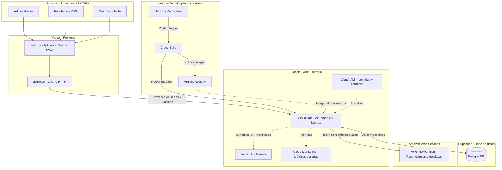

# Nexoria

Grupo 6 · Cloud Computing 2026 · Universidad Galileo

- **Integrantes:** Jean Carlo Pacheco Pérez, Rodrigo Armando Nathanael Gálvez Mazariegos
- **Proveedor cloud:** Google Cloud Platform (con Vertex AI y AWS Rekognition)
- **Servicios principales:** Cloud Run, Artifact Registry, Cloud Build, Cloud Monitoring, Cloud IAM, Vertex AI / Gemini, AWS Rekognition, Supabase PostgreSQL, Vercel
- **Repositorio:** Repositorio privado
- **Despliegue:** backend https://nexoria-backend-670955609593.us-central1.run.app
- **Documentación PDF:** no se entregó documentación en PDF
- **Video:** No se entregó video

---

# Milestone 2: Arquitectura y Despliegue Inicial — Nexoria Project

## 1. Información General del Proyecto

- **Nombre del proyecto:** `Nexoria-project`
- **ID del proyecto GCP:** `nexoria-project-511405`
- **Organización:** `rundoit1-org`
- **Proveedor principal:** Google Cloud Platform (GCP)
- **Servicios complementarios:** Supabase, Vercel y Amazon Web Services (AWS).

**Descripción:**

NEXORIA es una plataforma SaaS de administración residencial que permite gestionar condominios, residentes, propiedades, reservas, pagos y controles de acceso. Su arquitectura utiliza servicios en la nube para facilitar el despliegue, la disponibilidad y el crecimiento de la aplicación.

El proyecto integra Google Cloud Platform como infraestructura principal, Vercel para el frontend, Supabase para la base de datos PostgreSQL y AWS Rekognition para el reconocimiento de placas vehiculares.

---

## 2. Configuración de Cuenta y Facturación

- **Cuenta de facturación asociada:** `Nexoria-facturacion`
- **Estado:** Activo.
- **Gestión de costos y seguridad:** Se implementaron medidas de control financiero y monitoreo del consumo de recursos para reducir el riesgo de gastos imprevistos.
- **Optimización económica:** Se seleccionaron servicios administrados y alternativas de menor costo, adecuados para el desarrollo y las pruebas de un proyecto académico.

**Cambio de infraestructura:**

Inicialmente se utilizó Cloud SQL para alojar la base de datos PostgreSQL. Sin embargo, debido al costo de mantener este servicio, se decidió migrar a Supabase, conservando PostgreSQL como motor de base de datos.

Este cambio permite mantener la estructura relacional del sistema y reducir los costos de infraestructura sin modificar la arquitectura general del backend.

---

## 3. Servicios de la Arquitectura

### Servicio 1: Compute — GCP Cloud Run (`nexoria-backend`)

- **Tipo:** Computación sin servidor (Serverless).
- **Rol:** Ejecutar el backend desarrollado con Node.js y Express, atendiendo las solicitudes HTTP de la aplicación.
- **Región:** `us-central1`
- **Facturación:** Basada en solicitudes (Request-based).
- **Acceso:** Endpoint HTTP público, con autenticación y autorización gestionadas por la aplicación.
- **Endpoint:** `https://nexoria-backend-670955609593.us-central1.run.app`

Cloud Run permite ejecutar el backend en contenedores sin administrar servidores directamente y ajustar los recursos según la demanda.

### Servicio 2: Database — Supabase PostgreSQL

- **Tipo:** Base de datos relacional administrada.
- **Motor:** PostgreSQL.
- **Rol:** Almacenar información de usuarios, condominios, apartamentos, residentes, reservas, pagos, accesos y demás módulos del sistema.
- **Conectividad:** Comunicación con el backend de Node.js y Express.

Supabase reemplaza a Cloud SQL como proveedor de la base de datos, manteniendo PostgreSQL y el modelo relacional utilizado por NEXORIA.

### Servicio 3: Container Registry — GCP Artifact Registry

- **Tipo:** Repositorio de artefactos y contenedores.
- **Rol:** Almacenar y administrar las imágenes Docker utilizadas por el backend.

Artifact Registry conserva las imágenes generadas durante el proceso de integración y despliegue, permitiendo que Cloud Run utilice la imagen correspondiente a cada versión.

### Servicio 4: CI/CD — GCP Cloud Build y GitHub

- **Tipo:** Integración y despliegue continuo.
- **Rol:** Automatizar la construcción y publicación de nuevas versiones del backend.

**Flujo de trabajo:**

1. Se realizan cambios en el repositorio de GitHub.
2. Un push a la rama principal activa el trigger de Cloud Build.
3. Cloud Build construye la imagen Docker del backend.
4. La imagen se publica en Artifact Registry.
5. Se despliega una nueva revisión del servicio en Cloud Run.

Este proceso disminuye las tareas manuales y facilita la actualización de la aplicación.

### Servicio 5: Observability — GCP Cloud Monitoring & Alerting

- **Tipo:** Monitoreo y observabilidad.
- **Rol:** Supervisar el comportamiento del backend y el consumo de recursos.
- **Dashboard:** `Nexoria-Backend-Dashboard`

**Métricas principales:**

- Cantidad de solicitudes HTTP (`request_count`).
- Latencia de las solicitudes.
- Uso de CPU.
- Consumo de memoria.
- Estado y comportamiento del servicio.

Cloud Monitoring facilita la identificación de problemas de rendimiento y permite configurar alertas por correo electrónico.

### Servicio 6: Identity & Access — GCP Cloud IAM

- **Tipo:** Administración de identidades y permisos.
- **Rol:** Controlar el acceso a los recursos de Google Cloud.

Cloud IAM permite asignar permisos a usuarios y cuentas de servicio para administrar los recursos de infraestructura. Su propósito es limitar las operaciones según las responsabilidades de cada identidad.

### Servicio 7: Artificial Intelligence — Vertex AI / Gemini

- **Tipo:** Inteligencia artificial generativa.
- **Rol previsto:** Incorporar asistencia y consultas inteligentes dentro de NEXORIA.
- **Estado:** Integración planificada.

Vertex AI permitirá incorporar funcionalidades de inteligencia artificial utilizando los modelos Gemini, aprovechando la infraestructura de Google Cloud.

### Servicio 8: Computer Vision — AWS Rekognition

- **Tipo:** Servicio de inteligencia artificial para análisis de imágenes.
- **Rol:** Reconocimiento de placas vehiculares dentro del módulo de garita.
- **Estado:** Integración operativa.

AWS Rekognition se utiliza para analizar imágenes de vehículos y extraer información relacionada con las placas, facilitando su procesamiento dentro del sistema de control de accesos.

### Servicio 9: Frontend — Vercel

- **Tipo:** Plataforma de alojamiento y despliegue web.
- **Tecnología:** Next.js.
- **Rol:** Publicar la aplicación web y PWA de NEXORIA.

Vercel aloja las interfaces de administrador, guardia y residente. Estas se comunican con el backend mediante peticiones HTTPS a la API REST.

---

## 4. Arquitectura y Ruta hacia la Entrega Final

La arquitectura de NEXORIA se distribuye entre distintos proveedores para aprovechar los servicios que mejor se adaptan a las necesidades y al presupuesto del proyecto.

| Plataforma | Servicio | Función |
|---|---|---|
| Google Cloud | Cloud Run | Ejecución del backend |
| Supabase | PostgreSQL | Base de datos relacional |
| Google Cloud | Artifact Registry | Imágenes Docker |
| Google Cloud | Cloud Build | Integración y despliegue continuo |
| Google Cloud | Cloud Monitoring | Métricas y alertas |
| Google Cloud | Cloud IAM | Identidades y permisos |
| Google Cloud | Vertex AI / Gemini | Inteligencia artificial planificada |
| AWS | Rekognition | Reconocimiento de placas |
| Vercel | Next.js | Aplicación web y PWA |

**Funcionamiento general:**

Los usuarios acceden a NEXORIA mediante la aplicación alojada en Vercel. Las solicitudes se envían al backend en Cloud Run, que procesa la lógica del sistema y utiliza Supabase PostgreSQL para almacenar o consultar información.

Para las funciones de reconocimiento de placas, el backend se comunica con AWS Rekognition. El proceso de actualización del backend se automatiza mediante GitHub, Cloud Build y Artifact Registry.

Google Cloud Monitoring permite observar el rendimiento del servicio, mientras que Cloud IAM administra los permisos sobre los recursos de Google Cloud.

---

## 5. Diagrama de Arquitectura Actualizado

El siguiente diagrama representa los componentes principales de NEXORIA, sus proveedores y las conexiones entre el frontend, backend, base de datos, servicios de inteligencia artificial y herramientas de despliegue.

**Descripción del diagrama:**

El diagrama muestra la distribución de los servicios de NEXORIA entre Vercel, Google Cloud, Supabase y AWS. También representa el flujo de comunicación de los usuarios con el backend, el acceso a la base de datos y el proceso automatizado de construcción y despliegue.

La conexión con Vertex AI se representa mediante una línea discontinua porque corresponde a una integración planificada.

---

## 6. Conclusión

La arquitectura de NEXORIA permite integrar diferentes servicios en la nube para desarrollar una plataforma de administración residencial escalable y organizada.

La utilización de Cloud Run simplifica la ejecución del backend, mientras que Supabase PostgreSQL proporciona una alternativa de almacenamiento relacional con menores costos para el proyecto. Por otro lado, Cloud Build y Artifact Registry permiten automatizar los despliegues, y Cloud Monitoring facilita la supervisión del sistema.

Finalmente, la integración de AWS Rekognition incorpora funcionalidades de reconocimiento de placas y demuestra cómo NEXORIA puede combinar servicios de distintos proveedores dentro de una misma arquitectura.
