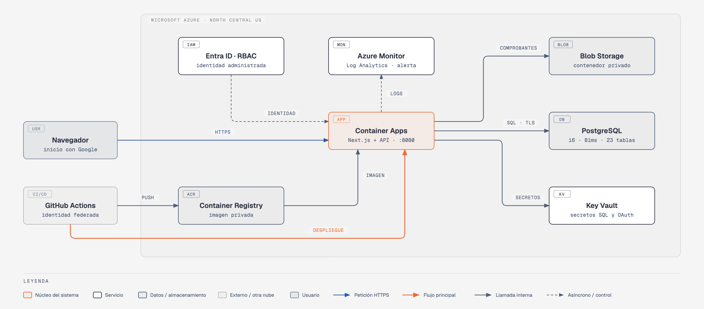
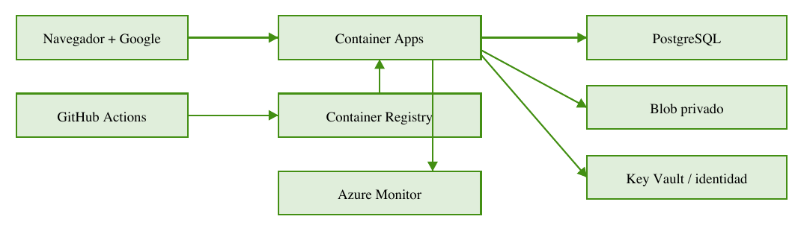

# Semilla — asistente de gestión para pequeños negocios

Cloud Computing 2026 · Universidad Galileo

- **Integrantes:** Lizardo Enmanuel González Méndez, Jessell Andrea Contreras Escobar
- **Proveedor cloud:** Microsoft Azure
- **Servicios principales:** Azure Container Apps, Azure Database for PostgreSQL, Azure Blob Storage, Microsoft Entra ID / RBAC, Azure Key Vault, Azure Monitor, GitHub Actions (con Azure Container Registry como auxiliar)
- **Repositorio:** https://github.com/lizardoenm12/semilla-cloud
- **Despliegue:** https://app-asistente-negocios-dev.redplant-0de50877.northcentralus.azurecontainerapps.io
- **Documentación PDF:** [documentacion.pdf](documentacion.pdf)
- **Video:** [Video de demostración](video.mp4)

---

> Contenido convertido del informe técnico entregado por el equipo ([documentacion.pdf](documentacion.pdf)).

## Asistente Negocios

Informe técnico | Universidad Galileo | Lizardo Gonzalez y Jessel Contreras

Aplicación web para registrar operaciones, consultar inventario y adjuntar comprobantes. El usuario revisa la propuesta antes de confirmar; el texto se interpreta mediante reglas.

[Abrir el proyecto publicado](https://app-asistente-negocios-dev.redplant-0de50877.northcentralus.azurecontainerapps.io/)

## Arquitectura

## Siete servicios del proyecto

| Servicio | Función |
|---|---|
| Azure Container Apps | Ejecuta Next.js y la API por HTTPS. |
| Azure Database for PostgreSQL | Conserva operaciones, inventario y sesiones; 23 tablas. |
| Azure Blob Storage | Guarda comprobantes en el contenedor privado comprobantes. |
| Microsoft Entra ID / RBAC | Identidades administradas y roles acotados para aplicación y despliegue. |
| Azure Key Vault | La identidad de la app lee únicamente los secretos SQL y OAuth que necesita. |
| Azure Monitor | Log Analytics recibe eventos y una regla evalúa errores. |
| ACR - auxiliar, no contado | Guarda la imagen privada que descarga Container Apps. |
| GitHub Actions | Construye la imagen y publica la revisión con identidades federadas. |

## Despliegue paso a paso

1. Seleccionar Azure for Students y comprobar que el límite de gasto esté activo. Usar el grupo `rg-asistente-negocios-m2`.
2. Preparar PostgreSQL 16 B1ms con 32 GiB y la base negocios. Se restauró el esquema del respaldo, sin copiar datos ni sesiones anteriores. Crear un rol SQL limitado a las operaciones de la aplicación.
3. Crear o reutilizar Storage, el contenedor privado comprobantes y Key Vault. Guardar la URL SQL y el secreto OAuth en Key Vault. Asignar permisos por secreto y contenedor a `identidad-negocios-m2`.
4. Preparar ACR Basic y Container Apps con perfil Consumption, 0.5 vCPU, 1 GiB, puerto 8080 y escala 0 a 1. Configurar URL canónica HTTPS y variables que referencian secretos, nunca sus valores.
5. Autorizar en Google el retorno `/api/auth/callback` sobre la URL publicada. El inicio interactivo fue confirmado por el usuario después de configurar Key Vault.
6. Permitir en PostgreSQL las IP de salida de Container Apps. Se verificaron 181 IP y se retiró la regla amplia para todos los servicios Azure. La app exige TLS.
7. Configurar la federación de GitHub Actions para la rama principal. El job image construye y sube la imagen; deploy actualiza la app con permisos limitados. Revisar [infra/deployment.json](https://github.com/lizardoenm12/semilla-cloud/blob/main/infra/deployment.json) y [.github/workflows/imagen-dev.yml](https://github.com/lizardoenm12/semilla-cloud/blob/main/.github/workflows/imagen-dev.yml) en el repositorio.
8. Enviar consola y eventos de sistema al workspace `log-asistente-negocios`. Guardar las consultas y habilitar la regla de errores de 15 minutos. Retención: 30 días; límite diario de ingesta: 0.025 GB.

## Seguridad y comprobaciones

Google verifica a la persona. Las membresías restringen el negocio al que puede acceder. Las identidades Azure autorizan al servidor. No se guardan secretos en Git ni se publica acceso anónimo a Blob.

Se comprobó HTTPS 200, versión desplegada y rechazo 401 en la API privada sin sesión. Log Analytics recibió un evento de arranque de la revisión. La alerta está habilitada; no se simuló un incidente para probar el correo.

[Ejecución verificada de GitHub Actions: 42533221752](https://github.com/lizardoenm12/semilla-cloud/actions/runs/42533221752)

[Repositorio del proyecto](https://github.com/lizardoenm12/semilla-cloud) (acceso sujeto a permisos)

## Estimación mensual de costos

Escenario de piloto: 10 usuarios activos, 30 acciones diarias por persona, 30 días y 8 solicitudes API estimadas por acción: 72,000 solicitudes al mes. Son supuestos de uso, no capacidad medida. La app puede bajar a cero en inactividad. Los comprobantes son pequeños y ocasionales.

| Componente | USD/mes | Supuesto de planificación |
|---|---|---|
| PostgreSQL | 18.18 | Referencia histórica B1ms, 32 GiB y 730 h. |
| Container Apps | 0–5 | Poco tráfico y escala 0–1. Depende de las horas activas. |
| ACR, Blob, Vault y Monitor | 5–10 | Reserva conjunta; ACR persistente, archivos y consultas limitados. |
| Entra/RBAC y GitHub Actions | Sin cargo incremental presupuestado | No se añadió licencia Entra. Actions se contabiliza aparte según su plan y minutos. |
| **Total estimado** | **23.18–33.18** | Reserva redondeada: USD 25–35 antes de impuestos. |

Las referencias monetarias provienen de la proyección histórica del proyecto, no de una cotización vigente para North Central US. El crédito estudiantil y los beneficios disponibles pueden modificar el importe pagado. Para recalcular, medir tiempo de réplica, tamaño y cantidad de archivos, ingesta y minutos de CI.

Como referencia histórica para Monitor, 0.75 GB/mes a USD 2.76/GB más una regla a USD 0.50/mes da USD 2.57, incluido en la reserva conjunta. El límite de ingesta no garantiza un tope de facturación.

## Documentación adicional

Documentos técnicos del repositorio sobre la solución cloud (algunos conservan estados intermedios del proyecto, como indica cada documento):

- [Servicios de Azure](docs/servicios-azure.md)
- [Despliegue en Azure, guía por etapas](docs/despliegue.md)
- [CI/CD](docs/cicd.md)
- [Key Vault](docs/keyvault.md)
- [PostgreSQL](docs/postgresql.md)
- [Observabilidad con Azure Monitor](docs/observabilidad.md)
- [Costos, crédito y cierre](docs/costos-y-cierre.md)
- [Defensa técnica y decisiones del proyecto cloud](docs/defensa-tecnica-cloud.md)
- [Diagrama de arquitectura provisional (SVG)](docs/arquitectura-provisional.svg)
