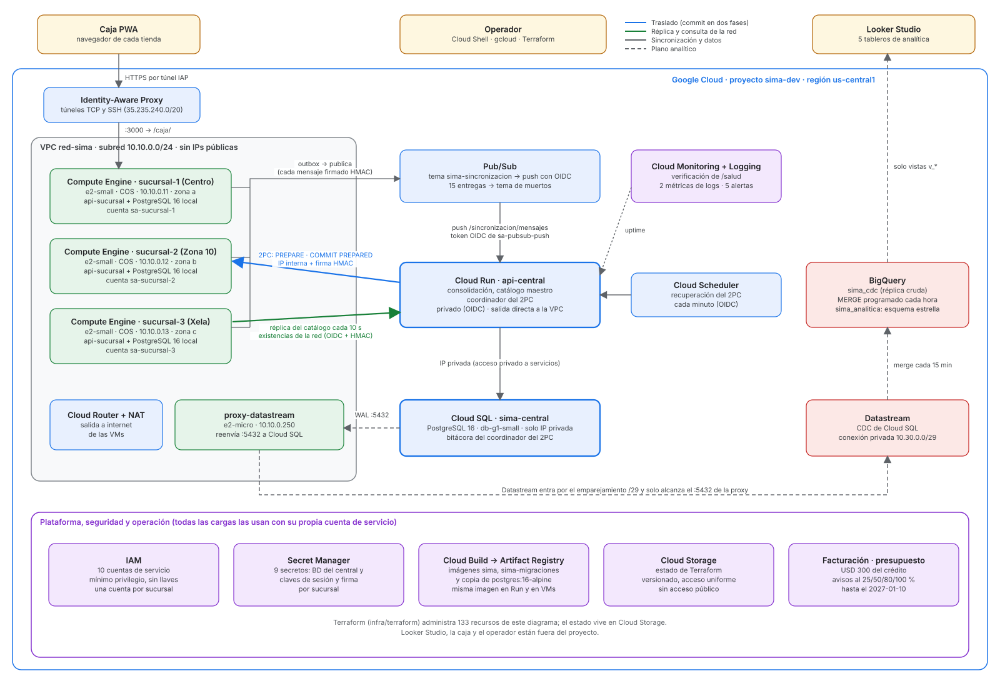

# SIMA en Google Cloud

**Documentación del proyecto de Cloud Computing** · Universidad Galileo, FISICC · Segundo semestre 2026

| | |
|---|---|
| **Curso** | Cloud Computing — Ing. Adrián Catalán |
| **Integrantes** | David Alejandro Ortega Reyes · Dilan Jareth Arreaga Tiu |
| **Proyecto** | SIMA — Sistema de inventario distribuido multisucursal (proyecto conjunto con Ingeniería de Software y Ciencias de la Computación VI) |
| **Proveedor** | Google Cloud Platform · proyecto `<id-proyecto>` · región `us-central1` |
| **Repositorio** | Repositorio privado |

## Enlaces de la entrega

| Entregable | Enlace |
|---|---|
| Proyecto desplegado: `api-central` (Cloud Run, privado) | `https://api-central-3ajtjckllq-uc.a.run.app` — responde `403` sin token por diseño (sección 7.3); `GET /salud` con token de identidad |
| Video de demostración (5–7 min) | [Video de demostración](../video.mp4) |
| Infraestructura como código (bono) | `infra/terraform/` — 133 recursos administrados |

## Contenido

1. [Resumen](#1-resumen)
2. [Qué le pide SIMA a la nube](#2-qué-le-pide-sima-a-la-nube)
3. [Arquitectura](#3-arquitectura)
4. [Servicios utilizados](#4-servicios-utilizados)
5. [Cómo se integran: los cinco flujos](#5-cómo-se-integran-los-cinco-flujos)
6. [Red](#6-red)
7. [Seguridad](#7-seguridad)
8. [Observabilidad y pruebas en la nube](#8-observabilidad-y-pruebas-en-la-nube)
9. [Infraestructura como código (Terraform)](#9-infraestructura-como-código-terraform)
10. [Despliegue paso a paso](#10-despliegue-paso-a-paso)
11. [Estimación de costos](#11-estimación-de-costos)
12. [Escalabilidad y manejo de recursos](#12-escalabilidad-y-manejo-de-recursos)
13. [Limitaciones conocidas](#13-limitaciones-conocidas)

---

## 1. Resumen

SIMA es un sistema de inventario para cadenas minoristas con varias sucursales. Cada sucursal corre su propio
nodo, con su propia base PostgreSQL, y **sigue vendiendo aunque se caiga el internet**. Cuando hay enlace, la
sucursal sincroniza contra un nodo central que consolida la red, administra el catálogo maestro y coordina los
traslados de mercadería entre sucursales con **commit en dos fases (2PC)**.

En Google Cloud, las tres sucursales son máquinas virtuales de Compute Engine en zonas distintas, la central es un
servicio privado de Cloud Run con su base en Cloud SQL, la sincronización viaja por Pub/Sub, la recuperación del
2PC la dispara Cloud Scheduler y la analítica se separa por completo de la operación: Datastream copia los cambios
de Cloud SQL a BigQuery, donde un esquema estrella alimenta los tableros de Looker Studio.

El proyecto usa **14 servicios de Google Cloud** (sección 4), ninguno de Firebase. Toda la infraestructura está
descrita en Terraform (133 recursos, con el estado en Cloud Storage) y se verifica con un script que hace llamadas
reales contra el ambiente: la última corrida completa dio **87 de 87** comprobaciones operativas y **28 de 28**
analíticas (3 de noviembre de 2026).

## 2. Qué le pide SIMA a la nube

La decisión de arquitectura que ordena todo el proyecto es que **no todas las operaciones necesitan la misma
garantía**. Cada servicio de la nube se eligió para cumplir una fila de esta tabla:

| Operación | Ejemplo | Garantía | Dónde se resuelve en GCP |
|---|---|---|---|
| Local a una sucursal | Venta, ajuste, recepción | Transacción ACID en la base local; **nunca requiere red** | PostgreSQL dentro de la VM de la sucursal (Compute Engine) |
| Propagar lo local | Avisar a la central de cada venta | Al menos una vez, idempotente | Outbox en la misma transacción → Pub/Sub → `api-central` |
| Cruza dos sucursales | Traslado de mercadería | Atómica en ambas puntas (2PC) | Coordinador en Cloud Run, bitácora en Cloud SQL, recuperación por Cloud Scheduler |
| Global de solo lectura | Existencias de la red | Consistencia eventual, con la antigüedad del dato a la vista | Consulta a `api-central`; copia local en la sucursal para cuando no hay enlace |
| Analítica | Rotación, capital dormido, utilidad | Nunca contra la base operativa | Datastream → BigQuery → Looker Studio |

Lo que la nube **no** hace es igual de importante: una venta jamás consulta a la central, y ningún tablero toca
Cloud SQL ni la base de una sucursal.

## 3. Arquitectura



*Figura 1. Arquitectura desplegada.*

La arquitectura tiene tres planos:

- **Plano operativo** (verde y azul). Las tres sucursales viven en una VPC sin IPs públicas, cada una en una zona
  distinta (`us-central1-a`, `-b`, `-c`) para que la falla de una zona no tumbe a más de una tienda. La central
  (`api-central`) es un servicio de Cloud Run que entra a la VPC por salida directa: así alcanza a Cloud SQL por IP
  privada y a cada sucursal por su IP interna fija (`10.10.0.11` a `.13`) durante el 2PC.
- **Plano analítico** (rojo, líneas punteadas). Datastream lee el WAL de Cloud SQL a través de una VM pequeña
  (`proxy-datastream`) y escribe en BigQuery cada 15 minutos. Una consulta programada arma el esquema estrella cada
  hora. Looker Studio solo lee las vistas `v_*` de ese esquema.
- **Plataforma** (morado). IAM, Secret Manager, Cloud Build con Artifact Registry, Cloud Storage, Cloud Monitoring
  con Logging y el presupuesto de facturación. Cada carga de trabajo los usa con su propia cuenta de servicio.

**Topología de la demo final.** Para demostrar el corte de internet apagando el Wi-Fi de una laptop real, la
sucursal 1 (Centro) puede correr en la laptop con Docker mientras la central y las sucursales 2 y 3 siguen en GCP.
La laptop llega a GCP suplantando a `sa-sucursal-1` sin llaves, y la central la alcanza por un túnel SSH inverso
sobre IAP hacia la VM `sucursal-1`, que queda con un candado para que nunca existan dos nodos «sucursal 1». El
procedimiento está en [`docs/despliegue-gcp.md`](despliegue-gcp.md) (partes B y C) y las decisiones en
[`docs/decisiones.md`](decisiones.md) (2 y 3 de noviembre).

## 4. Servicios utilizados

| # | Servicio | Categoría del enunciado | Rol en SIMA |
|---:|---|---|---|
| 1 | **Compute Engine** | Compute | Las tres sucursales (`e2-small`, Container-Optimized OS) y la VM `proxy-datastream` (`e2-micro`) |
| 2 | **Cloud Run** | Compute | `api-central`: consolidación, catálogo maestro y coordinador del 2PC; jobs `migrar-central` y `cdc-central` |
| 3 | **Cloud SQL para PostgreSQL 16** | Database | Base de la central y bitácora del coordinador del 2PC |
| 4 | **BigQuery** | Database (analítica) | Réplica cruda (`sima_cdc`) y esquema estrella (`sima_analitica`) |
| 5 | **Cloud Storage** | Storage | Estado remoto de Terraform con bloqueo y versionado; informes generados en GCP |
| 6 | **Pub/Sub** | Mensajería | Sincronización sucursal → central, con reintentos y tema de mensajes muertos |
| 7 | **Datastream** | Integración de datos | Captura de cambios (CDC) de Cloud SQL hacia BigQuery |
| 8 | **VPC, Cloud NAT, acceso privado a servicios e Identity-Aware Proxy** | Networking | Red privada, salida a internet sin IPs públicas, Cloud SQL por IP privada y acceso administrativo sin puertos abiertos |
| 9 | **Cloud IAM** | Security | 10 cuentas de servicio con permisos mínimos, una por sucursal; ninguna llave descargada |
| 10 | **Secret Manager** | Security | Contraseñas de la base y claves de sesión y de firma de cada sucursal |
| 11 | **Cloud Monitoring y Cloud Logging** | Monitoring and Logging | Verificación de `/salud`, dos métricas basadas en logs y cinco políticas de alerta |
| 12 | **Cloud Build y Artifact Registry** | CI/CD | Construyen y guardan las imágenes; la misma imagen corre en Cloud Run y en las VMs |
| 13 | **Cloud Scheduler** | Orquestación | Dispara cada minuto la recuperación del coordinador del 2PC |
| 14 | **Cloud Billing (presupuestos)** | Gestión de costos | Presupuesto sobre el crédito con avisos al 25, 50, 80 y 100 % |

Además, **Terraform** describe todo lo anterior (bono de infraestructura como código) y **Looker Studio** presenta los
tableros; ninguno de los dos se cuenta entre los servicios. El proyecto **no usa ningún producto de Firebase**: la
base es Cloud SQL administrada desde la consola y la CLI de GCP, el almacenamiento es Cloud Storage y la
autenticación de la caja es propia (sesión firmada por la sucursal).

### 4.1 Compute Engine — las sucursales

| Parámetro | Valor | Por qué |
|---|---|---|
| VMs | `sucursal-1`, `-2`, `-3` | Una tienda por VM, cada una autónoma |
| Tipo | `e2-small` (2 vCPU compartidas, 2 GB) | Alcanza para la API y PostgreSQL de una tienda; ver pruebas de carga (8.3) |
| Zonas | `us-central1-a`, `-b`, `-c` | Una falla de zona afecta a una sola sucursal |
| Imagen | Container-Optimized OS (`cos-stable`) | Solo corre contenedores; superficie de ataque mínima |
| Disco | 20 GB `pd-balanced` | Guarda la base de la sucursal; `prevent_destroy` en Terraform |
| Red | Sin IP pública; IP interna estática reservada | El coordinador busca a la sucursal N en `10.10.0.1N` |
| Seguridad | VM blindada (arranque seguro, vTPM, monitoreo de integridad) | Detecta un arranque alterado |
| Cuenta | `sa-sucursal-N`, una por VM | Cada VM lee solo sus propias claves |

Cada VM arranca con `infra/gcp/sucursal/arranque.sh`: lee de los metadatos su
número de sucursal y la URL de la central, descarga las imágenes de Artifact Registry, lee sus dos claves de Secret
Manager con el token de su cuenta (guarda una copia `0600` para poder arrancar sin internet), levanta PostgreSQL 16
con `max_prepared_transactions > 0` (es participante del 2PC), aplica las migraciones y arranca `api-sucursal`, que
también sirve la caja PWA en `/caja/`.

La VM `proxy-datastream` (`e2-micro`, Debian 12, `10.10.0.250`) solo reenvía el puerto 5432 hacia la IP privada de
Cloud SQL. No tiene cuenta de servicio porque no llama a ninguna API.

### 4.2 Cloud Run — la central

| Parámetro | Valor | Por qué |
|---|---|---|
| Servicio | `api-central` | Consolidación, catálogo maestro, consulta de la red, coordinador del 2PC |
| Recursos | 1 vCPU, 512 MiB | Suficiente para el volumen de tres sucursales |
| Escalado | 0 a 2 instancias; CPU solo durante las peticiones | Sin costo de CPU en reposo; la recuperación del 2PC no depende de una instancia viva (la dispara Cloud Scheduler) |
| Red | Salida directa a la VPC (`PRIVATE_RANGES_ONLY`) | Llega a Cloud SQL y a las sucursales por IP privada, sin conector |
| Acceso | Privado: sin `allUsers`; solo invocan las cuentas listadas en `acceso-central.tf` | La central no queda expuesta a internet |
| Secretos | `BD_URL` y `SERVICIO_CLAVE_S1..S3` desde Secret Manager | Ningún valor en la imagen ni en el repositorio |

Dos jobs de Cloud Run completan la central: `migrar-central` aplica las migraciones SQL numeradas, y `cdc-central`
prepara la base para Datastream (usuario de replicación, publicación y slot).

### 4.3 Cloud SQL — la base de la central

| Parámetro | Valor | Por qué |
|---|---|---|
| Instancia | `sima-central`, PostgreSQL 16, edición Enterprise | Mismo motor y versión que las sucursales |
| Tipo | `db-g1-small`, zonal | Costo de desarrollo; la alta disponibilidad se costea en el escenario de producción (11.4) |
| Disco | 10 GB SSD con crecimiento automático | El WAL que retiene el slot de Datastream puede crecer |
| Red | **Solo IP privada** (acceso privado a servicios); sin IP pública | Nadie desde internet llega a la base |
| Banderas | `max_prepared_transactions=20`, `cloudsql.logical_decoding=on` | 2PC nativo de PostgreSQL y CDC para Datastream |
| Respaldos | Diarios a las 08:00, se conservan 7 | Recuperación ante un error de despliegue |

### 4.4 Pub/Sub — la sincronización

| Recurso | Configuración |
|---|---|
| Tema `sima-sincronizacion` | Las sucursales publican cada fila de su outbox |
| Suscripción `sima-sincronizacion-push` | Push a `api-central /sincronizacion/mensajes` con token OIDC de `sa-pubsub-push`; plazo de 30 s; reintentos de 10 s a 10 min; retención 7 días; sin vencimiento |
| Tema `sima-sincronizacion-muertos` y su suscripción | Tras 15 entregas fallidas el mensaje pasa aquí; `scripts/pubsub/muertos.mjs` los revisa y los reenvía |

No se usan claves de orden: la central aplica cada mensaje con una **guarda de versión** (un mensaje viejo no pisa
uno nuevo) y una tabla de idempotencia (`inbox_idempotencia`), así que el orden de llegada no importa y un duplicado
no se aplica dos veces.

### 4.5 Cloud Scheduler — la recuperación del 2PC

El job `sima-recuperacion-2pc` llama cada minuto a la recuperación del coordinador con un token OIDC de `sa-scheduler`.
Como Cloud Run puede estar en cero instancias, sin este job un traslado que quedó a medias esperaría a la próxima
petición. La recuperación aplica la bitácora: `INICIADO` vencido se aborta, `COMPROMETIDO` reenvía `COMMIT PREPARED`
y `ABORTADO` reenvía `ROLLBACK PREPARED`.

### 4.6 Datastream y BigQuery — la analítica

| Pieza | Configuración |
|---|---|
| Conexión privada | Emparejamiento de VPC con el rango `10.30.0.0/29`; el firewall solo deja llegar al 5432 de `proxy-datastream` |
| Stream `sima-central-cdc` | Desde la publicación `sima_cdc` de Cloud SQL, modo *merge*, con *backfill* completo; frescura de 15 min |
| Dataset `sima_cdc` | Una tabla `public_<tabla>` por cada tabla de la central |
| Dataset `sima_analitica` | Dimensiones, `hecho_movimiento`, historia simulada (marcada `origen = 'SIMULADO'`) y las vistas de los tableros |
| Consulta programada | `MERGE` de `hecho_movimiento` cada hora, con la cuenta `sa-analitica` |
| Looker Studio | 5 páginas: movimientos, rotación, capital dormido, reposición y salud de la sincronización ([`docs/tableros.md`](tableros.md)) |

`verificar-gcp.sh` comprueba que ninguna vista use `EXTERNAL_QUERY`: la analítica jamás consulta la base operativa.

### 4.7 Secret Manager

| Secreto | Lo lee |
|---|---|
| `sima-db-central-password` | Nadie en ejecución: es la contraseña de origen con la que se arma la URL |
| `sima-bd-url-central` | `sa-api-central` y `sa-cdc` (la cadena de conexión completa) |
| `sima-db-replicacion-password` | `sa-cdc`, al preparar la base para Datastream |
| `sima-sesion-clave-s1..s3` | Solo la sucursal correspondiente (`sa-sucursal-N`) |
| `sima-servicio-clave-s1..s3` | La sucursal correspondiente y `sa-api-central` (que no lee las claves de sesión) |

Terraform crea los contenedores y los permisos, **nunca los valores**, para que no queden en el estado. Los valores
los genera `infra/gcp/12-claves.sh` con `openssl` y los envía por tubería a
`gcloud secrets versions add`: no tocan el disco, no se imprimen y no quedan en el historial.

### 4.8 Cloud Build y Artifact Registry

`infra/gcp/cloudbuild.yaml` construye en paralelo la imagen `sima` (la misma para
`api-central` y `api-sucursal`; la variable `PAQUETE` decide cuál arranca), la imagen `sima-migraciones` y una copia
de `postgres:16-alpine` en el registro del proyecto, para que las VMs no dependan de Docker Hub al arrancar. Cada
imagen se etiqueta con el commit. La construcción se lanza con `infra/gcp/04-imagenes.sh`.

### 4.9 Cloud Storage

El bucket `gs://<id-proyecto>-tfstate` (región `us-central1`, versionado, acceso uniforme, sin acceso público)
guarda el estado de Terraform con bloqueo, de modo que dos `apply` no pueden pisarse. Lo crea
`infra/terraform/arranque-estado.sh` fuera de Terraform, porque el estado no puede vivir en un recurso que él mismo
administra. También guarda informes generados en GCP (por ejemplo, el borrador de las pruebas de carga).

## 5. Cómo se integran: los cinco flujos

**1. Una venta (sin red).** La caja llama a `api-sucursal` en la VM. En **una sola transacción** de la base local se
descuenta la existencia con bloqueo pesimista (`SELECT … FOR UPDATE`, espera máxima 3 s), se escriben el documento,
el movimiento del kárdex y la fila del **outbox**. Nada de esto sale de la VM: la venta se confirma aunque la VPC no
tenga salida.

**2. Sincronización (cuando hay enlace).** El publicador de la sucursal toma las filas pendientes del outbox
(`SKIP LOCKED`), firma cada mensaje con la clave de servicio de la sucursal y lo publica en Pub/Sub con la identidad
de su VM. Pub/Sub lo entrega por push con OIDC a `api-central`, que lo aplica de forma idempotente en Cloud SQL. Si
la central falla, Pub/Sub reintenta; tras 15 intentos el mensaje queda en el tema de muertos sin perderse.

**3. Réplica central → sucursal.** Cada 10 s la sucursal pide a la central los cambios del catálogo, los usuarios y
la lista de costos (token OIDC del metadata server + firma HMAC). Las altas de productos y de empleados que hace el
administrador llegan así a las tres tiendas.

**4. Traslado entre sucursales (2PC).** La sucursal destino pide el traslado. El coordinador, en Cloud Run, escribe
la transacción global en Cloud SQL **antes** de avisar a nadie, llama a `POST /traslados/:id/preparar` en el origen y
en el destino por IP interna (con firma HMAC), y cada uno deja su parte en `PREPARE TRANSACTION`. Con los dos votos
SÍ registra `COMPROMETIDO` y envía `COMMIT PREPARED`; con un NO o un plazo vencido, aborta. Si Cloud Run muere a
mitad, Cloud Scheduler dispara la recuperación al minuto siguiente; si una sucursal queda con una transacción
preparada huérfana, su reconciliador consulta la decisión a la central y solo deshace ante un «desconocido»
explícito.

**5. Analítica.** Datastream lleva cada cambio de Cloud SQL a `sima_cdc` (≤ 15 min), la consulta programada lo
integra al esquema estrella (≤ 60 min) y Looker Studio lo muestra. Un movimiento tarda hasta unos 75 minutos en verse
en un tablero; a cambio, la carga analítica nunca compite con la operación.

## 6. Red

| Elemento | Valor | Para qué |
|---|---|---|
| VPC | `red-sima` (modo personalizado) | Red propia del proyecto |
| Subred | `subred-sima`, `10.10.0.0/24`, con acceso privado a Google | VMs, salida directa de Cloud Run y la proxy |
| IPs reservadas | `10.10.0.11`–`.13` (sucursales), `10.10.0.250` (proxy) | Cloud Run toma IPs de la misma subred: reservarlas evita que se quede con la de una sucursal recreada |
| Acceso privado a servicios | `10.20.0.0/20` | IP privada de Cloud SQL |
| Emparejamiento de Datastream | `10.30.0.0/29` | Conexión privada de Datastream |
| Cloud Router + Cloud NAT | `router-sima`, `nat-sima` (IPs automáticas) | Salida a internet de VMs sin IP pública |
| Firewall `permitir-interno` | TCP, UDP e ICMP desde `10.10.0.0/24` | Tráfico entre la central y las sucursales |
| Firewall `permitir-ssh-iap` | TCP 22 desde `35.235.240.0/20` | Solo Identity-Aware Proxy puede abrir SSH o túneles |
| Firewall `permitir-datastream-proxy` | TCP 5432 desde `10.30.0.0/29` hacia la etiqueta `proxy-datastream` | Datastream solo alcanza el reenvío |

No hay ninguna regla abierta a `0.0.0.0/0`. Para simular la caída del enlace de una sucursal en GCP,
`infra/gcp/07-corte-enlace.sh` agrega reglas temporales `corte-*` (y `iptables` en la VM) que se retiran al
restaurar; quedan fuera de Terraform a propósito.

## 7. Seguridad

### 7.1 Identidades (IAM)

Ninguna cuenta de servicio tiene llaves descargadas. Las VMs obtienen sus tokens del metadata server, Cloud Run y
Cloud Scheduler los emiten con su agente de servicio, y quien opera usa su propia cuenta en Cloud Shell. Todos los
permisos se dan con `*_iam_member` (no autoritativos), así que Terraform no borra permisos que no conoce.

| Cuenta de servicio | Permisos | Usada por |
|---|---|---|
| `sa-sucursal-1`, `-2`, `-3` | `logging.logWriter`, `monitoring.metricWriter`; lector de Artifact Registry; publicador en el tema de sincronización; `run.invoker` sobre `api-central`; `secretAccessor` **solo** sobre sus dos secretos | Cada VM de sucursal |
| `sa-api-central` | `logging.logWriter`; `secretAccessor` sobre la URL de la base y las claves de servicio | Cloud Run `api-central` |
| `sa-pubsub-push` | `run.invoker` sobre `api-central` | Entrega push de Pub/Sub |
| `sa-scheduler` | `run.invoker` sobre `api-central` (el agente de Cloud Scheduler tiene `serviceAccountTokenCreator` sobre ella) | Job de recuperación del 2PC |
| `sa-cdc` | `logging.logWriter`; `secretAccessor` sobre la URL de la base y la contraseña de replicación | Job `cdc-central` |
| `sa-analitica` | `bigquery.jobUser`; `dataViewer` en `sima_cdc`; `dataEditor` en `sima_analitica` | Consulta programada del `MERGE` |
| `sa-sucursal` | La cuenta compartida anterior; **pendiente de retiro** (13) | Ninguna VM la usa desde el 28 de octubre |

Además, el agente de Cloud Monitoring tiene `run.invoker` para la verificación de `/salud`, y la cuenta de quien
opera tiene `serviceAccountTokenCreator` sobre `sa-sucursal-1` solo para la demo híbrida (la laptop suplanta a la
sucursal sin llave).

**Por qué una cuenta por sucursal.** Con una cuenta compartida, cualquier VM podía leer la clave de firma de otra
sucursal y hacerse pasar por ella. Desde el 28 de octubre cada VM solo puede leer sus propios secretos.

### 7.2 Red privada

Ni las sucursales, ni la proxy, ni Cloud SQL tienen IP pública. La central es un servicio sin acceso anónimo. El
único camino de un humano a una VM es Identity-Aware Proxy, que exige su cuenta de Google y el permiso de IAP.

### 7.3 Autenticación en capas

| Capa | Mecanismo |
|---|---|
| Cloud Run | Token OIDC de una cuenta autorizada; sin token, `403` antes de llegar al código |
| Entre nodos | Firma HMAC-SHA256 por petición con una clave distinta por sucursal (`X-SIMA-Firma`), sobre método, ruta, marca de tiempo y hash del cuerpo; ventana de ±60 s. La central identifica a la sucursal por la firma, no por el cuerpo. Va en las dos direcciones |
| Caja | Usuario y contraseña validados en la propia sucursal (funciona sin internet), sesión firmada con la clave de sesión de esa sucursal y roles por ruta (cajero, encargado, administrador) |

La firma HMAC se suma al OIDC; no lo reemplaza. Así, una cuenta de servicio robada no basta para firmar como una
sucursal, y una clave de firma robada no basta para entrar a Cloud Run.

### 7.4 Datos e integridad

- Secretos solo en Secret Manager; ninguno en el repositorio, en las imágenes ni en el estado de Terraform.
- El kárdex (`movimiento`) es inmutable: un trigger rechaza `UPDATE` y `DELETE`.
- Ventas y recepciones llevan una llave de idempotencia (UUID con índice único): un doble clic o un reintento no
  cobra dos veces.
- Respaldos diarios de Cloud SQL (7) y, antes de cada despliegue, snapshots de los discos y respaldo lógico de cada
  sucursal ([`docs/despliegue-gcp.md`](despliegue-gcp.md)).
- `prevent_destroy` en Terraform sobre la red, la subred, Cloud SQL, las VMs y los secretos: un plan que intente
  destruirlos falla.

### 7.5 Control de costos como seguridad

El presupuesto avisa al 25, 50, 80 y 100 % del crédito, y el proyecto **nunca se pasó a cuenta de pago**: si el
crédito se agota, los servicios se detienen en lugar de generar deuda.

## 8. Observabilidad y pruebas en la nube

### 8.1 Monitoreo y alertas

| Qué | Condición | Por qué ese umbral |
|---|---|---|
| Verificación de disponibilidad de `/salud` | HTTPS cada 5 min con OIDC; falla si no responde `"estado":"OK"` desde más de una región | `/salud` responde 503 si la base no contesta: también detecta una Cloud SQL caída |
| CPU de Cloud SQL | > 80 % durante 10 min | `db-g1-small` comparte un núcleo; un pico corto es normal |
| Disco de Cloud SQL | > 80 % | Lo que puede llenarlo es el WAL retenido por el slot de Datastream |
| Errores de `api-central` (métrica de logs) | Más de 5 en 10 min | Un 503 aislado al arrancar no es un incidente |
| Traslado 2PC sin resolver (métrica de logs) | Al menos 1 en 10 min | Un traslado en duda bloquea mercadería: se avisa con el primero |
| Presupuesto | 25, 50, 80 y 100 % de USD 300 | El crédito es un total, no un monto mensual |

`encender-apagar.sh apagar` deshabilita las cinco políticas antes de apagar, para que un ambiente apagado no
dispare alertas; `encender` las habilita al final. Los registros de las VMs, de Cloud Run y de los jobs llegan a
Cloud Logging con su cuenta de servicio.

### 8.2 Verificación del despliegue

`infra/gcp/verificar-gcp.sh` comprueba el ambiente real con llamadas de verdad:
salud de cada nodo, inicio de sesión, réplica, ventas con idempotencia, sincronización por Pub/Sub, un traslado 2PC
firmado de punta a punta, corte de enlace, Datastream, BigQuery y alertas. Última corrida (3 nov 2026):
`--sin-analitica` **87/0** y `--solo-analitica` **28/0**.

### 8.3 Pruebas de carga en GCP

Con un perfil corto para no gastar crédito ([`docs/resultados-carga.md`](resultados-carga.md)), k6 corriendo en
`sucursal-2` contra `sucursal-1` y la estrategia de producción (pesimista):

| Prueba | Resultado |
|---|---|
| Ventas sobre un solo producto, 20 y 50 ventas/s | 100 % aceptadas, p95 13 ms, 0 errores |
| Agotamiento: 200 unidades, 601 intentos | Exactamente 200 vendidas, **0 de sobreventa** |
| Consulta de existencias de la red en `api-central` | p95 ≈ 53 ms desde Cloud Shell, con token |
| pgbench sobre la transacción de venta | 226 a 245 TPS, sin transacciones fallidas |
| Verificaciones contra la base | 17 de 17 |

## 9. Infraestructura como código (Terraform)

| Aspecto | Valor |
|---|---|
| Versión | Terraform 1.16.5; proveedores `google` y `google-beta` 8.5.0 (fijados, con `.terraform.lock.hcl`) |
| Recursos administrados | 133 |
| Estado | `gs://<id-proyecto>-tfstate`, con bloqueo |
| Credenciales | La cuenta de `gcloud` de quien opera (`credenciales.sh`); sin llaves de cuentas de servicio |
| Archivos | `red.tf`, `apis.tf`, `cuentas.tf`, `secretos.tf`, `sql.tf`, `vms.tf`, `cloud_run.tf`, `acceso-central.tf`, `pubsub.tf`, `datastream.tf`, `bigquery.tf`, `monitoreo.tf` |

**Adopción sin recrear nada.** La infraestructura se creó primero con scripts de `gcloud` y ya tenía datos. Terraform
la adoptó en 8 fases con bloques `import` (red; APIs, secretos y cuentas; Cloud Run; Cloud SQL; VMs; Datastream;
BigQuery; monitoreo), aplicando solo planes de importación sin cambios en Cloud SQL ni en las VMs. Desde entonces,
todo cambio de infraestructura se hace en los `.tf`.

**Flujo de cambio.** `revisar-plan.sh` corre el plan, lo guarda y lo clasifica: salida 0 (nada que objetar), 2
(crea o cambia en el lugar: se revisa cada cambio) o 1 (destruye, reemplaza o toca Cloud SQL o una VM: se planifica
aparte). Solo se aplica el plan revisado: `terraform apply plan.bin`.

**Qué queda fuera de Terraform, a propósito:** los valores de los secretos, las imágenes, las migraciones, el SQL de
las tablas y vistas de BigQuery, el encendido y apagado (en `ignore_changes`) y las reglas temporales de corte.

## 10. Despliegue paso a paso

Todo se corre desde **Cloud Shell**, en la raíz del repositorio clonado en `~/sima`. Los scripts de `infra/gcp/` son
idempotentes y no hacen preguntas. Los valores comunes (proyecto, región, rangos, nombres) están en
`infra/gcp/variables.sh`.

### 10.1 Requisitos

- Proyecto de GCP con facturación ligada al crédito de prueba (no se necesita cuenta de pago).
- Cuenta con rol de propietario del proyecto.
- Cloud Shell con el repositorio: `git clone <URL del repositorio> ~/sima`.
- Un correo para las alertas (no se guarda en el repositorio).

```bash
gcloud config set project <id-proyecto>
cd ~/sima
```

### 10.2 Construcción de la infraestructura

Este es el orden en que se construyó el ambiente actual. Cada paso indica qué comprobar antes de seguir.

**Paso 1 — Proyecto, red y base de la central.**

```bash
infra/gcp/01-proyecto.sh     # facturación y APIs
infra/gcp/02-red.sh          # red-sima, subred, acceso privado a servicios, firewall, router y NAT
infra/gcp/03-cloud-sql.sh    # sima-central: PostgreSQL 16, solo IP privada, banderas del 2PC y de CDC
```

Comprobar: `gcloud sql instances describe sima-central --format='value(ipAddresses)'` muestra solo una IP `PRIVATE`.

**Paso 2 — Imágenes y central.**

```bash
infra/gcp/04-imagenes.sh     # Artifact Registry + Cloud Build: sima, sima-migraciones, postgres:16-alpine
infra/gcp/05-cloud-run.sh    # job migrar-central (aplica migraciones) y servicio api-central
```

Comprobar: el job `migrar-central` terminó en `Succeeded` y `api-central` tiene una revisión lista.

**Paso 3 — Terraform: instalar e inicializar.**

```bash
infra/terraform/instalar-terraform.sh && export PATH="$HOME/bin:$PATH"
infra/terraform/arranque-estado.sh          # una sola vez: el bucket del estado
cd infra/terraform
source ./credenciales.sh
terraform init
```

**Paso 4 — Cuentas, secretos y claves.** Primero se crean las cuentas por sucursal, los contenedores de los secretos
y sus permisos (plan acotado), y luego se cargan los valores:

```bash
./revisar-plan.sh \
  -target=google_service_account.cuenta \
  -target=google_project_iam_member.permiso \
  -target=google_secret_manager_secret.secreto \
  -target=google_secret_manager_secret_iam_member.lector \
  -target=google_artifact_registry_repository_iam_member.sucursal_n_lee_imagenes \
  -target=google_pubsub_topic_iam_member.sucursal_n_publica
terraform apply plan.bin     # solo creaciones; nada cambia en lo que ya corre
cd ~/sima && infra/gcp/12-claves.sh && infra/gcp/12-claves.sh --comprobar
```

**Paso 5 — Todo lo demás con Terraform.** VMs de sucursal con su cuenta y su script de arranque, `api-central`
privado con sus claves, Pub/Sub, Cloud Scheduler, accesos y monitoreo:

```bash
cd ~/sima/infra/terraform && source ./credenciales.sh
TF_VAR_alerta_correo=correo@ejemplo.com ./revisar-plan.sh
terraform apply plan.bin
```

Comprobar: `gcloud compute instances list` muestra las tres sucursales `RUNNING` sin IP externa, y
`gcloud run services get-iam-policy api-central --region=us-central1` no incluye `allUsers`.

**Paso 6 — Saldo inicial del kárdex (obligatorio antes de vender).** Cada sucursal valúa su existencia al costo de
lista vigente con `registrar_saldo_inicial`; hasta entonces las ventas responden `409 SIN_SALDO_INICIAL`. El comando
exacto está en [`docs/despliegue-gcp.md`](despliegue-gcp.md), paso A8.

**Paso 7 — Analítica.**

```bash
infra/gcp/08-datastream.sh   # cdc-central prepara la base; proxy, conexión privada, perfiles y stream con backfill
# hacer al menos una venta y un traslado desde la caja (crean las tablas de origen en sima_cdc)
infra/gcp/09-bigquery.sh     # esquema estrella, historia simulada, consulta programada y vistas
```

Después se arman los tableros de Looker Studio sobre las vistas de `sima_analitica` según
[`docs/tableros.md`](tableros.md).

**Paso 8 — Verificar.**

```bash
infra/gcp/verificar-gcp.sh --sin-analitica
infra/gcp/verificar-gcp.sh --solo-analitica
```

> El ambiente actual se construyó con estos scripts y Terraform lo **adoptó**; repetido sobre recursos existentes,
> cada script los reconoce y `terraform plan` sale sin cambios. En un proyecto vacío, Terraform y `08` declaran los
> mismos recursos de Datastream: para ese caso manda el orden de
> `infra/terraform/README.md` («Crear el proyecto desde cero»), que no se ha
> ejecutado.

### 10.3 Desplegar una versión nueva

Procedimiento ejecutado el 28 de octubre y el 3 de noviembre, con cada comando en
[`docs/despliegue-gcp.md`](despliegue-gcp.md):

1. **Comprobaciones con todo encendido:** nada del 2PC abierto, outbox de cada sucursal vacío y Pub/Sub sin mensajes
   pendientes.
2. **Respaldos:** respaldo lógico de cada sucursal, VMs detenidas, snapshots de sus discos y respaldo de Cloud SQL.
3. **Imágenes:** `infra/gcp/04-imagenes.sh` desde la rama a desplegar.
4. **Migraciones de la central** con el job `migrar-central` (punto de no retorno: después, volver atrás es restaurar
   el respaldo).
5. **`api-central`** con la imagen nueva (apply acotado de Terraform).
6. **Sucursales una por una:** encender, revisar su arranque (`arranque.sh` aplica las migraciones de la sucursal) y
   seguir con la siguiente.
7. **Saldo inicial** si la versión lo requiere, y **verificación completa** con `verificar-gcp.sh`.

### 10.4 Operación diaria

```bash
infra/gcp/encender-apagar.sh encender   # Cloud SQL, VMs, proxy, stream y alertas (unos 4 min)
infra/gcp/encender-apagar.sh apagar     # al terminar, SIEMPRE: alertas, stream, VMs y Cloud SQL
```

Abrir la caja de una sucursal (queda en `localhost`, como necesita el *service worker* de la PWA):

```bash
gcloud compute start-iap-tunnel sucursal-1 3000 --local-host-port=localhost:3001 --zone=us-central1-a
# luego http://localhost:3001/caja/
```

Llamar a la central:

```bash
URL="$(gcloud run services describe api-central --region=us-central1 --format='value(status.url)')"
curl -H "Authorization: Bearer $(gcloud auth print-identity-token)" "$URL/salud"
gcloud run services proxy api-central --region=us-central1 --port=8080   # para el navegador
```

## 11. Estimación de costos

### 11.1 Método

Precios de lista de `us-central1` sin descuentos por compromiso de uso, tomados de las páginas de precios de Google
Cloud (los mismos del Anexo B del estudio de factibilidad, consultados el 4 de octubre de 2026, y el de las alertas
de Cloud Monitoring, vigente desde mayo de 2026). Un mes son 730 horas. Tipo de cambio de referencia: Q7.65 por
USD 1. Los consumos que caben en el nivel gratuito se anotan en USD 0 con su justificación.

| Concepto | Precio unitario |
|---|---|
| Compute Engine `e2-small` | USD 0.016753 por hora |
| Disco `pd-balanced` | USD 0.10 por GB al mes |
| Cloud SQL `db-g1-small` | USD 0.035 por hora |
| Cloud SQL: SSD / respaldos | USD 0.17 / USD 0.08 por GB al mes |
| Cloud NAT | USD 0.0014 por VM-hora, USD 0.005 por IP-hora, USD 0.045 por GB procesado |
| Datastream (CDC) | USD 2.00 por GB procesado |
| Artifact Registry | 0.5 GB gratis; luego USD 0.10 por GB al mes |
| Secret Manager | 6 versiones activas gratis; luego USD 0.06 por versión al mes |
| Alertas de Cloud Monitoring | USD 0.10 por condición al mes |

### 11.2 Gasto real

Al 4 de noviembre de 2026 el proyecto había consumido **USD 25.69** del crédito de prueba de USD 300, según el informe
de Facturación. Del costo de lista, Compute Engine representa el 41 % y Cloud SQL el 23 %: lo que cobra por hora
encendido. Todo está cubierto por el crédito, que vence el 10 de enero de 2027.

### 11.3 Escenarios de la arquitectura desplegada

**Escenario 1 — Encendido todo el mes (cota superior).**

| Servicio | Cálculo | USD/mes |
|---|---|---:|
| Compute Engine: 3 sucursales `e2-small` | 3 × 730 h × 0.016753 | 36.69 |
| Discos de las sucursales | 3 × 20 GB × 0.10 | 6.00 |
| `proxy-datastream` `e2-micro` y su disco de 10 GB | Nivel gratuito (una `e2-micro` y 30 GB estándar en `us-central1`) | 0.00 |
| Cloud SQL `db-g1-small` | 730 h × 0.035 | 25.55 |
| Cloud SQL: 10 GB SSD + 10 GB de respaldos | 1.70 + 0.80 | 2.50 |
| Cloud NAT: 4 VMs, 1 IP, 5 GB | 4.09 + 3.65 + 0.23 | 7.96 |
| Datastream | 1 GB procesado (el uso medido es de kilobytes por sesión) | 2.00 |
| Artifact Registry | 2 GB de imágenes − 0.5 GB gratis | 0.15 |
| Secret Manager | 9 versiones − 6 gratis | 0.18 |
| Alertas de Cloud Monitoring | 5 condiciones × 0.10 | 0.50 |
| Cloud Run | ≈ 0.9 millones de peticiones al mes (réplica cada 10 s de 3 sucursales, Scheduler, Pub/Sub, verificación); CPU solo durante las peticiones. Dentro de los 2 millones de peticiones y 180 000 vCPU-s gratuitos | 0.00 |
| Pub/Sub, BigQuery, consulta programada, Cloud Build, Cloud Logging, Cloud Scheduler (1 job de 3 gratis), Cloud Storage (estado < 1 MB), IAP, presupuestos | Nivel gratuito o sin cargo | 0.00 |
| **Total** | | **81.53** (Q623.70) |

**Escenario 2 — Con horario de encendido, como se opera (≈ 100 h al mes).** Discos, almacenamiento de Cloud SQL,
secretos e imágenes se cobran todo el mes; lo demás, solo encendido.

| Servicio | Cálculo | USD/mes |
|---|---|---:|
| Compute Engine | 3 × 100 h × 0.016753 | 5.03 |
| Discos de las sucursales | 3 × 20 GB × 0.10 | 6.00 |
| Cloud SQL `db-g1-small` | 100 h × 0.035 | 3.50 |
| Cloud SQL: almacenamiento y respaldos | igual que el escenario 1 | 2.50 |
| Cloud NAT | 4 × 100 × 0.0014 + 100 × 0.005 + 1 GB × 0.045 | 1.10 |
| Datastream | 0.5 GB | 1.00 |
| Artifact Registry, Secret Manager, alertas | igual que el escenario 1 | 0.83 |
| **Total** | | **19.96** (Q152.69) |

**Lectura.** Apagar el ambiente fuera de las sesiones reduce el costo un 75 %. El gasto real (USD 25.69 en unas tres
semanas y media) queda algo por encima del escenario 2 porque incluye días de demostración con todo encendido,
pruebas de carga y el *backfill* inicial de Datastream. Con lo que queda del crédito (≈ USD 274) el ambiente podría correr **encendido todo el tiempo** hasta su
vencimiento (dos meses × USD 81.53 = USD 163.06).

### 11.4 Operación para un cliente real (3 sucursales)

En producción las sucursales no son VMs sino un equipo pequeño en cada tienda (con su contenedor y su PostgreSQL),
así que en Google Cloud solo queda la central, encendida todo el tiempo. Estimación del estudio de factibilidad:

| Recurso | USD/mes |
|---|---:|
| Cloud SQL 1 vCPU / 3.75 GB, sin alta disponibilidad (730 h) | 49.31 |
| Cloud SQL: 20 GB SSD + 20 GB de respaldos | 5.00 |
| Cloud Run con 1 instancia mínima (para no pagar el arranque en frío) | 10.00 |
| Datastream: 2 GB procesados | 4.00 |
| Artifact Registry: 1 GB | 0.05 |
| Pub/Sub, BigQuery, Monitoring, Logging, Secret Manager, Looker Studio | 0.00 |
| **Total** | **68.36** (Q522.97) |

Con **alta disponibilidad** en Cloud SQL, recomendable porque la bitácora del coordinador del 2PC vive allí, el total
sube a **USD 117.67** (Q900.20): entre Q174 y Q300 por sucursal al mes, en el rango de los sistemas POS comerciales de
Guatemala. SIMA no gana por precio; se justifica por lo funcional (vender sin internet y traslados que nunca quedan a
medias).

### 11.5 Medidas de control de costos implementadas

- `encender-apagar.sh` apaga todo lo que cobra por hora (VMs, Cloud SQL, stream) y deshabilita las alertas.
- Cloud Run con mínimo 0 instancias y CPU solo durante las peticiones.
- `proxy-datastream` en `e2-micro`, dentro del nivel gratuito.
- Copia de `postgres:16-alpine` en Artifact Registry y frescura de Datastream de 15 min (cada aplicación en BigQuery
  cuesta).
- Presupuesto con avisos al 25, 50, 80 y 100 % y proyecto sin cuenta de pago.
- Pruebas de carga en GCP con un perfil corto.

## 12. Escalabilidad y manejo de recursos

- **Más sucursales.** Una sucursal nueva es una VM (en desarrollo) o un equipo en la tienda (en producción), con su
  cuenta de servicio, sus dos secretos y su IP reservada: en Terraform es una entrada más en `local.sucursales`. La
  carga de cada venta no crece con el número de tiendas, porque se resuelve en la base local.
- **La central** escala horizontalmente en Cloud Run (hoy limitada a 2 instancias para acotar el costo) y Pub/Sub
  absorbe ráfagas: si la central se satura o se cae, los mensajes esperan hasta 7 días y se reintentan sin perderse.
- **Cuello de botella previsto:** Cloud SQL, que concentra la consolidación y la bitácora del 2PC. Se escala
  verticalmente y con alta disponibilidad; la analítica ya no le pesa, porque vive en BigQuery.
- **Costo que crece con el volumen:** Datastream, por GB procesado. Es la línea que hay que vigilar con quince
  sucursales, y el presupuesto la cubre.

## 13. Limitaciones conocidas

Se documentan para que la evaluación sea honesta; ninguna afecta la consistencia del inventario.

- **La caja se abre por un túnel de IAP en `localhost`, no por un dominio público con HTTPS.** Es la forma de no
  exponer ninguna VM; en producción la caja corre en la propia tienda.
- **Cloud SQL acepta conexiones sin TLS** (`ALLOW_UNENCRYPTED_AND_ENCRYPTED`). Solo es alcanzable por IP privada
  dentro de la VPC; exigir TLS es el siguiente endurecimiento.
- **Cloud SQL es zonal, sin recuperación a un punto en el tiempo.** Costo de desarrollo; la alta disponibilidad está
  costeada en 11.4.
- **La cuenta compartida `sa-sucursal` sigue existiendo** con sus permisos hasta retirarla en un apply aparte; ninguna
  VM la usa.
- **La firma entre nodos tolera ±60 s de reloj.** Las VMs de GCP están sincronizadas; un equipo con el reloj atrasado
  recibe `401` hasta corregirlo.
- **Las imágenes se construyen a demanda** (`04-imagenes.sh`), no con un disparador por cada push.
- **La contraseña del perfil de Datastream** no está declarada en Terraform; se pasaría con
  `secret_manager_stored_password`.

---

**Documentos relacionados:** [`docs/decisiones.md`](decisiones.md) (cada decisión con fecha y alternativas) ·
[`docs/despliegue-gcp.md`](despliegue-gcp.md) (procedimiento completo) · `infra/gcp/README.md`
(scripts) · `infra/terraform/README.md` (IaC) ·
[`docs/resultados-carga.md`](resultados-carga.md) · [`docs/tableros.md`](tableros.md)
