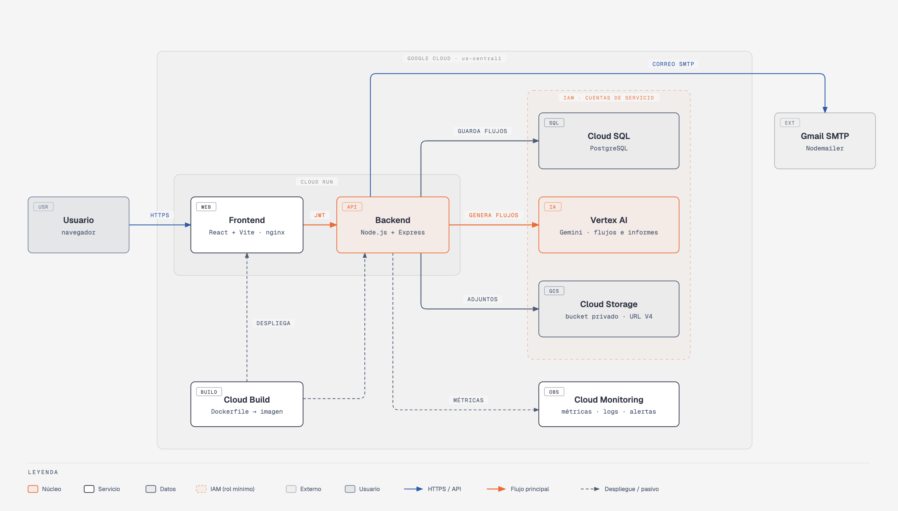
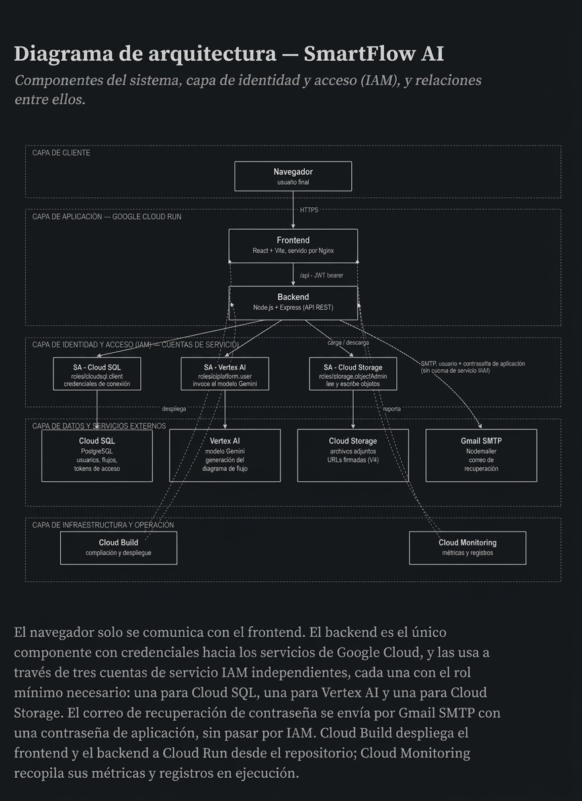
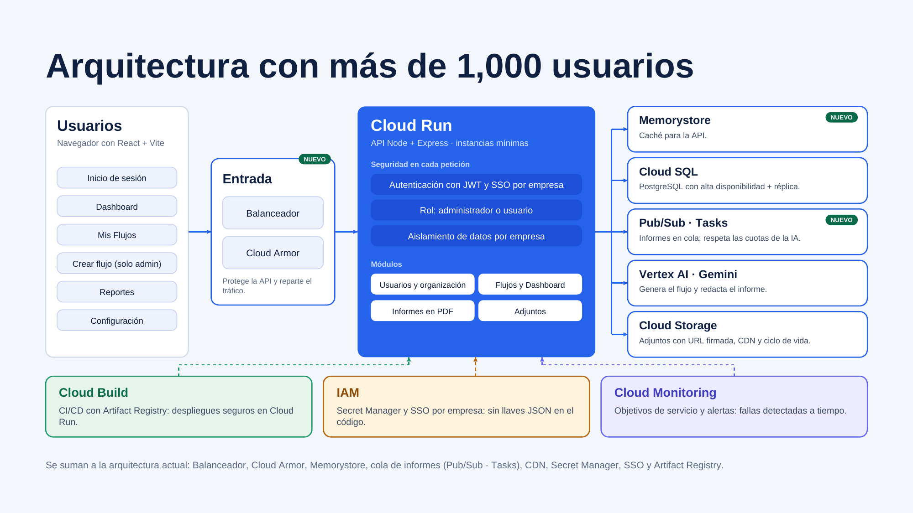
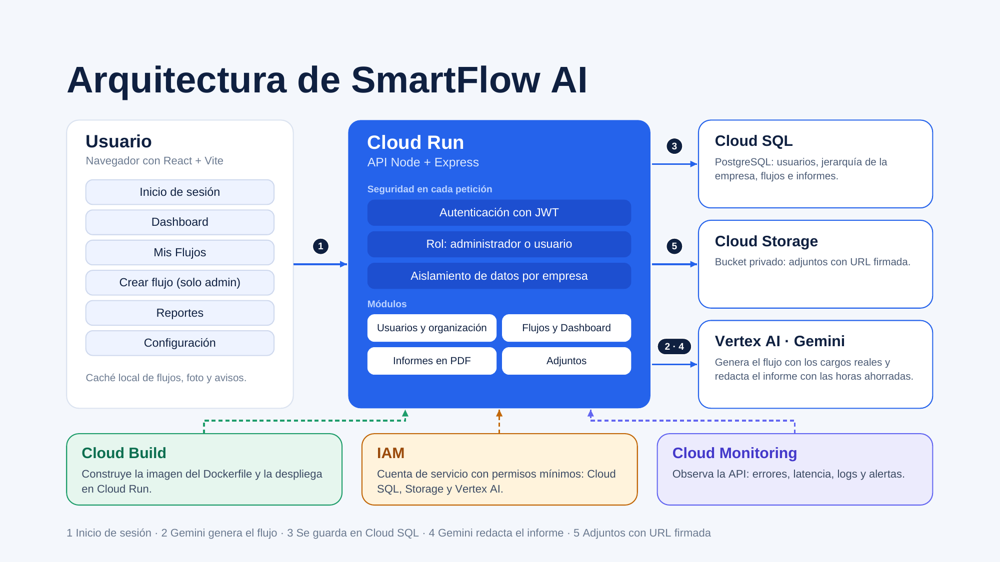

# SmartFlow AI

Cloud Computing 2026 · Universidad Galileo

- **Integrantes:** Andrea Sofía Dávila Equité, Wilder Javier Cardoza de la Cruz
- **Proveedor cloud:** Google Cloud
- **Servicios principales:** IAM, Cloud Build, Cloud Run, Cloud SQL (PostgreSQL), Cloud Storage, Vertex AI (Gemini), Cloud Monitoring
- **Repositorio:** https://github.com/Sistemas-UG/Proyecto-IS
- **Despliegue:** https://smartflow-frontend-1020540188448.us-central1.run.app
- **Documentación PDF:** [documentacion.pdf](documentacion.pdf) (presentación del proyecto)
- **Video:** [Video de demostración](video.mp4)



---

SmartFlow AI Estado actual del proyecto

Proyecto de FISICC (Ingeniería de Software) para automatizar y optimizar procesos de
negocio con IA. Genera diagramas de flujo a partir de descripciones en lenguaje
natural (Vertex AI / Gemini), detecta cuellos de botella y genera reportes.

**Stack:** React + Vite + Tailwind + React Flow (frontend) · Node.js + Express,
módulos ES (backend) · PostgreSQL en Cloud SQL · Vertex AI (Gemini) · Google Cloud
Storage · despliegue en Cloud Run vía Cloud Build.

La presentación completa del proyecto está en [documentacion.pdf](documentacion.pdf).

## 1. Levantar el backend

```bash
cd backend
npm install
# Configura tu .env (ver sección "Variables de entorno" más abajo)
npm run dev
```

Corre en `http://localhost:4000`. Prueba: `curl http://localhost:4000/api/health`
→ `{"status":"ok"}`

## 2. Levantar el frontend (otra terminal)

```bash
cd Frontend
npm install
cp .env.example .env
npm run dev
```

Abrir `http://localhost:5173`.

## 3. Iniciar sesión

Ya **no hay usuarios de prueba hardcodeados** — el login valida contra la tabla
`usuarios` en PostgreSQL (Cloud SQL), con contraseñas cifradas con `bcryptjs` y
sesión real por JWT. Regístrate desde la pantalla de registro o usa una cuenta
que ya exista en la base de datos.

## Cómo está conectado

- **`Frontend/src/lib/api.js`** — cliente HTTP único, lee `VITE_API_URL` y agrega
  el header `Authorization: Bearer <token>` automáticamente.
- **`Frontend/src/lib/AuthContext.jsx`** — guarda el token en `localStorage`,
  expone `login()` / `logout()` / `user`, valida sesión contra `GET /api/auth/me`.
- **`App.jsx`** — rutas privadas envueltas en `<ProtectedRoute>`.
- **`Login.jsx`** → `POST /api/auth/login`, `POST /api/auth/register`, y el flujo
  de recuperación de contraseña (`POST /api/auth/forgot-password`).
- **`ResetPassword.jsx`** → `POST /api/auth/reset-password`, ruta
  `/restablecer-contrasena?token=...`.
- **`Dashboard.jsx`** → `GET /api/dashboard/kpis` + `GET /api/dashboard/recent-flows`
- **`MisFlujos.jsx`** → `GET /api/flows`
- **`CrearFlujo.jsx`** → `POST /api/ai/generate-flow` (Vertex AI / Gemini genera el
  flujo real; el layout se ordena automáticamente con `dagre`). El botón
  "Guardar en Mis Flujos" hace `POST /api/flows`.
- **`Reportes.jsx`** → `GET /api/reports/summary` + `GET /api/reports/bottlenecks`
- **`Configuracion.jsx`** → `GET /api/users` + datos del usuario logueado

## Lo que ya está implementado

1. **PostgreSQL real** en Cloud SQL (ya no arreglo en memoria) — tablas de
   organizaciones, usuarios, flujos, nodos, conexiones, tareas, archivos
   adjuntos, cuellos de botella e insights de IA.
2. **Autenticación real** — JWT (`jsonwebtoken`) + contraseñas cifradas con
   `bcryptjs` (ya no el token demo `demo-token::<id>`).
3. **Vertex AI + Gemini** conectado en `backend/src/services/ai.service.js`
   para generar los flujos a partir del texto del usuario.
4. **Auto-layout de diagramas** con `dagre` — los nodos del flujo generado salen
   ordenados en vez de encimados.
5. **Google Cloud Storage** para archivos adjuntos, con URLs firmadas (V4) en
   vez de públicas.
6. **Despliegue en Cloud Run** (backend y frontend), con build vía Cloud Build
   y Dockerfiles propios (el frontend se sirve con nginx sobre el build de Vite).
7. **Cloud Monitoring** — dashboard básico configurado para el proyecto.
8. **Recuperación de contraseña por correo** — recién implementada: token
   aleatorio (hash guardado en `password_reset_tokens`, expira en 30 min),
   envío por Gmail/Nodemailer, validación con transacción en Postgres.
   *(En fase de prueba end-to-end, aún no confirmada 100% funcionando.)*


## Variables de entorno (backend)

No se versiona el `.env` real. Variables que usa el backend:

```
PORT, NODE_ENV, CORS_ORIGIN, FRONTEND_URL
DB_USER, DB_PASSWORD, DB_NAME, DB_PORT, DB_HOST, INSTANCE_CONNECTION_NAME
GOOGLE_CLOUD_PROJECT, GOOGLE_CLOUD_LOCATION, GEMINI_MODEL, GOOGLE_APPLICATION_CREDENTIALS
GCS_BUCKET_NAME
JWT_SECRET
GMAIL_USER, GMAIL_APP_PASSWORD
```

## Arquitectura en la nube

*Contenido tomado de la presentación del grupo ([documentacion.pdf](documentacion.pdf)) y del diagrama de arquitectura de su repositorio.*

### Diagrama de arquitectura — SmartFlow AI



### SmartFlow AI

Describes un proceso de tu empresa y la inteligencia artificial lo convierte en un flujo de trabajo, detecta cuellos de botella y genera el informe.

IAM · Cloud Build · Cloud Run · Cloud SQL · Cloud Storage · Vertex AI · Cloud Monitoring

### ¿Para quién es y qué les aporta?

| Público | Uso | Beneficio |
| --- | --- | --- |
| Recursos Humanos | Vacaciones, contratación, renuncias y desvinculación. | Menos solicitudes atoradas y aprobaciones claras. |
| Jefes de área | Revisan y aprueban las solicitudes de su equipo. | Saben qué aprobar y dónde se demora su área. |
| Gerencia y dirección | Deciden con base en informes ejecutivos. | Ven horas ahorradas, riesgos y recomendaciones. |
| Empresas sin área de procesos | Pequeñas y medianas, sin analistas ni consultores. | Documentan y mejoran procesos con datos aislados por empresa. |

### ¿Cómo funciona?

1. **Inicio de sesión:** Cada usuario entra con su cuenta. Su rol (administrador o usuario) define qué puede crear y solo ve los datos de su empresa.
2. **Describe el proceso:** Escribe con sus palabras cómo se hace algo, por ejemplo una solicitud de vacaciones, y elige si usa la jerarquía de su empresa.
3. **Gemini genera el flujo:** Vertex AI devuelve pasos, decisiones con rama Sí y No y finales, con los cargos reales de la empresa y sus cuellos de botella.
4. **Edita y guarda:** El usuario ajusta el diagrama y lo guarda en Cloud SQL. Queda en Mis Flujos y se refleja en el Dashboard.
5. **Informe en PDF:** Gemini redacta el informe ejecutivo con el ahorro estimado en horas. Se guarda en Reportes y se descarga en PDF.

### Del texto al informe

1. **Describe**
   - Texto libre, sin dibujar nada
   - Ejemplo: un empleado pide vacaciones, su jefe aprueba y RRHH valida los días
   - Flujo general o con la jerarquía de su empresa
2. **Gemini modela**
   - Nodos de inicio, paso, decisión y fin
   - Cada decisión tiene rama Sí y No
   - Usa solo los cargos reales de la empresa
   - Marca cuellos de botella y su riesgo
3. **Informe PDF**
   - Resumen ejecutivo
   - Riesgos y cuellos de botella
   - Recomendaciones de automatización
   - Ahorro estimado en horas
   - Diagrama del flujo en la última hoja

### Los 7 servicios de Google Cloud

| Servicio | Qué hace | Dónde está en la app |
| --- | --- | --- |
| IAM | Permisos mínimos por identidad | Cuenta de servicio del backend |
| Cloud Build | Construye la imagen del backend | Dockerfile de la API |
| Cloud Run | Ejecuta la API sin servidores | Backend Node + Express |
| Cloud SQL | PostgreSQL administrado | Usuarios, flujos y reportes |
| Cloud Storage | Archivos en bucket privado | Adjuntos con URL firmada |
| Vertex AI | Gemini crea flujos e informes | Crear Flujo y Reportes |
| Cloud Monitoring | Métricas, logs y alertas | Salud y errores de la API |

### Google Cloud frente a Azure y AWS

| Google Cloud (SmartFlow) | Microsoft Azure | Amazon Web Services |
| --- | --- | --- |
| IAM | Entra ID + Azure RBAC | AWS IAM |
| Cloud Build | Azure Pipelines / ACR Tasks | AWS CodeBuild |
| Cloud Run | Azure Container Apps | AWS Fargate (ECS) |
| Cloud SQL | Azure Database for PostgreSQL | Amazon RDS for PostgreSQL |
| Cloud Storage | Azure Blob Storage | Amazon S3 |
| Vertex AI \* | Microsoft Foundry | Amazon Bedrock |
| Cloud Monitoring | Azure Monitor | Amazon CloudWatch |

\* Desde abril de 2026, Vertex AI se llama Gemini Enterprise Agent Platform. Equivalentes aproximados; precios y funciones varían.

### ¿Por qué Google Cloud para SmartFlow?

- **Gemini en la misma plataforma:** La IA que arma flujos e informes vive en el mismo proyecto, con la misma identidad (IAM) y la misma factura.
- **Cloud Run, sin servidores:** La API corre en un contenedor, escala según el uso y puede bajar a cero instancias cuando nadie la usa.
- **Costo inicial de $0:** El prototipo corre con crédito de prueba y capa gratuita; su consumo real equivale a ≈ $15 al mes.
- **Estándares abiertos:** Docker, PostgreSQL y Node + Express: la mayor parte del código no depende de Google.

### Portabilidad: ¿y si cambiamos de nube?

| Se queda igual | Habría que cambiar |
| --- | --- |
| Interfaz React + Vite | Vertex AI → Foundry o Bedrock (se reutiliza el diseño de prompts) |
| API Node + Express con JWT | Cloud Storage → Blob o S3 (URL firmada → SAS o prefirmada) |
| Imagen Docker de la API | Cloud Monitoring y Cloud Build → equivalentes del otro proveedor |
| Base PostgreSQL y su esquema | |

La dependencia real está en la IA y en los archivos; el resto es estándar. Análisis propio del equipo, no una migración probada.

### Con más de 1,000 usuarios, esto cambiaría

| Servicio | Cambio | Por qué |
| --- | --- | --- |
| Cloud Run | Instancias mínimas + balanceador | Sin arranques lentos |
| Cloud SQL | Alta disponibilidad + réplica | Sin caídas y más lecturas |
| Vertex AI | Informes en cola (Pub/Sub, Tasks) | Respeta cuotas de la IA |
| Cloud Storage | CDN y ciclo de vida de archivos | Descargas rápidas, menor costo |
| IAM | Secret Manager y SSO por empresa | Sin llaves JSON en el código |
| Cloud Build | CI/CD con Artifact Registry | Despliegues seguros |
| Cloud Monitoring | Objetivos de servicio y alertas | Fallas detectadas a tiempo |

Se suman Cloud Armor (protege la API) y Memorystore (caché).

### Arquitectura con más de 1,000 usuarios



Se suman a la arquitectura actual: Balanceador, Cloud Armor, Memorystore, cola de informes (Pub/Sub · Tasks), CDN, Secret Manager, SSO y Artifact Registry.

### Costos: hoy y con 1,000+ usuarios

**Hoy · prototipo: $0 · Q0.** No pagamos nada: corre con crédito de prueba y capa gratuita. Consumo real equivalente: ≈ $15 al mes (≈ Q114).

**Futuro · 1,000+ usuarios: $700–900 al mes (≈ Q5,341 – Q6,867).** SQL alta disponibilidad: $380 · Cloud Run: $120 · Vertex AI: $60 · Balanceador, Armor y Redis: $75 · Logging, Storage y Build: $90.

**Incremento:** +$685 a +$885 al mes (≈ +Q5,227 a +Q6,753). Frente al consumo real de hoy ($15). Equivale a ≈ Q5–7 por usuario al mes.

### Costos: de dónde salen los $700–900

| Servicio | Qué incluye | Al mes (USD) | Al mes (Q) |
| --- | --- | --- | --- |
| Cloud SQL | Alta disponibilidad + réplica | $380 | ≈ Q2,899 |
| Cloud Run | Instancias mínimas, sin arranques lentos | $120 | ≈ Q916 |
| Vertex AI | Gemini Flash para flujos e informes | $60 | ≈ Q458 |
| Balanceador, Armor y Redis | Balanceador, Cloud Armor y Memorystore | $75 | ≈ Q572 |
| Logging, Storage y Build | Logs, archivos con CDN y CI/CD | $90 | ≈ Q687 |
| **Suma de los conceptos** | | **$725** | **≈ Q5,532** |
| **Rango estimado** | Considera variación de uso | **$700–900** | **≈ Q5,341 – Q6,867** |

Estimaciones en us-central1 con Gemini Flash. Tipo de cambio Banguat: Q7.63 por US$1. Validar en la calculadora de precios de Google Cloud.

### Arquitectura de SmartFlow AI



1 Inicio de sesión · 2 Gemini genera el flujo · 3 Se guarda en Cloud SQL · 4 Gemini redacta el informe · 5 Adjuntos con URL firmada

### Mejoras a futuro: cambios y soluciones

| Cambio | Posible solución | Servicio sugerido |
| --- | --- | --- |
| IA que genera los flujos más rápido | Mostrar el diagrama en streaming, usar un modelo más ligero para flujos simples y pedir salida JSON con esquema. | Vertex AI (Gemini) |
| Informes sin hacer esperar al usuario | Encolar la generación del informe y avisar cuando el PDF esté listo. | Cloud Tasks / Pub/Sub |
| Notificaciones persistentes | Calcular las alertas en el servidor y enviarlas por correo, no solo en el navegador. | Cloud Run + Cloud Scheduler |
| Inicio de sesión con cuenta de la empresa | SSO por empresa (OIDC), además del acceso actual. | Identity Platform / IAM |
| Plantillas de flujos por sector | Guardar flujos frecuentes (vacaciones, contratación) como punto de partida y gastar menos llamadas a la IA. | Cloud SQL + Gemini |

Propuestas del equipo, aún no implementadas. Servicios sugeridos; la elección final puede variar.
