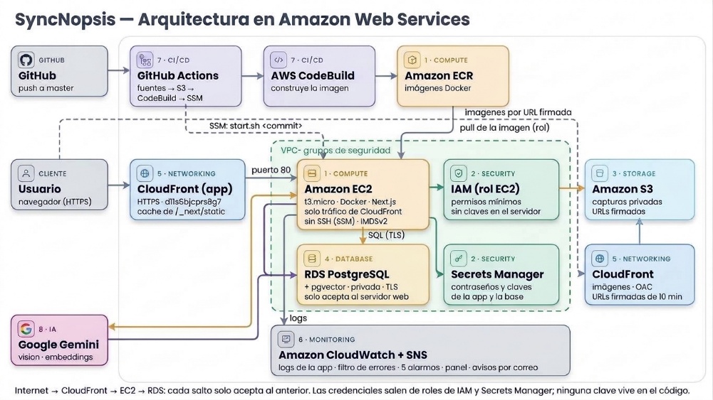

# SyncNopsis

Grupo 8 · Cloud Computing 2026 · Universidad Galileo

- **Integrantes:** Fernando Josué Alegría Velásquez, Anyelo Arthur Sánchez Naranjo
- **Proveedor cloud:** Amazon Web Services (AWS), región us-east-2; la IA usa la API de Google Gemini
- **Servicios principales:** Amazon EC2 + Amazon ECR, AWS IAM + Secrets Manager, Amazon S3, Amazon RDS for PostgreSQL + pgvector, Amazon CloudFront, Amazon CloudWatch + SNS, GitHub Actions + AWS CodeBuild + Systems Manager, Google Gemini API
- **Repositorio:** Repositorio privado
- **Despliegue:** https://d11s6bjcprs8g7.cloudfront.net
- **Documentación PDF:** [documentacion.pdf](documentacion.pdf)
- **Video:** [Video de demostración](video.mp4)

---

> Contenido convertido de la documentación final entregada por el equipo ([documentacion.pdf](documentacion.pdf)).

## SyncNopsis — Documentación de la arquitectura en Amazon Web Services

| Dato | Valor |
|---|---|
| Curso | Cloud Computing 2026 · Universidad Galileo · FISICC |
| Equipo | Fernando Alegría · Anyelo Sánchez |
| Proyecto desplegado | https://d11s6bjcprs8g7.cloudfront.net |
| Repositorio | Privado |
| Drive con videos/imágenes | https://drive.google.com/drive/folders/19AEpgjOMzTPznUOez0nvhiv1EqO8IHDL?usp=sharing |
| Proveedor | Amazon Web Services (la IA usa la API de Google Gemini) |
| Servicios | 8: 7 en AWS (Compute, Security, Storage, Database, Networking, Monitoring y CI/CD) más Gemini (AI) |
| Fecha | 8 de noviembre de 2026 |

### Resumen

SyncNopsis es un "segundo cerebro" con inteligencia artificial: el usuario guarda capturas de pantalla y la IA las convierte en notas organizadas, tareas, eventos de calendario y respuestas en un chat.

La aplicación web corre en Amazon EC2 detrás de Amazon CloudFront; los datos viven en Amazon RDS for PostgreSQL con búsqueda semántica (pgvector) y las imágenes en Amazon S3. Cada salto de red solo acepta al anterior, las credenciales salen de roles de IAM y Secrets Manager, y cada push a GitHub se despliega solo.

## 1. Descripción del proyecto

SyncNopsis es un proyecto propio del equipo, con versión web (Next.js 16 + TypeScript) y app Android. Esta entrega cubre el despliegue de la versión web en la nube.

- **Captura inteligente:** subida de imágenes desde la web; la app Android las sincroniza desde el teléfono.
- **Análisis con IA:** título, resumen, categoría, etiquetas, tareas, fechas y montos de cada captura.
- **Organización:** colecciones, tablero Kanban, calendario con los eventos detectados, grafo de conceptos y estadísticas.
- **Chat con tus notas:** la IA responde usando solo las capturas y notas más relevantes para cada pregunta (RAG).
- **Panel de administración:** métricas, gestión de usuarios (rol y suspensión), anuncios a todos y estado de los servicios.

## 2. Arquitectura



*Figura 1. Arquitectura de SyncNopsis en AWS.*

La arquitectura sigue tres principios: ninguna pieza queda expuesta si no lo necesita, ninguna credencial vive en el código y todo lo que se puede automatizar se automatiza.

### Flujos principales

- **Visitar la app.** El navegador entra por HTTPS a CloudFront, que reenvía la petición al servidor EC2 por el puerto 80. El servidor solo acepta las IPs de CloudFront, por lo que no se puede entrar directo a su IP.
- **Subir una captura.** La API valida la sesión y entrega una URL firmada de S3 válida por 5 minutos; el navegador sube la imagen directo al bucket privado y la API guarda el registro en RDS.
- **Analizar con IA.** El servidor lee la imagen de S3 con su rol, la envía a la API de Gemini, guarda el resultado y los eventos de calendario en RDS y genera el vector del resumen (embeddings de Gemini) para la búsqueda semántica.
- **Ver imágenes.** La API revisa que el archivo sea del usuario y redirige a una URL firmada de CloudFront de 10 minutos; CloudFront lee el bucket con Origin Access Control y guarda la imagen en caché cerca del usuario.
- **Chat.** Se genera el vector de la pregunta, RDS devuelve con pgvector las 6 capturas o notas más parecidas y solo esas se envían al modelo, lo que reduce los tokens hasta en un 90 %.
- **Desplegar.** Un push a master dispara GitHub Actions: sube las fuentes a S3, CodeBuild construye la imagen y la publica en ECR, y Systems Manager ordena al servidor usar la nueva versión.

## 3. Servicios utilizados

| # | Categoría | Servicio | Papel en SyncNopsis |
|---|---|---|---|
| 1 | Compute | Amazon EC2 + Amazon ECR | Ejecuta la app Next.js en Docker (t3.micro); ECR guarda las imágenes con escaneo de vulnerabilidades |
| 2 | Security | AWS IAM + Secrets Manager + grupos de seguridad | Roles con permisos mínimos, secretos fuera del código y red en capas |
| 3 | Storage | Amazon S3 | Capturas y avatares en un bucket privado y cifrado con URLs firmadas |
| 4 | Database | Amazon RDS for PostgreSQL + pgvector | Datos de la app y búsqueda semántica; base privada con TLS |
| 5 | Networking | Amazon CloudFront | URL pública con HTTPS, caché de archivos estáticos e imágenes firmadas |
| 6 | Monitoring | Amazon CloudWatch + SNS | Logs, métrica de errores, 5 alarmas, panel y avisos por correo |
| 7 | CI/CD | GitHub Actions + AWS CodeBuild + Systems Manager | Construcción y despliegue automático en cada push |
| 8 | AI | Google Gemini API | Análisis de imágenes, chat, notas y cuadernos; vectores para el RAG |

### Detalle por servicio

**Amazon EC2 + ECR.** Instancia syncnopsis-web (Amazon Linux 2023, t3.micro, disco gp3 de 10 GB cifrado, 1 GB de swap) con IP elástica. Al arrancar instala Docker y ejecuta `/opt/syncnopsis/start.sh`, que lee el secreto de la app, descarga la imagen de ECR y la levanta con reinicio automático y logs hacia CloudWatch. No tiene llave SSH: se administra con Systems Manager y exige IMDSv2.

**AWS IAM.** El servidor usa el rol syncnopsis-ec2-role: S3 solo sobre `users/*`, lectura de su imagen en ECR, escritura de logs, lectura del secreto syncnopsis/app y SSM. CodeBuild tiene su propio rol y GitHub un usuario que solo puede subir fuentes, iniciar el build y mandar el comando de despliegue a esa instancia.

**AWS Secrets Manager.** syncnopsis/app guarda la contraseña de la base, la clave de servicio de Supabase, la clave de Gemini y la clave privada de CloudFront. La contraseña del usuario maestro de RDS la genera y rota el propio RDS.

**Amazon S3.** Bucket syncnopsis-capturas-966499104801 con bloqueo de acceso público, cifrado AES-256 y CORS limitado a la URL de la app. Un segundo bucket guarda las fuentes de CodeBuild y las borra a los 7 días.

**Amazon RDS.** PostgreSQL 18.3 en db.t4g.micro con 20 GB cifrados, sin IP pública. La app se conecta con el usuario syncnopsis_app (solo SELECT, INSERT, UPDATE y DELETE) validando el certificado de AWS. pgvector guarda los vectores de los embeddings de Gemini con índices HNSW.

**Amazon CloudFront.** Dos distribuciones: la de la app (HTTPS, sin caché para páginas y API, caché para `/_next/static`) y la de imágenes (bucket privado con OAC y URLs firmadas por el grupo de claves syncnopsis-signers).

**Amazon CloudWatch.** Grupo de logs `/syncnopsis/web` (30 días), filtro de errores que genera la métrica SyncNopsis/AppErrors, alarmas de errores, CPU y salud de EC2, CPU y espacio de RDS, tema SNS con avisos por correo y el panel SyncNopsis.

**CI/CD.** Workflow `.github/workflows/deploy-aws.yml` y `web/buildspec.yml`. Cada imagen se etiqueta con el commit, así cada versión desplegada es rastreable.

## 4. Seguridad

| Capa | Medida aplicada |
|---|---|
| Red | Internet → CloudFront → EC2 → RDS: el servidor solo acepta la lista de IPs de CloudFront y la base solo acepta al grupo de seguridad del servidor; la base no tiene IP pública |
| Identidad | Roles de IAM con permisos mínimos; el servidor no guarda claves de AWS; IMDSv2 obligatorio |
| Secretos | Secrets Manager para la app; GitHub guarda sus credenciales como secretos cifrados; el .dockerignore excluye los .env |
| Cifrado | HTTPS de extremo a extremo hacia el usuario, TLS 1.3 hacia RDS validando el certificado, discos y buckets cifrados |
| Datos | La API de datos usa SQL parametrizado con lista de tablas y columnas y fuerza que cada usuario solo vea y modifique lo suyo |
| Archivos | Bucket privado; subidas y lecturas solo con URLs firmadas de pocos minutos después de validar al dueño |
| Aplicación | Todas las rutas /api piden sesión; el rol de admin se lee de la base; las cuentas suspendidas no pueden usar datos, archivos ni IA |
| Operación | Sin SSH (Systems Manager), escaneo de imágenes en ECR, alarmas y logs centralizados |

## 5. Pasos de despliegue

Estos pasos reproducen la arquitectura desde cero con AWS CLI.

**1. Prerrequisitos.**

Instalar AWS CLI v2, PostgreSQL client (psql), Node.js 24 y GitHub CLI.

```bash
aws login --region us-east-2        # sesión con la cuenta del proyecto
gh auth login                       # para guardar secretos del repositorio
```

**2. Almacenamiento.**

```bash
aws s3api create-bucket --bucket syncnopsis-capturas-<cuenta> --create-bucket-configuration LocationConstraint=us-east-2
aws s3api put-public-access-block --bucket ... --public-access-block-configuration BlockPublicAcls=true,IgnorePublicAcls=true,BlockPublicPolicy=true,RestrictPublicBuckets=true
aws s3api put-bucket-encryption ... AES256 && aws s3api put-bucket-cors ... (PUT/GET desde la URL de la app)
```

**3. Red.**

```bash
aws ec2 create-security-group --group-name syncnopsis-web-sg ...
aws ec2 authorize-security-group-ingress --group-id <web-sg> --ip-permissions 'IpProtocol=tcp,FromPort=80,ToPort=80,PrefixListIds=[{PrefixListId=<lista de CloudFront>}]'
aws ec2 create-security-group --group-name syncnopsis-db-sg ... && permitir 5432 solo desde <web-sg>
```

**4. Base de datos.**

```bash
aws rds create-db-instance --db-instance-identifier syncnopsis-db --engine postgres --engine-version 18.3 --db-instance-class db.t4g.micro \
  --allocated-storage 20 --storage-encrypted --manage-master-user-password --db-name syncnopsis --vpc-security-group-ids <db-sg> --no-publicly-accessible
psql ... -f web/db/schema.sql && psql ... -f web/db/vector.sql   # desde un túnel de SSM o al crearla
CREATE ROLE syncnopsis_app LOGIN ...; GRANT SELECT, INSERT, UPDATE, DELETE ON ALL TABLES IN SCHEMA public TO syncnopsis_app;
```

**5. Secretos.**

```bash
aws secretsmanager create-secret --name syncnopsis/app --secret-string file://secret.json   # DB_PASSWORD, SUPABASE_SERVICE_ROLE_KEY, GEMINI_API_KEY, CLOUDFRONT_*
rm secret.json
```

**6. Imágenes firmadas.**

```bash
Generar un par RSA 2048, subir la pública: aws cloudfront create-public-key ... && aws cloudfront create-key-group ...
aws cloudfront create-origin-access-control ... && aws cloudfront create-distribution (origen S3 con OAC y TrustedKeyGroups)
aws s3api put-bucket-policy (s3:GetObject solo para la distribución, condición AWS:SourceArn)
```

**7. Permisos.**

```bash
aws iam create-role --role-name syncnopsis-ec2-role ... && aws iam put-role-policy ... (S3, ECR, Logs, Secrets Manager)
aws iam attach-role-policy --policy-arn arn:aws:iam::aws:policy/AmazonSSMManagedInstanceCore
aws iam create-instance-profile --instance-profile-name syncnopsis-ec2-profile && add-role-to-instance-profile
```

**8. Imagen.**

```bash
aws ecr create-repository --repository-name syncnopsis-web --image-scanning-configuration scanOnPush=true
aws codebuild create-project ... (aws/codebuild/standard:7.0, privilegedMode, buildspec web/buildspec.yml)
aws codebuild start-build --project-name syncnopsis-web
```

**9. Servidor.**

```bash
aws ec2 run-instances --image-id <AL2023> --instance-type t3.micro --security-group-ids <web-sg> --iam-instance-profile Name=syncnopsis-ec2-profile \
  --metadata-options HttpTokens=required --block-device-mappings '...Encrypted=true...' --user-data file://userdata.sh
aws ec2 allocate-address && aws ec2 associate-address --instance-id <id> --allocation-id <eip>
```

**10. URL pública.**

```bash
aws cloudfront create-distribution (origen: DNS de la IP elástica, http-only; CachingDisabled + AllViewerExceptHostHeader; /_next/static/* con CachingOptimized)
```

Agregar la URL en Supabase → Authentication → URL Configuration (Site URL y Redirect URLs)

**11. Monitoreo.**

```bash
aws logs create-log-group --log-group-name /syncnopsis/web && put-retention-policy --retention-in-days 30
aws logs put-metric-filter ... SyncNopsis/AppErrors && aws sns create-topic + subscribe (correo)
aws cloudwatch put-metric-alarm (5 alarmas)   &&   aws cloudwatch put-dashboard --dashboard-name SyncNopsis
```

**12. CI/CD.**

```bash
aws iam create-user --user-name syncnopsis-github-deploy && put-user-policy (S3 fuentes, CodeBuild, SSM a la instancia)
aws iam create-access-key ... | gh secret set AWS_ACCESS_KEY_ID / AWS_SECRET_ACCESS_KEY
git push origin master   # GitHub Actions construye y despliega
```

## 6. Estimación de costos

Precios on-demand de us-east-2 tomados de la AWS Price List API el 14 de octubre de 2026 (equivalentes a la AWS Pricing Calculator), para un mes de 730 horas con el uso actual: pruebas del equipo (entre 115 y 230 acciones de IA al mes, entre analizar una captura y responder en el chat).

| Servicio | Supuesto de uso | Precio unitario | USD/mes |
|---|---|---|---:|
| Amazon EC2 | t3.micro Linux, 730 h | 0.0104 USD/h | 7.59 |
| Amazon EBS | 10 GB gp3 (disco del servidor) | 0.08 USD/GB-mes | 0.80 |
| IPv4 pública (IP elástica) | 1 dirección, 730 h | 0.005 USD/h | 3.65 |
| Amazon RDS for PostgreSQL | db.t4g.micro Single-AZ, 730 h | 0.016 USD/h | 11.68 |
| Almacenamiento de RDS | 20 GB gp2 (respaldos incluidos hasta 20 GB) | 0.115 USD/GB-mes | 2.30 |
| AWS Secrets Manager | 2 secretos (app y usuario maestro) | 0.40 USD/secreto | 0.80 |
| Amazon S3 | 5 GB + 3 000 PUT + 30 000 GET | 0.023 USD/GB · 0.005/1 000 PUT · 0.0004/1 000 GET | 0.14 |
| Amazon CloudFront | ≈ 20 GB y 300 000 peticiones (2 distribuciones) | 1 TB y 10 M peticiones gratis al mes | 0.00 |
| Amazon CloudWatch | ≈ 1 GB de logs, 5 alarmas, 1 panel | 5 GB, 10 alarmas y 3 paneles gratis | 0.00 |
| Amazon ECR | ≈ 0.9 GB (10 imágenes de 89 MB) | 0.10 USD/GB-mes | 0.09 |
| AWS CodeBuild | 30 despliegues × 2 min (general1.medium) | 0.01 USD/min | 0.60 |
| IA (Gemini API, variable) | 115 a 230 acciones al mes (pruebas del equipo) | gemini-3.8-flash: 0.75 USD/M entrada · 3.75 USD/M salida (2026) | 0.93 |
| Amazon SNS | Avisos por correo | 1 000 correos gratis al mes | 0.00 |
| **Total estimado** | | | **28.58** |

### Análisis

- **Dónde se va el dinero:** RDS (13.98 USD) y EC2 con su disco e IP (12.04 USD) son casi el 90 % del costo; se pagan por estar encendidos, no por uso.
- **Costo de IA (variable):** la app usa gemini-3.8-flash, que Google cobra por tokens: 0.75 USD por millón de entrada y 3.75 USD por millón de salida hasta el 31 de diciembre de 2026, y el doble desde el 1 de enero de 2027. Con unos 2 000 a 3 500 tokens de entrada y 400 a 600 de salida por acción (analizar una captura o responder en el chat), cada acción cuesta entre 0.004 y 0.008 USD. Los 0.93 USD de la tabla equivalen a entre 115 y 230 acciones al mes, que corresponde al uso actual: pruebas del equipo. El RAG evita mandar todas las notas en cada mensaje.
- **Capa gratuita permanente:** CloudFront (1 TB y 10 M peticiones), CloudWatch (5 GB de logs, 10 alarmas, 3 paneles) y SNS cubren por completo el uso actual.
- **Financiamiento:** la cuenta tiene 199.68 USD de crédito; al ritmo estimado alcanza para unos 7 meses sin cargos a la tarjeta. El presupuesto syncnopsis-presupuesto-aws avisa al 85 % y al 100 % de 20 USD.

### Costo de IA según el uso

| Escenario | Acciones / mes | USD/mes (2026) | USD/mes (desde 2027) |
|---|---:|---:|---:|
| Uso actual (pruebas del equipo) | 115 a 230 | 0.93 | 1.86 |
| Uso ligero | 1 000 | 4 | 8 |
| 500 usuarios, 10 acciones c/u | 5 000 | 20 | 40 |

### Escenarios de crecimiento

| Escenario | Cambios | USD/mes aprox. |
|---|---|---:|
| Curso (actual) | t3.micro · db.t4g.micro · 115 a 230 acciones de IA/mes (pruebas del equipo) | 28.58 |
| ~500 usuarios | EC2 t3.small · RDS db.t4g.small · 5 000 acciones de IA/mes (10 por usuario, tarifa de 2026) | ≈ 55 |
| ~5 000 usuarios | 2 EC2 t3.medium con balanceador · RDS db.t4g.medium Multi-AZ | ≈ 300 |

Ahorros posibles: Savings Plans de 1 año para EC2 y RDS (~30–40 %) y apagar RDS fuera de horario en desarrollo.

## 7. Estado, decisiones y lecciones

### Decisión sobre la IA: Gemini en lugar de Bedrock

Bedrock tenía la cuota diaria en 0 (restricción heredada del plan gratuito) y AWS Support no respondió al caso abierto el 14 de octubre; se usa la API de Gemini.

## 8. Recursos desplegados

| Recurso | Identificador |
|---|---|
| URL de la app | https://d11s6bjcprs8g7.cloudfront.net |
| Distribución de la app | E2ODRVNOL5VQSY |
| Distribución de imágenes | E31PL3ZL9P3D6R (d15yfq7zfs4hij.cloudfront.net) |
| Instancia EC2 | i-0454d829da3fd5848 (IP elástica 77.112.226.32) |
| Repositorio ECR | 966499104801.dkr.ecr.us-east-2.amazonaws.com/syncnopsis-web |
| Base de datos | syncnopsis-db (PostgreSQL 18.3) |
| Buckets S3 | syncnopsis-capturas-966499104801 · syncnopsis-builds-966499104801 |
| Secretos | syncnopsis/app · secreto maestro de RDS |
| Roles IAM | syncnopsis-ec2-role · syncnopsis-codebuild-role · usuario syncnopsis-github-deploy |
| CloudWatch | Logs /syncnopsis/web · panel SyncNopsis · tema SNS syncnopsis-alertas |
| CodeBuild | syncnopsis-web |
